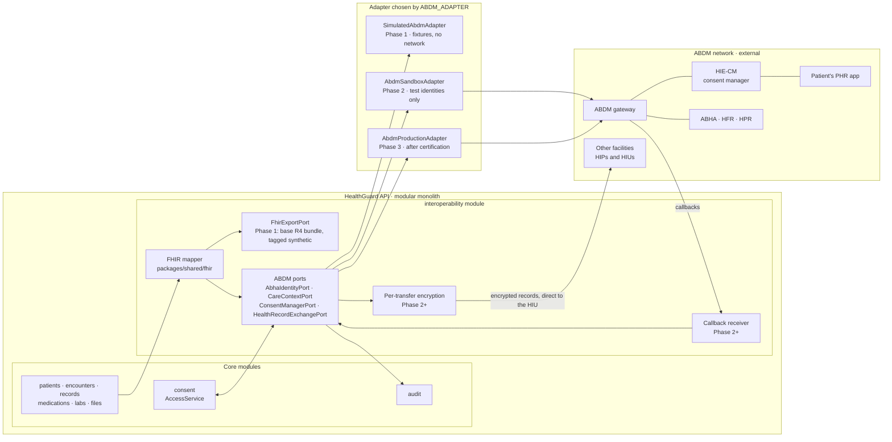
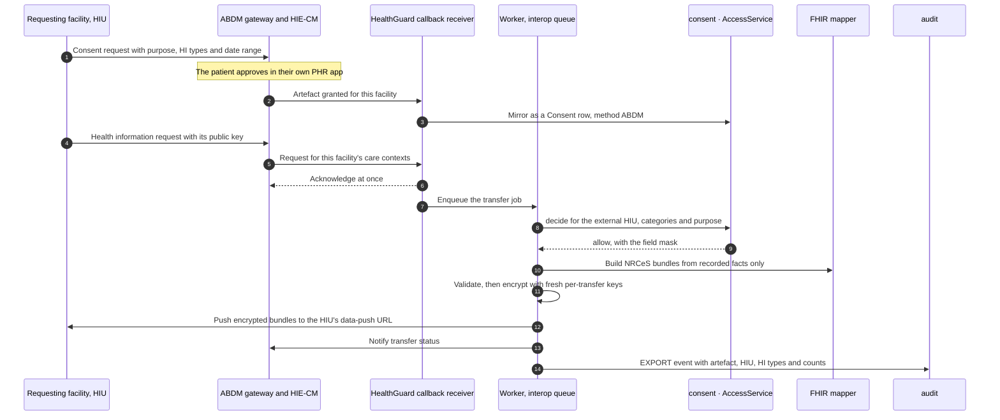

# HealthGuard — ABDM Integration Design

> **Status:** technical design (Step 2). No application code yet.
> **Phase 1 implements no ABDM connectivity.** The demo contains a clearly labelled simulation behind the same interfaces a real integration will use. HealthGuard is not ABDM-certified and makes no claim of ABDM compliance.
> **Data:** synthetic only.
>
> Related: [PRD](PRD.md) · [Architecture](ARCHITECTURE.md) · [Data model](DATA_MODEL.md) · [Security](SECURITY.md) · [AI agents](AI_AGENT_SPEC.md) · [FHIR mapping](FHIR_MAPPING.md) · [Roadmap](ROADMAP.md)

## 1. Where ABDM integration belongs

The Ayushman Bharat Digital Mission (ABDM) is India's national digital health infrastructure: ABHA health IDs, registries of facilities (HFR) and professionals (HPR), and a health information exchange with a consent manager (HIE-CM). HealthGuard does not replace any of it. HealthGuard helps a clinic look after its patients between visits; ABDM is how those records move between facilities with the patient's consent.

- **Participants.** HealthGuard's customers, the clinics and hospitals, are the ABDM participants: each facility becomes a Health Information Provider (HIP) and later a Health Information User (HIU). HealthGuard is the software that integrates on their behalf: one integration (one client ID and one callback endpoint, the "bridge" in ABDM terms) serves many facilities, and each facility is identified on the network by its HFR ID.
- **Multi-tenancy maps cleanly.** One HealthGuard `Organization` = one facility = one HFR ID (`Organization.hfrId`, unique) = one HIP ID. Callbacks are routed to the tenant by HIP ID, and every ABDM operation runs inside that tenant's scope like any other request. ABDM gives each branch of a hospital group its own HFR ID, so in Phase 3 each branch is its own organization; a site entity under one organization is a Phase 4 option if a group needs shared administration.
- **Location in the code.** Everything ABDM-specific lives in the `interoperability` module behind four ports. Core modules (patients, records, medications, labs, consent, audit) never import an ABDM client. The FHIR mapper in `packages/shared/fhir` turns HealthGuard's relational record into FHIR ([FHIR mapping](FHIR_MAPPING.md)); the ports move it across the boundary.
- **Data blind exchange.** ABDM describes the HIE-CM as a data-blind gateway: it brokers consent and notifications, while records travel encrypted directly from the HIP to the HIU.

**FHIR and ABDM adapter architecture**



## 2. Roles HealthGuard will play

| ABDM capability | What it involves | HealthGuard's role | When |
|---|---|---|---|
| **M1 — ABHA** | Verify a patient's ABHA; Scan and Share at registration | The facility's front desk verifies an ABHA the patient chooses to share and stores the verified ABHA address | Sandbox in Phase 2; production in Phase 3 |
| **M2 — HIP** | Link care contexts, answer discovery, notify new records, share records under a consent artefact | Each tenant facility is an HIP; HealthGuard builds, encrypts and sends the bundles | Sandbox in Phase 2; certified production in Phase 3 |
| **M3 — HIU** | Request consent, receive records from other HIPs, purge them when the consent ends | A clinician requests a patient's records from other facilities | Sandbox in Phase 3; production in Phase 4 |
| **PHR app** | Patient-facing app with an ABHA address that approves consent requests | Not planned. Patients use the PHR app of their choice; HealthGuard's patient PWA is not an ABDM PHR app | Not planned |
| **Registries** | HFR for facilities, HPR for professionals | `Organization.hfrId` and `ClinicianProfile.hprId` already exist in the data model; they are filled and verified from Phase 3 | Phase 3 |

Integrators' published guidance, quoting NHA, says that leaving the sandbox requires at least two completed milestones, followed by functional testing and a security audit (section 8). M1 plus M2 is therefore the first certification target, to be confirmed with NHA when Phase 2 starts.

## 3. Identity and linking

### 3.1 ABHA verification (M1)

- **Voluntary.** A patient is never required to have or share an ABHA; every HealthGuard feature works without one, as ABDM's HIP guidelines require.
- **Verify, don't create.** HealthGuard verifies an existing ABHA (OTP to the ABHA's registered mobile, or ABDM's Aadhaar-OTP route) or accepts a profile shared through Scan and Share. ABHA creation stays in ABDM's own channels. HealthGuard never asks for, receives or stores an Aadhaar number.
- **Storage.** A successful verification through a real adapter writes `PatientProfile.abhaNumber`, `abhaAddress` and `abhaVerifiedAt`. In production these fields are field-level encrypted with a blind index for lookup ([Security §7](SECURITY.md#7-encryption-boundaries)); `abhaAddress` is unique within an organization, a rule that moves to the blind index once the field is encrypted. In Phase 1 these fields stay empty for every patient, including synthetic ones.
- **Matching.** The verified ABHA profile (name, year of birth, gender, mobile) is compared with the `PatientProfile`. Any mismatch goes to staff review; records are never merged automatically.
- **Audit.** Verification attempts and results are audited without the identifiers themselves.

### 3.2 Care contexts and linking (M2)

- **What a care context is.** The unit under which a facility's records are grouped and shared. HealthGuard creates one care context per completed `Encounter`; lab results and documents attach to the encounter that ordered or received them.
- **What is shared.** Only facility records: clinician-entered or clinician-verified rows. Patient-reported and device data, AI summaries and AI recommendations are never shared through ABDM (an open question for patient-reported data is in section 9).
- **HIP-initiated linking.** After a consultation for a patient with a verified ABHA, HealthGuard links the new care context to the patient's ABHA address, so it appears in the patient's PHR app.
- **Patient-initiated discovery.** The patient's PHR app asks the facility to find their records. HealthGuard matches on verified identifiers only, returns the unlinked care contexts and confirms the link with an OTP to the patient.
- **New-record notification.** When a linked care context gains a new record, the HIP notifies ABDM so the patient is informed, as the HIP guidelines require.
- **Phase 3 schema additions** (by migration; not in the Phase 1 schema): `AbdmCareContext` (organization, patient, encounter, care-context reference, link status, linked time) and `AbdmTransfer` (artefact, HIU, care contexts, HI types, status, counts, timestamps; no content).

## 4. Consent boundary

Two consent systems exist side by side, and HealthGuard enforces both through one decision point.

| | HealthGuard consent | ABDM consent |
|---|---|---|
| Governs | Access to the patient's data inside HealthGuard by the facility's own staff, its AI features and, from Phase 2, caregivers | Movement of records between facilities over the ABDM network |
| Where the patient decides | HealthGuard's sharing screen, or assisted at the clinic | The patient's PHR app, through the HIE-CM |
| Source of truth | The `Consent` row | The consent artefact held by the HIE-CM |
| Enforced by | `AccessService.decide()` | `AccessService.decide()` on the mirrored artefact, plus the artefact checks in section 5 |

**Rules**
- An ABDM consent never grants access inside HealthGuard to anyone except the HIU it names, for the records it names. A HealthGuard consent never authorizes sharing over ABDM.
- HealthGuard is neither an ABDM consent manager nor a consent manager under the DPDP Rules. Its consents record what the patient allows the facility to do in HealthGuard.
- **Mirroring.** When the HIE-CM notifies a facility of a granted artefact, HealthGuard stores it as a `Consent` row with method `ABDM` and the artefact ID in `externalRef`: categories from the artefact's HI types, `dataFrom`/`dataTo` from its date range, `validUntil` from its expiry. Revocation and expiry notifications change the row's status at once, and a daily reconciliation compares the mirrored rows with the HIE-CM. The artefact stays the source of truth; when the mirror and the artefact disagree, the stricter one applies.
- **Grantees.** When a facility is the HIP, the grantee is an external HIU. Phase 3 adds grantee type `EXTERNAL_HIU` with `granteeExternalId`, plus copies of the artefact's purpose code and HI types on the `Consent` row. When a facility is the HIU, the grantee is the organization (or the requesting clinician), which the Phase 1 model already supports.
- **Imported records** (HIU, Phase 3+) land as `INTEROP_IMPORT` rows with verification `UNVERIFIED`. They are deleted when the artefact is revoked, expires or reaches its erase time, regardless of HealthGuard's own retention rules, and they are excluded from AI context until a clinician verifies them and the patient's `AI_ASSISTANCE` consent covers them.

**Purpose mapping**

| HealthGuard purpose | ABDM purpose code | How it is used |
|---|---|---|
| `CONSULTATION`, `MEDICATION_MANAGEMENT`, `LAB_REVIEW` | `CAREMGT` (care management) | HIU requests made by a clinician. Inbound `CAREMGT` artefacts are mirrored under `CONSULTATION`, narrowed to the artefact's HI types |
| `EMERGENCY_ACCESS` | `BTG` (break the glass) | Inbound `BTG` artefacts are honoured as ABDM requires, audited as `BREAK_GLASS` and queued for the privacy lead's review. HealthGuard does not send `BTG` requests before Phase 4 |
| none | `PATRQT` (self-requested) | The patient's own PHR app requests their records; mirrored under a reference purpose added in Phase 3 |
| `AI_ASSISTANCE`, `CAREGIVING` | none | Internal purposes; never sent to ABDM |
| none | `PUBHLTH`, `HPAYMT`, `DSRCH` | Never requested by HealthGuard. How an HIP must answer such requests is confirmed with NHA before Phase 3 go-live (section 9) |

The `ConsentPurpose.abdmPurposeCode` column holds the outbound mapping in the first two rows ([Data model §4.2](DATA_MODEL.md#42-reference-data)).

**Data category to health information type**

| `DataCategory` | ABDM HI type | NRCeS record profile |
|---|---|---|
| `DEMOGRAPHICS` | Included in every bundle as the Patient resource | none of its own |
| `ENCOUNTERS`, `CONDITIONS`, `ALLERGIES`, `CARE_PLAN` | `OPConsultation`; an inpatient encounter also yields `DischargeSummary` | `OPConsultRecord`, `DischargeSummaryRecord` |
| `HISTORY` | `ImmunizationRecord` for immunizations; `OPConsultation` for procedures | `ImmunizationRecord`, `OPConsultRecord` |
| `MEDICATIONS` | `Prescription` | `PrescriptionRecord` |
| `LABS` | `DiagnosticReport` | `DiagnosticReportRecord` |
| `VITALS`, `ACTIVITY` | `WellnessRecord` (clinician-recorded values only) | `WellnessRecord` |
| `DOCUMENTS` | `HealthDocumentRecord` | `HealthDocumentRecord` |
| `ADHERENCE`, `APPOINTMENTS` | Not shared; a follow-up appears inside the OP consultation | none |
| none | `Invoice` | `InvoiceRecord`; out of scope (no billing) |

An inbound artefact is translated the other way: its HI types become the set of categories the `AccessService` will allow for that grantee.

## 5. Health information exchange boundary

When another facility (an HIU) asks for a patient's records under a granted artefact, the facility's HealthGuard tenant acts as the HIP (Phase 3; built against the sandbox in Phase 2):



**Checks before anything leaves**
1. The callback carries a valid gateway token, verified against ABDM's published keys; its request ID has not been seen before; the HIP ID belongs to an active tenant.
2. The artefact is `GRANTED` and unexpired, names this facility as HIP and this HIU, and the request's care contexts, HI types and date range fall inside it.
3. `AccessService.decide()` allows each category for the external HIU and purpose; the field mask applies.
4. Only recorded facts are mapped: rows with `ACTIVE` record status, clinician-entered or clinician-verified. No AI summaries, AI recommendations, drafts or unconfirmed extractions, ever.
5. Every bundle validates against the NRCeS package before encryption; a failure stops that bundle and is reported as a failed transfer, never sent half-formed.

**Rules of the boundary**
- **Encryption.** Each transfer uses fresh keys agreed with the HIU (ECDH on Curve25519, with AES-256-GCM, the scheme ABDM specifies and calls Fidelius), implemented with a vetted library and tested against ABDM's reference implementation. HIP-side keys exist only for the duration of the transfer.
- **Outbound calls.** Only to the configured ABDM gateway and to data-push URLs received in authenticated gateway requests. Those URLs are an explicit, narrow exception to the no-user-supplied-URLs rule ([Security §9](SECURITY.md#9-api-security)): HTTPS only, public addresses only after DNS resolution, no redirects, size and time limits, sent through an egress proxy.
- **Asynchronous by design.** ABDM callbacks are acknowledged immediately and processed by the worker on an `interop` BullMQ queue (added in Phase 2), with retries, backoff and a dead-letter queue. A clinician's request never waits on ABDM.
- **Audit and monitoring.** Every discovery, link, artefact notification and transfer is audited with IDs and counts, never content. Metrics track callbacks and failures per facility.
- **Inbound data** (HIU, Phase 3+). Decrypt, verify checksums, validate, store as unverified `INTEROP_IMPORT` rows linked to the artefact, and purge on revocation, expiry or erase time through a daily maintenance job.
- **Environments.** Sandbox credentials and test identities live only in a separate non-production environment. Pilot or production data never touches the sandbox, and sandbox identities never reach production.

## 6. Adapter interfaces

Four ports in the `interoperability` module. The sketch below is design documentation, not implementation; every method is tenant-scoped.

```ts
// Design sketch: packages/shared/src/interop/abdm-ports.ts (not implemented in Phase 1)
export interface FacilityRef { organizationId: string; hipId: string | null } // hipId = the facility's HFR ID

export interface AbhaIdentityPort {                                   // M1
  startVerification(f: FacilityRef, abha: { address?: string; number?: string },
                    method: 'ABHA_MOBILE_OTP' | 'AADHAAR_OTP'): Promise<{ transactionId: string }>;
  confirmVerification(f: FacilityRef, transactionId: string, otp: string): Promise<VerifiedAbhaProfile>;
  onProfileShared(f: FacilityRef, payload: SharedProfile): Promise<VerifiedAbhaProfile>; // Scan and Share
}

export interface CareContextPort {                                    // M2
  linkCareContexts(f: FacilityRef, patient: AbhaLinkedPatient, contexts: CareContextRef[]): Promise<LinkResult>;
  onDiscover(f: FacilityRef, request: DiscoveryRequest): Promise<CareContextRef[]>;
  onLinkConfirm(f: FacilityRef, confirmation: LinkConfirmation): Promise<LinkResult>;
  notifyNewRecord(f: FacilityRef, context: CareContextRef, hiType: AbdmHiType): Promise<void>;
}

export interface ConsentManagerPort {
  onArtefactNotification(f: FacilityRef, notification: ArtefactNotification): Promise<void>; // grant, revoke, expire
  fetchArtefact(f: FacilityRef, artefactId: string): Promise<ConsentArtefact>;
  requestConsent(f: FacilityRef, request: ConsentRequestInput): Promise<{ requestId: string }>; // HIU, Phase 3+
}

export interface HealthRecordExchangePort {
  onHealthInformationRequest(f: FacilityRef, request: HealthInformationRequest): Promise<void>; // HIP: acknowledge, enqueue
  pushHealthInformation(transfer: PreparedTransfer): Promise<TransferResult>;                // HIP
  requestHealthInformation(f: FacilityRef, artefactId: string): Promise<{ transactionId: string }>; // HIU, Phase 3+
  onHealthInformationReceived(f: FacilityRef, push: EncryptedPush): Promise<void>;           // HIU, Phase 3+
}
```

| Adapter | Phase | Talks to | Allowed when |
|---|---|---|---|
| none | any | nothing | `ABDM_ADAPTER=off`, the default; ABDM screens are hidden |
| `SimulatedAbdmAdapter` | 1 | Nothing: deterministic fixtures; every response carries `simulated: true` | `ABDM_ADAPTER=simulated`, only with `DEMO_MODE=true` |
| `AbdmSandboxAdapter` | 2 | ABDM sandbox gateway | `ABDM_ADAPTER=sandbox`, only in the separate sandbox environment with test identities |
| `AbdmProductionAdapter` | 3 | ABDM production gateway | `ABDM_ADAPTER=production`, only with `DEMO_MODE=false`, after certification, for facilities with a verified HFR ID |

- The API refuses to start with a combination the table does not allow.
- One contract-test suite runs against every adapter: the simulated adapter in CI from Phase 1, the sandbox adapter nightly from Phase 2.
- Callback endpoints (`/api/v1/abdm/callbacks/...`) exist only when the sandbox or production adapter is active.

## 7. Simulated in the demo versus real later

| Capability | Phase 1 demo: simulated | Phase 2: sandbox prototype | Phase 3+: real |
|---|---|---|---|
| ABHA verification | A fixture profile for Ananya with the address `ananya.demo@simulated`; no ABHA number is shown or stored | Sandbox test identities in a separate environment | Real verification; identifiers encrypted at rest |
| Care-context linking | `POST /interop/abdm/simulated/link` derives care contexts from Ananya's encounters and shows them; nothing is sent | HIP-initiated and patient-initiated linking against the sandbox | Production |
| Consent artefact | One fixture artefact from a fictional facility, used to walk through the checks in section 5; no `Consent` row is created | Sandbox artefacts mirrored as `Consent` rows | Production |
| Record sharing | `POST /interop/abdm/simulated/share` runs the HIP checks and previews the Phase 1 FHIR export (base R4, tagged synthetic) as "what would be shared"; no encryption, nothing leaves | NRCeS bundles encrypted and pushed to sandbox HIUs | Production, after functional testing and the security audit |
| Requesting records (HIU) | Not simulated | Not built | Sandbox in Phase 3; production in Phase 4 |
| What is stored | Audit events only: a `READ` for the care-context list and an `EXPORT` with channel `ABDM_SIMULATED` for the preview | Sandbox environment data only | Full, per sections 3–5 |

**The simulation never:**
- calls any ABDM, NHA or ABHA endpoint, or any network at all;
- imitates ABDM, NHA or ABHA app screens, logos or branding; it is a neutral step-by-step panel;
- shows or stores a realistic ABHA number, or writes the `PatientProfile` ABHA fields;
- claims certification, compliance or a live connection. Every simulated screen carries "SIMULATED — not connected to ABDM" in addition to the global "DEMO • SYNTHETIC HEALTH DATA • NOT FOR CLINICAL USE" banner.

In the demo, Dr. Meera (who holds FHIR export permission) can open the panel from Ananya's record at the end of the script.

## 8. Path to a real integration

**Agreements and registration**
- [ ] Register HealthGuard on the ABDM sandbox; obtain sandbox credentials.
- [ ] Pilot facilities registered in HFR, their doctors in HPR; each facility's agreement to be served by HealthGuard's integration.
- [ ] Data-processing agreements with each facility; review against NHA's Health Data Management Policy and the DPDP Rules.

**Build in the sandbox (Phase 2)**
- [ ] Current (V3) ABDM APIs for M1 and M2; asynchronous callbacks with idempotency on request IDs.
- [ ] Gateway token verification; callback receiver on public HTTPS.
- [ ] NRCeS bundles for OP consultations, prescriptions, diagnostic reports, immunizations, wellness records and health documents, validated against the 6.5.0 package (or the version current at the time).
- [ ] Per-transfer encryption, tested against ABDM's reference implementation.
- [ ] Consent mirroring, daily reconciliation, revocation handling; field-level encryption of ABHA identifiers; row-level security already on.
- [ ] Contract tests passing nightly against the sandbox.

**Certification (Phase 3)**
- [ ] At least two milestones complete in the sandbox (M1 and M2).
- [ ] Functional testing by an NHA-empanelled agency.
- [ ] Web application security audit (WASA) by a CERT-In-empanelled auditor, with vulnerabilities closed and a safe-to-host certificate.
- [ ] Submission to NHA, review, and production credentials.

**Go-live and operations**
- [ ] Per facility: verify the HFR ID, configure the HIP ID, enable the production adapter for that tenant only.
- [ ] Monitoring and alerts per facility; key rotation; incident response that meets CERT-In's six-hour reporting and the DPDP breach-intimation rules.
- [ ] Re-test after each ABDM API or NRCeS version change.

## 9. Open questions to settle before Phase 3

| Question | Default until settled |
|---|---|
| How must an HIP answer requests under `PUBHLTH`, `HPAYMT` and `DSRCH`? | Follow NHA's guidance; record every such transfer for the privacy lead |
| May patient-reported and device readings be shared as `WellnessRecord`, and with what provenance? | Not shared |
| How long may a facility keep clinical notes that relied on imported records after the artefact ends? | Notes stay (they are the facility's record); imported rows are purged |
| May imported records feed AI features? | Only after clinician verification, and only with the patient's `AI_ASSISTANCE` consent |
| Should HealthGuard offer ABHA creation at the front desk? | No; verification only |

## 10. References

- [ABDM](https://abdm.gov.in) and the [ABDM sandbox](https://sandbox.abdm.gov.in)
- [ABDM guidelines for HIPs and HIUs](https://abdm.gov.in:8081/uploads/HIP_HIU_Guidelines_f85df336ec.pdf)
- [ABDM Health Information Exchange and Consent Manager overview](https://abdm.gov.in:8081/uploads/ABDM_HIE_CM_ea5d4c0559.pdf)
- [FHIR Implementation Guide for ABDM, NRCeS](https://nrces.in/ndhm/fhir/r4/index.html)
- [Digital Personal Data Protection Rules, 2025: phased commencement](https://www.hlc.com/en/publications/indias-digital-personal-data-protection-act-2023-brought-into-force-)
- [CERT-In Directions, 2022: overview](https://www.mondaq.com/india/security/1191962/an-overview-on-the-cert-in-cyber-security-directions-2022)
- Vendor implementation notes used for orientation only, to be checked against NHA's current documentation: [milestones and multi-facility integration](https://nirmitee.io/blog/abdm-integration-milestones-m1-m2-m3-m4-multi-software-guide), [certification process](https://nirmitee.io/blog/abdm-certification-process-sandbox-to-production-guide/), [HIU flow and HI types](https://nirmitee.io/blog/building-abdm-hiu-from-scratch-m3-flow-reference-architecture/), [Fidelius encryption](https://nirmitee.io/blog/abdm-fidelius-encryption-nodejs-implementation-guide)
