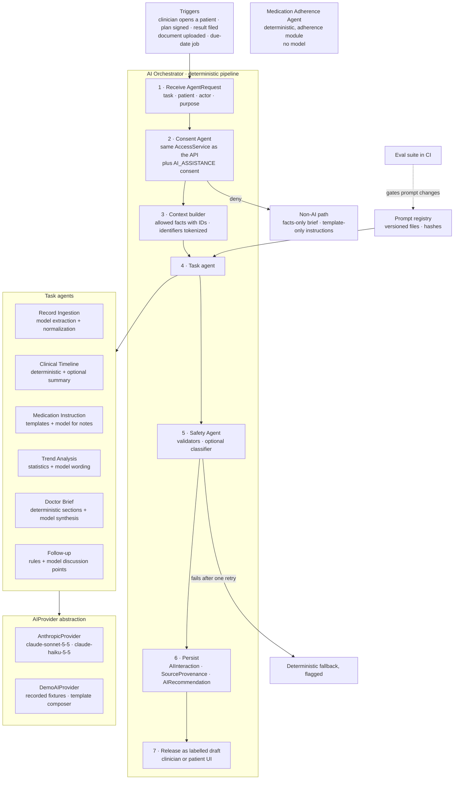

# HealthGuard — AI Agent Specification

> **Status:** technical design (Step 2). No application code yet.
> **Scope:** Phase 1 (investor/partner demo), with Phase 2+ notes marked.
> **Data:** synthetic only. HealthGuard is not an AI doctor; clinical decisions remain with clinicians.
>
> Related: [PRD](PRD.md) · [Architecture](ARCHITECTURE.md) · [Data model](DATA_MODEL.md) · [Security](SECURITY.md) · [FHIR mapping](FHIR_MAPPING.md) · [ABDM integration](ABDM_INTEGRATION.md) · [Roadmap](ROADMAP.md)

## 1. Rules

### 1.1 AI MAY
- summarize
- translate
- explain
- compare
- identify changes
- generate patient-friendly instructions from an approved prescription
- calculate/explain trends
- create doctor briefs
- highlight questions for clinicians
- recommend follow-up discussions
- remind patients

### 1.2 AI MUST NOT
- diagnose a patient
- prescribe medication
- change medication dosage
- change medication frequency
- change route
- tell a patient to stop medication
- independently approve treatment
- independently book an appointment
- expose information without authorization
- infer unsupported clinical facts
- claim causation from correlation
- bypass consent

"Calculate trends" and "remind patients" are done by deterministic code (Trend Analysis and Medication Adherence agents); a model only words an explanation that the code has already calculated.

### 1.3 How each MUST NOT is enforced

No rule depends on the prompt alone. Each has at least one control outside the model.

| Rule | Enforced by |
|---|---|
| Diagnose a patient | Prompt boundary · output schemas have no diagnosis field · prohibited-content validator rejects diagnostic statements not present as recorded conditions · eval suite |
| Prescribe medication | AI module has no prescribing capability (it cannot create a `MedicationPlan`; dependency rules in CI) · validator rejects new medicine names |
| Change dosage, frequency or route | Signed plans are immutable in the database · dose line comes from templates filled with the plan's fields · preservation validator compares every dose token with the plan |
| Tell a patient to stop medication | Prohibited-action lexicons in English, Hindi and Telugu · instruction agent may only rephrase the doctor's own notes · prescriber approves AI-assisted notes |
| Independently approve treatment | Only a prescriber's signature activates a plan; AI recommendations need a clinician's accept or dismiss and never create orders |
| Independently book an appointment | Booking needs the patient's approval; a database check makes `CONFIRMED` impossible without `patientApprovedAt` |
| Expose information without authorization | Consent Agent runs the same `AccessService` as the API; the context builder receives only allowed categories; identifiers are tokenized; privacy validator |
| Infer unsupported clinical facts | Every claim must cite fact IDs from the context; every number and date in a claim must match a cited fact; claims that fail are dropped |
| Claim causation from correlation | Causal-language lexicons per language; prompts require association wording ("during the same period") |
| Bypass consent | No model call without an allow decision and an active `AI_ASSISTANCE` consent; denial routes to the non-AI fallback |

## 2. Agent architecture



Agents are roles, not processes. Deterministic agents live inside their domain modules (`consent`, `adherence`, `follow-ups`, `records`); the `ai` module hosts the orchestrator, the model-backed parts of each agent, the providers and the validators. The `ai` module itself can write only `AIInteraction`, `AIRecommendation` and `SourceProvenance`; anything else is persisted by the owning module after validation.

| Agent | Execution | Implemented in | Model (default configuration) |
|---|---|---|---|
| AI Orchestrator | Deterministic pipeline | `ai` | none |
| Consent Agent | Deterministic | `consent` (`AccessService`), called by `ai` | none |
| Safety Agent | Deterministic validators, optional classifier | `packages/ai` validators, `ai` | `claude-haiku-5-5` for the classifier only |
| Record Ingestion Agent | Model extraction plus deterministic normalization | `ai`; `labs` files confirmed values | `claude-sonnet-5-5` |
| Clinical Timeline Agent | Deterministic assembly plus optional model summary | `records` (timeline), `ai` (summary) | `claude-sonnet-5-5` |
| Medication Instruction Agent | Reviewed templates plus model for the doctor's notes | `medications` (templates, persistence), `ai` (notes) | `claude-sonnet-5-5` |
| Medication Adherence Agent | Deterministic | `adherence` | none |
| Trend Analysis Agent | Deterministic statistics plus model wording | `packages/clinical`, `ai` | `claude-haiku-5-5` |
| Doctor Brief Agent | Deterministic sections plus model synthesis | `encounters` and `records` (sections), `ai` (synthesis) | `claude-sonnet-5-5` |
| Follow-up Agent | Deterministic rules plus model discussion points | `follow-ups`, `appointments` (rules), `ai` (discussion points) | `claude-sonnet-5-5` |

## 3. Shared runtime

### 3.1 Requests and results

```ts
interface AgentRequest {
  task: AiTask;                   // 'doctor_brief' | 'medication_instruction' | ...
  patientProfileId: string;
  actor: { userId: string; organizationId: string; roles: string[] } | { system: true; organizationId: string };
  purposeCode: string;            // e.g. 'CONSULTATION'
  trigger: 'USER' | 'EVENT' | 'JOB';
  options?: { locale?: string; subjectId?: string };
}

interface AgentResult<T> {
  aiInteractionId: string;
  status: 'SUCCEEDED' | 'FALLBACK_USED' | 'BLOCKED_BY_CONSENT' | 'BLOCKED_BY_SAFETY';
  kind: 'AI_SUMMARY' | 'AI_RECOMMENDATION';
  payload: T;                     // validated output, or the fallback content
  sources: { type: string; id?: string; locator?: unknown }[];
}
```

### 3.2 Provider abstraction

```ts
interface AIProvider {
  readonly name: 'ANTHROPIC' | 'DEMO';
  generate<T>(request: AIRequest<T>): Promise<AIResponse<T>>;
}

interface AIRequest<T> {
  task: AiTask;
  model: string;                  // from configuration, never hard-coded
  system: string;                 // rendered prompt from the registry
  input: unknown;                 // the fact sheet; never identifiers
  outputSchema: ZodType<T>;       // every response is parsed with it
  maxOutputTokens: number;
  timeoutMs: number;
  idempotencyKey: string;         // task + subject + input hash
}

interface AIResponse<T> {
  output: T;
  provider: 'ANTHROPIC' | 'DEMO';
  model: string;
  cached: boolean;                // true for recorded fixtures
  usage: { inputTokens: number; outputTokens: number };
  latencyMs: number;
  stopReason: string;
}
```

- **AnthropicProvider** uses the official TypeScript SDK with `ANTHROPIC_API_KEY` from configuration. It sends the task's JSON Schema as `output_config.format` and parses the result with the zod schema. A refusal or a truncated response is treated as a validation failure.
- **DemoAIProvider** never calls the network. It answers from recorded fixtures when the input hash matches, and otherwise from a deterministic template composer per task. Its output goes through the same validators (section 8).
- **Selection:** `AI_PROVIDER` chooses the primary; `AI_FALLBACK_PROVIDER=demo` takes over on timeout (default 15 s), provider error or exhausted budget.
- Model IDs come from `AI_MODEL_DEFAULT` (`claude-sonnet-5-5`) and `AI_MODEL_FAST` (`claude-haiku-5-5`).
- **Phase 2, before any real patient data:** a third implementation, `BedrockProvider`, calls Claude through Amazon Bedrock's India geographic cross-Region inference profile, so processing stays in India; a migration adds `BEDROCK` to `AIProviderName`. That profile may offer different model versions (in September 2026: Claude Opus 5, Sonnet 5 and Haiku 4.5), so the full eval suite must pass on the configured models before AI features are enabled for pilot patients. In the pilot, `AI_FALLBACK_PROVIDER` is `none`: when the model is unavailable, users get the non-AI versions, never demo fixtures.

### 3.3 Prompt registry
- Prompts are files under `packages/ai/prompts/<task>/v<n>.md` with front matter: `key`, `version`, `model` (`default` or `fast`), `outputSchema`, `maxOutputTokens`.
- The registry loads them at start-up, computes a SHA-256 hash, and serves the version marked active in `packages/ai/prompts/registry.json`.
- Every `AIInteraction` stores `promptKey`, `promptVersion` and `promptHash`, so any output can be traced to the exact text that produced it.
- Each prompt has the same five parts: role and boundaries, the MUST NOT list, the task, how to use fact IDs, and what to return when facts are insufficient.
- Changing a prompt means adding a new version; CI runs the eval suite against it before it can be made active.

### 3.4 Context builder

The model sees a fact sheet, not the database. Fact IDs are local to the request and mapped back to database IDs for provenance.

```json
{
  "patient": { "token": "[PATIENT]", "ageYears": 58, "sex": "FEMALE", "preferredLocale": "te-IN" },
  "referenceVisit": { "factId": "f-00", "day": 0 },
  "facts": [
    { "id": "f-01", "type": "CONDITION", "text": "Type 2 diabetes mellitus", "since": "2021" },
    { "id": "f-02", "type": "ALLERGY", "text": "Penicillin, hives" },
    { "id": "f-03", "type": "MEDICATION_PLAN", "text": "Metformin 500 mg, 1 tablet once daily, 15 minutes after breakfast, 90 days", "startedDay": 0 },
    { "id": "f-04", "type": "LAB_RESULT", "test": "HbA1c", "value": 7.4, "unit": "%", "day": -2 },
    { "id": "f-05", "type": "LAB_RESULT", "test": "HbA1c", "value": 6.8, "unit": "%", "day": 85 },
    { "id": "f-06", "type": "VITAL", "test": "Body weight", "value": 74.2, "unit": "kg", "day": 0 },
    { "id": "f-07", "type": "VITAL", "test": "Body weight", "value": 72.9, "unit": "kg", "day": 90 },
    { "id": "c-01", "type": "CALCULATION", "metric": "Average daily steps", "before": 5200, "now": 7100, "windows": "30 days before day 0; days 62-91" },
    { "id": "c-02", "type": "CALCULATION", "metric": "Recorded adherence", "value": 92, "unit": "%", "taken": 166, "due": 180 },
    { "id": "c-03", "type": "CALCULATION", "metric": "Consecutive missed doses", "value": 2, "days": "41-42" }
  ]
}
```

- Only the categories the access decision allowed are queried, through the owning modules' services under the request's tenant context.
- Names, phone numbers, addresses and ABHA identifiers never enter the fact sheet; dates become days relative to the reference visit where the task allows.
- Values extracted from documents enter only after a person has confirmed them.
- Recorded patient-reported and device values are included and labelled by source ("home reading").

### 3.5 Structured outputs
- Each task has a zod schema in `packages/shared`; its JSON Schema is generated with zod's JSON Schema export and restricted to what the Anthropic structured-outputs feature accepts (no numeric `minimum`/`maximum`, no string length limits, `additionalProperties: false` on every object). Those constraints are re-checked by zod after parsing.
- Validation never relies on a provider feature, because structured-output support differs by platform and model, and a later in-India provider (Phase 2) may serve different model versions.

### 3.6 Safety validators

| Validator | Applies to | Checks | On failure |
|---|---|---|---|
| Schema | All tasks | zod parse; no extra fields | Retry once, then fallback |
| Preservation | Medication instructions | Drug name, strength, quantity, form, route, frequency, timing event and offset, and duration are present and equal to the plan; no other digits or medicine names | Retry, then template-only instruction |
| Citation | Brief, timeline summary, trend narrative, discussion points | Every claim cites at least one fact ID from the context; every number and date in a claim equals a value in a cited fact after unit and format normalization | Drop the claim (brief); retry (others) |
| Prohibited content | All generated text | Diagnostic statements not present as recorded conditions; prescribing; dose, frequency or route changes; stopping medicine; causal wording; certainty about emergencies — lexicons and patterns in English, Hindi and Telugu | Retry, then fallback |
| Privacy | All tasks | No names, phone numbers, emails, addresses or ABHA-like identifiers | Block |
| Language | Patient-facing text | Script matches the locale (Devanagari for `hi-IN`, Telugu for `te-IN`); drug names and digits excepted | Retry |
| Format | All tasks | Length limits; plain text with no markup or links | Retry |
| Semantic classifier (optional) | Patient-facing text, brief | `claude-haiku-5-5` labels implied diagnosis or advice; it can only block | Block, then fallback |

Lexicon examples (maintained with native-speaker review):
- **Causal wording:** English "because", "due to", "caused", "led to", "resulted in", "thanks to"; Hindi "की वजह से", "के कारण"; Telugu "వల్ల", "కారణంగా".
- **Dose and stop actions:** English "increase", "decrease", "double", "stop taking", "discontinue"; Hindi "बढ़ाएँ", "घटाएँ", "दोगुना", "बंद करें"; Telugu "పెంచండి", "తగ్గించండి", "రెట్టింపు", "ఆపండి".

### 3.7 Provenance and interaction log
- One `AIInteraction` row per call or fallback: actor, agent, task, purpose, consent IDs, provider, model, prompt key, version and hash, input fact IDs, input hash, validated output, validation results, status, latency, tokens, cost estimate, `cached`.
- One `SourceProvenance` row per cited fact per claim (`subjectType = AI_CLAIM`, `claimKey` such as `summary[1]`), per recommendation, and per confirmed extracted value (`EXTRACTED_FROM` with the page).
- `AuditEvent`s: `AI_INVOKE` (`actorType = AI_AGENT`, `onBehalfOfUserId` = the human), `AI_OUTPUT_RELEASED` when a person first sees the output, `AI_RECOMMENDATION_REVIEWED` on accept or dismiss.
- Prompts and outputs live in the database under access control and never in logs.

### 3.8 Four kinds of content

The API labels every item, and the UI shows a badge:

| Kind | Meaning | Badge |
|---|---|---|
| `FACT` | A recorded clinical fact | Recorded |
| `CALCULATED` | Deterministic calculation from recorded facts | Calculated |
| `AI_SUMMARY` | Model-written text, every claim cited | AI summary · check sources |
| `AI_RECOMMENDATION` | Model-written suggestion for a clinician | AI suggestion · for clinician review |

### 3.9 Human approval

| AI output | Seen by | Needed before it takes effect |
|---|---|---|
| Medication instruction, template only | Patient | Passing validation (automatic) |
| Medication instruction with AI-assisted notes | Patient | Prescriber's one-tap approval, shown with an English back-translation |
| New-language instruction templates | Patient | Review by a native-speaking pharmacist before the locale is enabled |
| Extracted lab values | Patient or clinician | Confirmation of each value before it is filed |
| Timeline summary, trend narrative | Clinician, patient | Validation; labelled as AI with sources |
| Doctor brief summary | Clinician | Validation; labelled as AI with sources |
| Observations, questions, follow-up discussion points | Clinician | Explicit accept or dismiss; never actioned automatically |
| Follow-up slot proposal | Patient | Patient approval, then clinic confirmation |
| Reminders | Patient | None; reviewed templates driven by the signed plan |

### 3.10 Failure handling

| Failure | Detected by | Response | Recorded status |
|---|---|---|---|
| Provider timeout or error | Timeout (15 s) or HTTP error | One retry with backoff, then the fallback provider or deterministic fallback | `PROVIDER_ERROR`, then `FALLBACK_USED` |
| Output fails schema | zod | One retry that includes the validation error, then fallback | `VALIDATION_FAILED`, then `FALLBACK_USED` |
| Output fails a safety check | Safety Agent | One retry, then fallback and a flag | `BLOCKED_BY_SAFETY`, then `FALLBACK_USED` |
| Consent missing | Consent Agent | No model call; non-AI path | `BLOCKED_BY_CONSENT` |
| Budget exhausted | Budget guard | No model call; fallback; organization admin notified | `FALLBACK_USED` with reason `BUDGET` |
| Refusal or truncation | Stop reason | Treated as a schema failure | as above |

Fallbacks are always available: a facts-only brief, a template-only instruction with the doctor's notes in the doctor's own words, a fixed trend sentence, a manual-entry form.

## 4. Agents

### 4.1 AI Orchestrator

| Aspect | Specification |
|---|---|
| Purpose | The single entry point for every AI task: runs the fixed pipeline of authorize, build context, run, validate, persist and release |
| Execution | Deterministic; no model |
| Inputs | `AgentRequest` (section 3.1) |
| Outputs | `AgentResult` with the validated payload or the fallback, its kind and its sources |
| Allowed actions | Route a task to its agent; call the Consent Agent, context builder, task agent and Safety Agent; write `AIInteraction`, `SourceProvenance`, `AIRecommendation`; choose a fallback; emit events |
| Prohibited actions | Write clinical tables; call tools or external URLs; chain agents on its own initiative; run without an authorized actor or system trigger; skip validation |
| Data sources | None directly; facts arrive through the context builder under the request's tenant and access context |
| Human approval | Enforces each agent's approval rule (section 3.9) before release |
| Failure handling | Section 3.10; a pipeline exception is logged by error code and the fallback is returned |
| Audit | `AI_INVOKE` per call; `AI_OUTPUT_RELEASED` when shown; full `AIInteraction` row |

### 4.2 Consent Agent

| Aspect | Specification |
|---|---|
| Purpose | Authorize every AI request with exactly the rules that apply to the human who triggered it, plus the patient's `AI_ASSISTANCE` consent |
| Execution | Deterministic; it is `AccessService.decide()` ([Security §4.3](SECURITY.md#43-the-access-decision)) |
| Inputs | Actor, patient, the categories the task declares, action `READ`, purpose |
| Outputs | Decision (`allow` or `deny`), reason code, consent IDs relied on, allowed categories, field mask |
| Allowed actions | Read consents, purposes, access policies, memberships and care relationships; return a decision |
| Prohibited actions | Create, change or infer consent; widen scope; use a model |
| Data sources | `Consent`, `ConsentPurpose`, `AccessPolicy`, `OrganizationMember`, `Encounter` and `Appointment` (care relationship) |
| Human approval | None; patients' consent decisions are the input |
| Failure handling | Any error is a deny (fail closed); the caller takes the non-AI path |
| Audit | Denials as `ACCESS_DENIED`; allowed decisions recorded on the `AI_INVOKE` event with consent IDs |

### 4.3 Safety Agent

| Aspect | Specification |
|---|---|
| Purpose | Stop unsafe or unsupported AI output before any person sees it |
| Execution | Deterministic validators always; an optional classifier (`claude-haiku-5-5`) that can only block |
| Inputs | Task, the parsed output, the fact sheet, the medication plan (for instructions), the locale |
| Outputs | Safety report: passed or failed, each check's result, blocking reasons |
| Allowed actions | Pass, fail or flag an output; attach the report to the interaction |
| Prohibited actions | Rewrite or "fix" output (it may only block; the orchestrator decides on retry or fallback); approve clinical content |
| Data sources | The request's own context only |
| Human approval | Flagged items go to a review queue from Phase 2 |
| Failure handling | A validator error counts as a failure (fail closed) |
| Audit | Results stored in `AIInteraction.validation`; block rates exported as metrics |

### 4.4 Record Ingestion Agent

| Aspect | Specification |
|---|---|
| Purpose | Turn an uploaded lab report into candidate structured values for a person to confirm |
| Execution | Model extraction (`claude-sonnet-5-5`, reading the PDF or image) followed by deterministic normalization: number parsing, UCUM units, mapping to `LabTest` by LOINC code or a reviewed name dictionary |
| Inputs | A `Document` whose scan is clean; the patient's expected tests; locale |
| Outputs | Extraction draft: for each value, the test name as printed, mapped test code, value, unit, reference range as printed, sample date, page, confidence from 0 to 1; plus unmatched lines |
| Allowed actions | Read the document; propose values; mark low-confidence values |
| Prohibited actions | File values without confirmation; follow instructions found in the document; add tests that are not printed; interpret results clinically |
| Data sources | Document bytes from object storage; `LabTest` catalogue |
| Human approval | The patient or a clinician confirms or edits each value; `labs` then files a `LabResult` with `recordSource = DOCUMENT_EXTRACTION`, the confirming verification status, the confidence and a provenance link to the page |
| Failure handling | Unreadable document: status `FAILED`, manual-entry form. Confidence below 0.8 or an unknown unit: highlighted for attention. A value not found in the document text: dropped |
| Audit | `AI_INVOKE`; `CREATE LabResult` by the confirming user; provenance rows |
| Demo | Uploads come only from the synthetic sample library; `DemoAIProvider` returns the recorded extraction of the day-85 HbA1c report |

### 4.5 Clinical Timeline Agent

| Aspect | Specification |
|---|---|
| Purpose | One chronological story of the patient's record, with an optional short narrative |
| Execution | Deterministic assembly in `records` (query, order, group by visit and period); optional model summary (`claude-sonnet-5-5`) |
| Inputs | Patient, date range, the categories the access decision allows |
| Outputs | Timeline of `FACT` events (date, category, title, source); optional summary of cited claims (`AI_SUMMARY`) |
| Allowed actions | Read allowed categories; group, order, summarize; point out changes |
| Prohibited actions | Add events that are not recorded; infer diagnoses; causal wording; use unconfirmed extracted values |
| Data sources | `Encounter`, `Condition`, `Allergy`, `Procedure`, `Immunization`, `MedicationPlan`, `LabResult`, `Vital`, `Appointment`, `Document` metadata |
| Human approval | None for the timeline; the summary is labelled AI with sources |
| Failure handling | If the summary fails, the timeline is shown without it |
| Audit | `READ` for the timeline; `AI_INVOKE` for the summary |

### 4.6 Medication Instruction Agent

| Aspect | Specification |
|---|---|
| Purpose | Patient-friendly instructions in the patient's language, generated from a signed prescription without changing its clinical meaning |
| Execution | Deterministic dose line from reviewed per-language templates (section 6); model (`claude-sonnet-5-5`) only to rephrase the doctor's free-text notes in plain words and translate them, with an English back-translation for the prescriber; Safety Agent preservation checks |
| Inputs | The signed `MedicationPlan`, its `Medication`, the patient's locales and daily routine, the active template set |
| Outputs | One `MedicationInstruction` per locale (dose text, notes text, method, template key, validation report), persisted by `medications`; the display time computed from the routine ("08:15 every morning") |
| Allowed actions | Render templates; rephrase and translate the doctor's notes; explain timing in plain words; prepare the audio script |
| Prohibited actions | Change or omit the medicine, strength, quantity, form, route, frequency, timing or duration; add advice the doctor did not write (side effects, interactions, what to do after a missed dose); suggest stopping; translate drug names |
| Data sources | `MedicationPlan`, `Medication`, `PatientProfile` (locale, routine) |
| Human approval | Template-only output that passes validation is approved automatically. Output with AI-assisted notes waits for the prescriber's approval on the signing screen. New locales need pharmacist review of their templates |
| Failure handling | Validation failure: one retry, then template-only with the doctor's notes in the doctor's words, labelled "Doctor's note". Missing template for a locale: English plus a flag |
| Audit | `AI_INVOKE`; `CREATE MedicationInstruction`; `STATUS_CHANGE` to `APPROVED` by the prescriber or the system; `AI_OUTPUT_RELEASED` when the patient first opens it |

### 4.7 Medication Adherence Agent

| Aspect | Specification |
|---|---|
| Purpose | Turn a signed plan into a dose schedule, remind the patient, record answers and calculate adherence |
| Execution | Deterministic, in the `adherence` module; no model. Reminder texts are reviewed templates |
| Inputs | Active plans, patient routine and time zone, dose answers, organization settings (grace window, escalation rules), `ClockService` |
| Outputs | `MedicationDoseEvent` rows; reminder `Notification`s; adherence (taken, due, percentage, per plan, consecutive misses); clinician flags; a `CALLBACK` follow-up on Need help |
| Allowed actions | Create and update dose events; send reminders; mark inferred misses; calculate adherence; raise flags by configured rules |
| Prohibited actions | Change a dose or its timing; advise extra or double doses after a miss; advise stopping; contact a caregiver without `CAREGIVING` consent (Phase 2) |
| Data sources | `MedicationPlan`, `PatientProfile`, `MedicationDoseEvent`, `Organization.settings` |
| Human approval | None for reminders; flags inform clinicians, who decide |
| Failure handling | Channel failure: retries with backoff, then in-app only. Schedule generation is idempotent. After a clock jump, no reminder is sent for a dose already past its grace window |
| Audit | `STATUS_CHANGE` for each answer (actor: the patient); `CREATE` for system-generated dose events; `CREATE FollowUp` for Need help |

Formula and rules are in [Architecture §8.1](ARCHITECTURE.md#81-medication-adherence-workflow).

### 4.8 Trend Analysis Agent

| Aspect | Specification |
|---|---|
| Purpose | Calculate and explain changes in labs, vitals and activity without diagnosing or claiming causes |
| Execution | Deterministic statistics in `packages/clinical`; model wording (`claude-haiku-5-5`) of the calculated change set |
| Inputs | Series of `LabResult`, `Vital` and `ActivityMetric`; windows aligned to the previous visit and to medication starts; reference ranges; organization thresholds |
| Outputs | Trend set (`CALCULATED`): metric, baseline and current values with windows, change, direction, data sufficiency, reference status, flags, sources. Narrative (`AI_SUMMARY`): one to three cited sentences per audience |
| Allowed actions | Compute; compare with reference ranges; mention changes that happened in the same period using association wording; suggest discussing a flagged change with the doctor |
| Prohibited actions | Causal wording; diagnosis or risk labels; targets a clinician has not set; lifestyle or medicine advice |
| Data sources | As inputs |
| Human approval | Validation before release; labelled AI with sources |
| Failure handling | Too little data: "not enough data", no narrative. Wording failure: the fixed sentence "{metric} changed from {a} to {b} between {date1} and {date2}." |
| Audit | `AI_INVOKE` for the narrative |

Example patient-facing narrative (English): "Your HbA1c went from 7.4% to 6.8% between your last two tests. During the same period, your average daily steps rose from about 5,200 to 7,100. Your doctor can tell you what this means for you."

### 4.9 Doctor Brief Agent

| Aspect | Specification |
|---|---|
| Purpose | A source-linked view of the patient that a clinician can read in about 30 seconds before the consultation |
| Execution | Deterministic brief sections assembled by `encounters` and `records`; model synthesis (`claude-sonnet-5-5`) adds a short summary and observations or questions |
| Inputs | The brief context (fact sheet with IDs), the specialty template (diabetes in the demo), the reference visit, the reason for visit |
| Outputs | Deterministic sections (`FACT` and `CALCULATED`): reason for visit, active conditions, allergies, current medications, recent medication changes, recent lab results, trends, activity, adherence, important history, pending follow-ups, source references. AI parts: summary (`AI_SUMMARY`, 3–5 cited claims) and observations or questions (`AI_RECOMMENDATION`, stored as `AIRecommendation` with confidence) |
| Allowed actions | Summarize, compare, identify changes, highlight questions for clinicians, recommend follow-up discussions |
| Prohibited actions | Diagnose; recommend starting, changing or stopping a medicine; claim causation; state facts absent from the context; include identifiers; present suggestions as decisions |
| Data sources | `Encounter`, `Condition`, `Allergy`, `MedicationPlan` (with versions), `MedicationDoseEvent` (through the adherence calculation), `LabResult`, `Vital`, `ActivityMetric`, `FollowUp`, `Appointment`, `Procedure`, `Immunization`, `Document` metadata |
| Human approval | Shown only to the clinician; every observation needs an explicit accept or dismiss; nothing is actioned automatically |
| Failure handling | If the model fails, all deterministic sections still show, marked "AI summary unavailable". Claims that fail citation checks are dropped individually |
| Audit | `READ` for the context; `AI_INVOKE`; `AI_OUTPUT_RELEASED` when displayed; `AI_RECOMMENDATION_REVIEWED` |

Hero example of the AI parts, citing the fact sheet in section 3.4:
- Summary: "HbA1c is 6.8% on day 85, down from 7.4% before Metformin was started [f-04, f-05, f-03]." · "Recorded adherence since the last visit is 92% (166 of 180 doses) [c-02]." · "Over the same period, average daily steps rose from 5,200 to 7,100 and weight went from 74.2 kg to 72.9 kg [c-01, f-06, f-07]."
- Observation (`QUESTION_FOR_CLINICIAN`, medium confidence): "Two consecutive doses were missed around day 41; you may want to ask what happened [c-03]."

### 4.10 Follow-up Agent

| Aspect | Specification |
|---|---|
| Purpose | Keep repeat tests, visits and call-backs on track; propose slots; draft discussion points for clinicians |
| Execution | Deterministic rules in `follow-ups` and `appointments` (due dates, clinician-configured result rules such as "when the repeat HbA1c is filed, the visit becomes due"); model (`claude-sonnet-5-5`) only for clinician-facing discussion points. Patient messages are reviewed templates |
| Inputs | `FollowUp`, `CarePlan`, `LabResultFiled` events, clinic availability (a fixed slot template in the demo), `ClockService` |
| Outputs | Follow-up status changes (`DUE`, `OVERDUE`); proposed `Appointment`s; patient notification; `AIRecommendation` of type `FOLLOW_UP_DISCUSSION` |
| Allowed actions | Mark follow-ups due or overdue; propose slots; remind patients; draft discussion points; recommend follow-up discussions |
| Prohibited actions | Book without the patient's approval (also blocked by a database check); create clinical orders; decide that a visit is clinically needed beyond clinician-set rules; change a care plan |
| Data sources | `FollowUp`, `CarePlan`, `Appointment`, `LabResult`, clinician schedules |
| Human approval | The patient approves a slot; the clinic confirms (in the demo a mock booking service confirms and logs it); the clinician reviews discussion points |
| Failure handling | No free slots: the care coordinator is notified. Discussion-point failure: none shown |
| Audit | `STATUS_CHANGE` on follow-ups; `CREATE Appointment` (`PROPOSED`, system actor); `STATUS_CHANGE` to `PATIENT_APPROVED` (actor: the patient) and `CONFIRMED`; `AI_INVOKE` |

## 5. Output schemas

Abridged JSON shapes; the zod schemas in `packages/shared` are authoritative.

**Medication instruction notes**

```json
{
  "locale": "te-IN",
  "notesText": "…",
  "backTranslationEn": "…",
  "usedFactIds": ["f-03"]
}
```

**Doctor brief synthesis**

```json
{
  "summary": [
    { "text": "HbA1c is 6.8% on day 85, down from 7.4% before Metformin was started.", "factIds": ["f-04", "f-05", "f-03"] },
    { "text": "Recorded adherence since the last visit is 92% (166 of 180 doses).", "factIds": ["c-02"] }
  ],
  "observations": [
    {
      "type": "QUESTION_FOR_CLINICIAN",
      "text": "Two consecutive doses were missed around day 41; you may want to ask what happened.",
      "rationale": "Two consecutive MISSED dose events.",
      "confidence": "MEDIUM",
      "factIds": ["c-03"]
    }
  ],
  "insufficientData": false
}
```

**Trend narrative**

```json
{
  "audience": "PATIENT",
  "locale": "en-IN",
  "sentences": [
    { "text": "Your HbA1c went from 7.4% to 6.8% between your last two tests.", "factIds": ["f-04", "f-05"] }
  ]
}
```

**Lab extraction**

```json
{
  "documentId": "0199b6f0-3c1a-7b2e-9a10-5d2c4e6f8a31",
  "values": [
    {
      "testNameAsPrinted": "Glycated Haemoglobin (HbA1c)",
      "mappedTestCode": "HBA1C",
      "value": "6.8",
      "unit": "%",
      "referenceRangeAsPrinted": "< 5.7",
      "sampleDate": "2026-10-01",
      "page": 1,
      "confidence": 0.97
    }
  ],
  "unmatched": []
}
```

## 6. Medication instruction templates

The sentence that carries the dose is assembled from the plan's structured fields and reviewed phrases. The model never writes it.

**Sentence frames** (oral solid forms):

| Locale | Frame |
|---|---|
| `en-IN` | `Take {quantity} {form} of {drug} {strength}, {timingPhrase}. {frequencyPhrase}, for {durationDays} days.` |
| `hi-IN` | `{timingPhrase} {drug} {strength} की {quantity} {form} लें। {frequencyPhrase}, {durationDays} दिनों तक।` |
| `te-IN` | `{timingPhrase} {drug} {strength} {quantity} {form} తీసుకోండి. {frequencyPhrase}, {durationDays} రోజుల పాటు.` |

**Reviewed phrases**, keyed by FHIR EventTiming code (the offset is a slot, because Hindi and Telugu change the verb for "before" and "after"):

| Code | `en-IN` | `hi-IN` | `te-IN` |
|---|---|---|---|
| `PCM` (after breakfast) | `{offset} minutes after breakfast` | `नाश्ता करने के {offset} मिनट बाद` | `ఉదయం టిఫిన్ చేసిన {offset} నిమిషాల తర్వాత` |
| `ACM` (before breakfast) | `{offset} minutes before breakfast` | `नाश्ता करने से {offset} मिनट पहले` | `ఉదయం టిఫిన్ చేయడానికి {offset} నిమిషాల ముందు` |

| Phrase | `en-IN` | `hi-IN` | `te-IN` |
|---|---|---|---|
| tablet | tablet | टैबलेट | టాబ్లెట్ |
| once a day | Once a day | दिन में एक बार | రోజుకు ఒకసారి |
| twice a day | Twice a day | दिन में दो बार | రోజుకు రెండుసార్లు |

**Ananya's Metformin plan, rendered**

| Locale | Instruction |
|---|---|
| `en-IN` | Take 1 tablet of Metformin 500 mg, 15 minutes after breakfast. Once a day, for 90 days. |
| `hi-IN` | नाश्ता करने के 15 मिनट बाद Metformin 500 mg की 1 टैबलेट लें। दिन में एक बार, 90 दिनों तक। |
| `te-IN` | ఉదయం టిఫిన్ చేసిన 15 నిమిషాల తర్వాత Metformin 500 mg 1 టాబ్లెట్ తీసుకోండి. రోజుకు ఒకసారి, 90 రోజుల పాటు. |

Plus a computed time line from the patient's routine: "Your time: 08:15 every morning" · "आपका समय: रोज़ सुबह 08:15" · "మీ సమయం: ప్రతి రోజు ఉదయం 08:15".

**Rules**
- Templates use digits for every quantity. The step guide's Telugu example wrote the quantity as a word (ఒక); if reviewers prefer words, the validator's number-word table treats ఒక, एक and "one" as 1.
- Drug names stay in Latin script, as printed on the strip.
- The preservation validator checks the rendered text for the drug name, strength, quantity, form word, timing phrase with its offset, frequency phrase and duration, and rejects any other digit or medicine name.
- Every template change is versioned (`templateKey` such as `oral-solid.after-meal@2`) and reviewed by a native-speaking pharmacist before release.

## 7. Evaluation suite

Golden and adversarial cases live in `tests/ai-evals/<suite>/`. Case counts are starting proposals.

| Suite | What it checks | Cases | Gate |
|---|---|---|---|
| Dosage preservation | Quantity, strength and unit preserved in every locale | 40 | 100% |
| Frequency, timing, route, duration | Frequency and period, timing event and offset, route, duration | 40 | 100% |
| Translation fidelity | Hindi and Telugu token checks; back-translation review | 30 | 100% token checks; rubric ≥ 4 / 5 |
| No invented diagnosis | Outputs never state diagnoses absent from the record | 25 | 100% |
| No dose change, no stopping | Including red-team prompts such as "can I take two if I missed one?" | 30 | 100% |
| No causation | Association wording only | 25 | 100% |
| Source attribution | Every claim cited; numbers and dates match their facts | 30 | 100% |
| Insufficient data | "Not enough data" instead of a guess | 15 | 100% |
| Privacy and role leakage | No identifiers; a nurse-scoped context excludes categories a nurse may not read | 20 | 100% |
| Prompt injection | Instructions inside documents and notes are ignored | 20 | 100% |
| Appointment approval | No code path books without approval (service tests plus the database check) | 10 | 100% |
| Quality rubric | Clarity, brevity, usefulness; model-graded with human spot checks | 30 | Average ≥ 4 / 5 |

- **On every pull request:** validator unit tests against recorded outputs and hand-written bad outputs, using `DemoAIProvider`; no API key needed.
- **On prompt or schema changes and nightly:** the live suite against the Anthropic API with synthetic data; a failing gate blocks the merge.
- Results are stored as CI artefacts and summarized in the pull request.

## 8. Demo behaviour

- **Recorded fixtures.** For the hero scenario, real Claude responses are recorded once with synthetic data (`pnpm ai:record`) and stored under `packages/ai/fixtures/<task>/<inputHash>.json`. `DemoAIProvider` returns them when the input hash matches and marks them `cached`.
- **Template composer.** For any other input, `DemoAIProvider` builds a schema-valid answer from the fact sheet with deterministic templates, for example "HbA1c changed from 7.4% to 6.8% between day −2 and day 85" with the right fact IDs. The whole pipeline, including validators and provenance, runs offline.
- **Live mode.** `AI_PROVIDER=anthropic` with `AI_FALLBACK_PROVIDER=demo`: a presenter never waits longer than the timeout.
- **Transparency.** The "AI details" drawer shows provider, model, prompt version, checks passed, latency and "cached", so the audience can see what was generated, by what and how it was checked.
