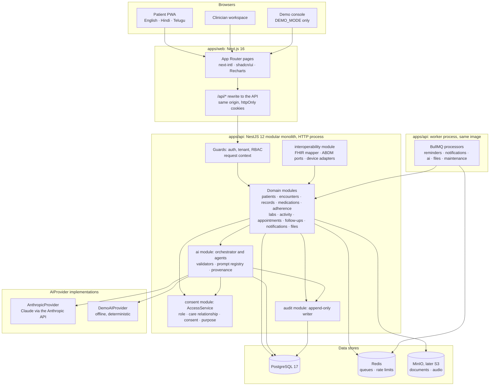
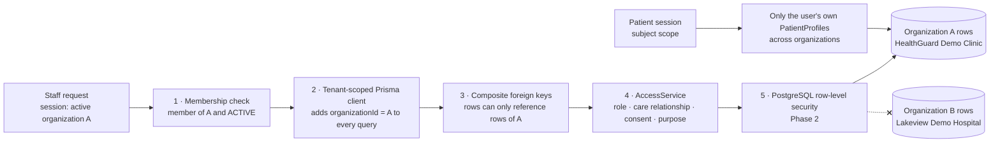
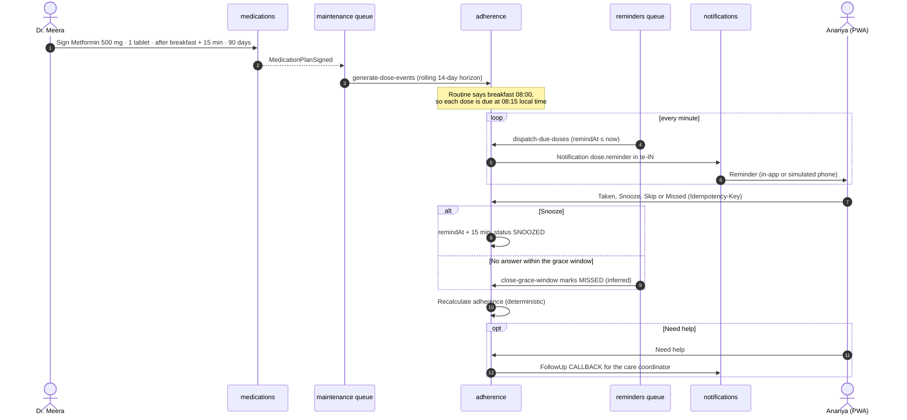
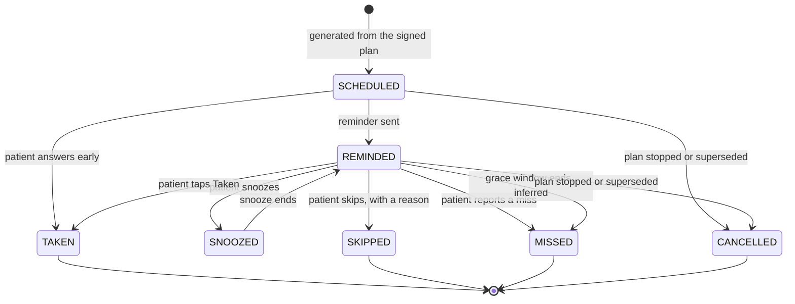
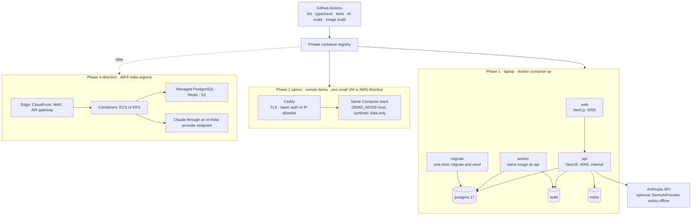
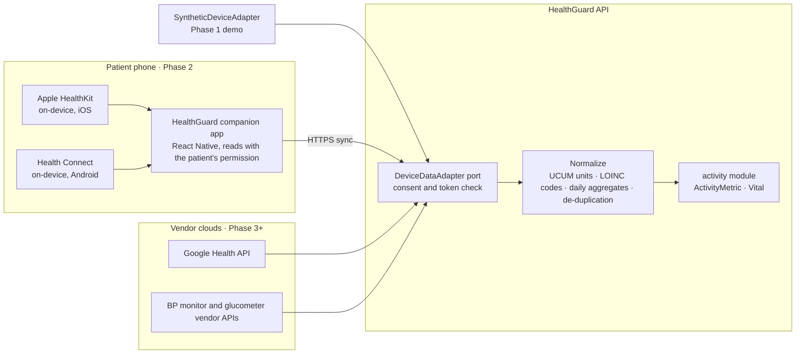

# HealthGuard — Architecture

> **Status:** technical design (Step 2). No application code yet.
> **Scope:** Phase 1 (investor/partner demo), with Phase 2+ hooks marked.
> **Data:** synthetic only. HealthGuard is not an AI doctor, does not replace clinicians and does not replace ABDM. This design is integration-ready, not production-compliant or ABDM-certified.
>
> Related: [PRD](PRD.md) · [Data model](DATA_MODEL.md) · [Security](SECURITY.md) · [AI agents](AI_AGENT_SPEC.md) · [FHIR mapping](FHIR_MAPPING.md) · [ABDM integration](ABDM_INTEGRATION.md) · [Roadmap](ROADMAP.md)

## 1. Architecture at a glance

HealthGuard is a **modular monolith**: one Next.js progressive web app, one NestJS API whose worker process runs from the same code, PostgreSQL, Redis and S3-compatible object storage. For the demo everything runs on a laptop with Docker Compose. AI sits behind a provider abstraction, reads patient data only through the same consent-aware access checks as people, and writes nothing but drafts.



Every arrow into patient data passes through `AccessService`. The AI module is a caller like any other: it reads through the access checks and its only writes are AI interaction records, recommendations and provenance links.

## 2. The seven final decisions in this design

| # | Decision | How the architecture implements it | Where |
|---|---|---|---|
| 1 | Realistic generic medicines at standard doses; all data synthetic; banner everywhere | Real generics in the global `Medication` catalogue; seeded rows carry `isSynthetic` and the demo organization `isDemo`; the banner "DEMO • SYNTHETIC HEALTH DATA • NOT FOR CLINICAL USE" sits in the root layout and on every export; `DEMO_MODE` refuses non-synthetic patients and real uploads | §4.6, [Data model §8](DATA_MODEL.md#8-synthetic-hero-dataset), [Security §13](SECURITY.md#13-pii-and-health-data-handling) |
| 2 | Responsive Next.js PWA, no native app yet, ready for Apple Health and Health Connect | `apps/web` is a PWA (manifest, Serwist service worker); a `DeviceDataAdapter` port has a synthetic implementation now and native-app adapters in Phase 2 | §4, §11 |
| 3 | English, Hindi, Telugu; more languages later; template-driven medication instructions | next-intl message catalogues; locales stored as BCP 47 strings; reviewed per-language dose templates; the model may only rephrase the doctor's free-text notes, and validators check the result | §4.4, [AI agents §6](AI_AGENT_SPEC.md#6-medication-instruction-templates) |
| 4 | Clinics and hospitals buy; B2B2C; multi-tenant from the start | Organization is the tenant; staff and patients are organization-scoped; tenant-scoped Prisma client, composite foreign keys, cross-tenant tests; PostgreSQL row-level security in Phase 2 | §6 |
| 5 | Laptop Docker Compose first; small cloud later; no Kubernetes now | `compose.yaml` with seven core services; the same images run on one small VM behind Caddy for remote demos; Kubernetes is a Phase 4 option, not a Phase 1 dependency | §10 |
| 6 | Anthropic API through an abstraction; key from the environment; DemoAIProvider; AI never makes clinical decisions | `AIProvider` interface with `AnthropicProvider` and `DemoAIProvider`; `ANTHROPIC_API_KEY` read only from configuration; deterministic fallbacks; validators and capability limits enforce the MUST NOT list. The same interface later takes a Phase 2 provider that keeps real patient data in India, without changes to callers | §7, [AI agents](AI_AGENT_SPEC.md) |
| 7 | Private repository `anidhatech/healthguard`, initially empty | The monorepo layout below is the target for implementation | §3 |

## 3. Repository layout

A pnpm workspace orchestrated by Turborepo:

```text
healthguard/
├── apps/
│   ├── web/                  Next.js PWA: patient app, clinician workspace, demo console
│   └── api/                  NestJS modular monolith
│       ├── src/main.ts       HTTP entry point
│       ├── src/worker.ts     BullMQ worker entry point (same modules)
│       ├── src/modules/      one folder per module (section 5)
│       └── prisma/           schema, migrations, synthetic seed scenario
├── packages/
│   ├── shared/               zod contracts, enums, error codes, locale list, RBAC permission map
│   ├── clinical/             pure deterministic logic: dose schedules, adherence, trends,
│   │                         "what changed", unit conversion, instruction templates and validators
│   ├── ai/                   AIProvider interface, AnthropicProvider, DemoAIProvider,
│   │                         prompt registry and prompt files, safety validators
│   ├── ui/                   shadcn/ui-based components and the demo banner
│   └── config/               tsconfig, ESLint and Prettier presets, dependency rules
├── tests/
│   ├── e2e/                  Playwright: hero journey, consent denials, cross-tenant checks
│   └── ai-evals/             golden and red-team cases per AI task
├── infrastructure/docker/    Dockerfiles, Caddyfile for the remote demo
├── docs/                     these documents
├── compose.yaml
└── .env.example
```

Pinned major versions, checked in October 2026:

| Tool | Version | Note |
|---|---|---|
| Node.js | 24 LTS | Meets Prisma 7 (≥ 20.19), Next.js 16 (≥ 20.9) and NestJS 12 (≥ 20) |
| TypeScript | 6.0.x | Not 7.0 yet: NestJS depends on legacy decorators and emitted decorator metadata, which the TypeScript 7.0 announcement does not address. Revisit after Phase 1. |
| Next.js / React | 16.x / 19.x | App Router |
| NestJS | 12.x | New NestJS projects are ESM by default |
| Prisma ORM | 7.10.x, pinned | npm's `latest` tag for the `prisma` CLI points at an 8.0 release candidate; use `@prisma/adapter-pg` |
| BullMQ | 6.x | via `@nestjs/bullmq` |
| next-intl / Tailwind CSS / Recharts / zod | 4.x / 4.x / 3.x / 4.x | |
| Serwist | 9.x | PWA service worker for Next.js |
| PostgreSQL / Redis | 17 / 7.x or Valkey 8 | |

## 4. Frontend architecture

### 4.1 Application structure

```text
apps/web/src/app/[locale]/
├── (auth)/login
├── (patient)/
│   ├── today                 doses due today, Taken / Snooze / Skip / Missed / Need help
│   ├── medicines/[planId]    instruction card with audio, schedule, history
│   ├── records               timeline, conditions, allergies, history, documents
│   ├── tests                 before/after lab comparisons
│   ├── activity              steps, weight, blood pressure
│   ├── appointments          proposals to approve, upcoming visits
│   ├── sharing               consents and "who saw my data"
│   └── settings              language, daily routine, notifications
├── (clinician)/
│   ├── patients              patients this clinician may see
│   └── patients/[patientId]  workspace: what changed, AI brief, timeline, medications,
│                             labs, activity, history, care plan, consent
└── (demo)/console            persona switcher, scenario clock, reset, AI provider toggle
```

### 4.2 Rendering and data access
- Server Components render first paint; they call the API through an internal client that forwards the session cookie. Client Components use TanStack Query for interactive data.
- One contract: request and response schemas are zod schemas in `packages/shared`. NestJS validates with them (nestjs-zod) and publishes them as OpenAPI; the web app imports the same types. A field cannot drift between client and server.
- The browser talks only to the web origin. Next.js rewrites `/api/*` to the NestJS service, so cookies are first-party and the API is never exposed directly.
- Every API item that carries clinical content includes a `kind` (`FACT`, `CALCULATED`, `AI_SUMMARY`, `AI_RECOMMENDATION`) and `sources`; the UI renders a badge and a "view source" link from them.

### 4.3 Patient PWA
- Mobile-first, installable (web app manifest), works on low-end Android Chrome and iOS Safari.
- Serwist service worker precaches the app shell and static assets only. API responses are sent with `Cache-Control: no-store` and are never cached by the service worker, so health data is not left in the browser cache.
- Offline: the shell loads and shows an offline notice; dose answers made offline are not queued in Phase 1.
- Notifications: in-app plus a simulated phone panel in the demo. Web Push, WhatsApp and SMS arrive in Phase 2.

### 4.4 Internationalization
- `next-intl` with locale-prefixed routes (`/en`, `/hi`, `/te`); the supported list lives in `packages/shared` and drives both web and API.
- UI strings come from message catalogues (`messages/en.json`, `hi.json`, `te.json`) using ICU plural and select rules.
- Clinical text never comes from UI catalogues. Medication instructions are pre-rendered per locale by the API from reviewed templates (`MedicationInstruction`), so the wording a pharmacist approved is exactly what the patient sees.
- Digits: every dose, time and duration uses Western Arabic digits in all three languages; drug names stay in Latin script as printed on the strip.
- Fonts: Noto Sans, Noto Sans Devanagari and Noto Sans Telugu through `next/font`.
- Dates and times use `Intl` with the patient's time zone (`Asia/Kolkata` by default).
- Adding a language means adding a locale code, a message catalogue, reviewed instruction templates and a font. No code or schema change.

### 4.5 Clinician workspace
- The patient page opens on **"WHAT CHANGED SINCE LAST VISIT?"**: a calculated panel that renders in well under a second because it involves no model call (section 12).
- The **AI Doctor Brief** panel appears beside it and fills in when the brief job finishes; until then it shows the deterministic sections.
- Every number links to its source record. An "AI details" drawer shows provider, model, prompt version, checks passed, latency and whether a cached response was used.
- Prescribing is structured: medicine from the catalogue, dose, unit, route, frequency, timing event and offset, duration, notes. The allergy cross-check warns before signing, and the generated patient instructions are shown for approval.

### 4.6 Demo safety in the UI
- The banner **DEMO • SYNTHETIC HEALTH DATA • NOT FOR CLINICAL USE** is part of the root layout on every page, cannot be dismissed, and is repeated on printed views and exported files.
- Uploads in demo mode come only from a library of bundled synthetic sample reports.
- The demo console exists only when `DEMO_MODE=true`.

### 4.7 Accessibility and design
- WCAG 2.2 AA target; touch targets of at least 44 px; meaning carried by colour plus icon plus text.
- Large medication cards, read-aloud audio for instructions, adjustable text size, reduced-motion support.
- Charts (Recharts): HbA1c and weight as lines with a "Metformin started" marker; daily steps with 30-day averages; adherence as a calendar strip.

## 5. Backend architecture

### 5.1 Modules

| Module | Owns | Responsibilities |
|---|---|---|
| `auth` | `User`, `AuthSession` | Local demo sign-in, sessions and refresh rotation, organization switch, OIDC strategy from Phase 2 |
| `organizations` | `Organization`, `OrganizationMember` | Tenants, members, roles, settings |
| `patients` | `PatientProfile` | Registration, demographics, language, daily routine, staff patient search, patient's own profiles |
| `clinicians` | `ClinicianProfile` | Professional details, prescriber flag |
| `encounters` | `Encounter` | Visits, previous-visit lookup, "what changed since last visit" calculation |
| `records` | `Condition`, `Allergy`, `Procedure`, `Immunization` | History with correction semantics; deterministic timeline assembly |
| `medications` | `Medication`, `MedicationPlan`, `MedicationInstruction` | Catalogue, draft, sign, supersede and stop plans; allergy cross-check; instruction rendering and approval |
| `adherence` | `MedicationDoseEvent` | Dose schedules, reminders, responses, adherence calculation, missed-dose rules |
| `labs` | `LabTest`, `LabResult` | Results, interpretation, before/after comparison |
| `activity` | `Vital`, `ActivityMetric` | Vitals, daily activity, device-data ingestion |
| `appointments` | `Appointment` | Slot proposals, patient approval, clinic confirmation (mock in the demo) |
| `follow-ups` | `CarePlan`, `FollowUp` | Care plans, due dates, call-backs |
| `consent` | `ConsentPurpose`, `Consent`, `AccessPolicy` | Consent lifecycle; `AccessService`, the single access-decision point; break-glass |
| `audit` | `AuditEvent` | Append-only writer, patient access log, auditor queries |
| `notifications` | `Notification` | Templates, channels, delivery |
| `ai` | `AIInteraction`, `AIRecommendation`, `SourceProvenance` | Orchestrator, agents, providers, prompts, validators |
| `interoperability` | none | FHIR export, ABDM ports (simulated), device adapters |
| `files` | `Document` | Uploads (sample library in the demo), scanning, signed download URLs |
| `common` | none | Request context, tenant-scoped Prisma client, errors, pagination, idempotency |
| `clock` | none | `ClockService`: the only source of "now"; honours the demo clock |
| `demo` | `SystemSetting` | Persona switch, scenario clock and reset. A scenario engine restores a checkpoint (day 0 or day 92) and moves forward by replaying a deterministic script day by day; moving backwards is a reset plus replay. Loaded only when `DEMO_MODE=true` |
| `health` | none | Liveness and readiness probes |

### 5.2 Module rules
- A module owns its tables. Only its repositories touch them; other modules call its public service (facade) or react to its events.
- Dependency rules are checked in CI with dependency-cruiser: no imports from another module's internals, and no imports of `packages/ai` outside the `ai` module.
- Clinical logic that must be exact (schedules, adherence, trends, instruction templates, validators) lives in `packages/clinical` as pure functions with table-driven tests.
- Two entry points share every module: `main.ts` serves HTTP; `worker.ts` boots the same modules as an application context and runs BullMQ processors. Docker runs one image twice with different commands.

### 5.3 Request pipeline

1. Security headers (Helmet) and body-size limits.
2. Rate limiter (Redis-backed).
3. Request ID and request context (AsyncLocalStorage: user, active organization, roles, purpose, request ID).
4. `AuthGuard`: validates the access-token cookie.
5. `TenantGuard`: the active organization's membership is `ACTIVE`; patient sessions get a subject scope instead.
6. `PermissionGuard`: the role grants the endpoint's permission (RBAC map in `packages/shared`).
7. Validation pipe: zod schema for params, query and body; unknown fields rejected.
8. Controller → application service → `AccessService.decide()` for any patient data → tenant-scoped repository.
9. `AuditService` writes the event in the same transaction as a change, or before the response for a read.
10. Response serializer applies the field mask and adds `kind` and `sources`; errors become RFC 9457 `application/problem+json`.

### 5.4 API conventions
- Base path `/api/v1`; JSON with camelCase fields; timestamps in ISO 8601 UTC.
- Cursor pagination (`?cursor=&limit=`, limit at most 100).
- `Idempotency-Key` header required on dose responses, appointment approvals and consent decisions.
- `X-Request-Id` on every response. Staff reads of patient data carry a purpose of use (`X-Purpose-Of-Use`), defaulted per route, for example `CONSULTATION` in the clinician workspace.
- A resource from another organization, or a patient the caller cannot even look up, returns `404`, not `403`, so IDs cannot be probed. Inside the patient's own organization, where staff can already see the patient's demographics, a denied clinical category returns `403` with a reason code (for example `NO_CARE_RELATIONSHIP`), so the UI can explain the denial and offer a consent request.
- OpenAPI document at `/api/docs` outside production only.

### 5.5 Key endpoints

| Module | Endpoints |
|---|---|
| auth | `POST /auth/login` · `POST /auth/refresh` · `POST /auth/logout` · `GET /auth/me` · `POST /auth/switch-organization` |
| patients | `GET /patients` · `POST /patients` · `GET /patients/{id}` · `PATCH /patients/{id}/routine` · `GET /me/patient-profiles` |
| encounters | `GET\|POST /patients/{id}/encounters` · `PATCH /encounters/{id}` · `GET /patients/{id}/what-changed` |
| records | `GET\|POST /patients/{id}/{conditions,allergies,procedures,immunizations}` · `POST /records/{type}/{id}/entered-in-error` · `GET /patients/{id}/timeline` |
| medications | `GET /medications?query=` · `POST /patients/{id}/medication-plans` · `POST /medication-plans/{id}/sign` · `POST /medication-plans/{id}/supersede` · `POST /medication-plans/{id}/stop` · `GET /medication-plans/{id}/instructions?locale=` · `POST /medication-instructions/{id}/approve` |
| adherence | `GET /patients/{id}/doses?from=&to=` · `POST /doses/{id}/response` · `POST /doses/{id}/need-help` · `GET /patients/{id}/adherence?since=` |
| labs | `GET /lab-tests` · `GET\|POST /patients/{id}/lab-results` · `GET /patients/{id}/lab-results/compare?test=` |
| activity | `GET\|POST /patients/{id}/vitals` · `GET /patients/{id}/activity?metric=&from=&to=` |
| appointments | `GET /patients/{id}/appointments` · `POST /appointments/{id}/approve` · `POST /appointments/{id}/confirm` · `POST /appointments/{id}/cancel` |
| follow-ups | `GET\|POST /patients/{id}/care-plans` · `GET\|POST /patients/{id}/follow-ups` · `PATCH /follow-ups/{id}` |
| consent | `GET /consent-purposes` · `GET /patients/{id}/consents` · `POST /patients/{id}/consent-requests` · `POST /consents/{id}/grant\|deny\|revoke` · `POST /patients/{id}/break-glass` (Phase 2) |
| audit | `GET /patients/{id}/access-log` · `GET /audit-events` |
| ai | `POST /patients/{id}/ai/doctor-brief` · `POST /patients/{id}/ai/trend-explanation` · `POST /documents/{id}/ai/extract` · `GET /ai/interactions/{id}` · `GET /ai/interactions/{id}/events` (SSE) · `POST /ai/recommendations/{id}/review` · `POST /ai/extractions/{id}/confirm` |
| interoperability | `GET /patients/{id}/fhir/bundle` · `POST /interop/abdm/simulated/link` · `POST /interop/abdm/simulated/share` · `POST /interop/devices/synthetic/sync` |
| files | `POST /patients/{id}/documents` · `GET /documents/{id}` · `GET /documents/{id}/download-url` |
| demo | `GET /demo/state` · `POST /demo/clock` · `POST /demo/persona` · `POST /demo/reset` |
| health | `GET /health/live` · `GET /health/ready` |

### 5.6 Domain events

In-process events (`@nestjs/event-emitter`) published only after the transaction commits. Reconciliation jobs repair anything a crash interrupts, so no event is the only record of work.

| Event | Emitted by | Consumers |
|---|---|---|
| `MedicationPlanSigned` | medications | adherence: generate dose events · ai: generate instructions |
| `MedicationPlanStopped`, `MedicationPlanSuperseded` | medications | adherence: cancel future doses |
| `DoseResponded`, `DoseMissed` | adherence | adherence: missed-dose rules · follow-ups: call-back on Need help |
| `LabResultFiled` | labs | follow-ups: close the repeat test, mark the visit due |
| `DocumentScanned` | files | ai: record ingestion for clean lab reports |
| `FollowUpDue` | follow-ups | appointments: propose slots · notifications |
| `AppointmentApproved` | appointments | notifications · demo mock booking confirmation |
| `ConsentChanged` | consent | access cache invalidation · notifications |
| `EncounterOpened` | encounters | ai: start the doctor brief |

## 6. Multi-tenant architecture



- **Tenant model.** An `Organization` is a clinic or hospital. Staff belong through `OrganizationMember`; patients belong through `PatientProfile`, one per organization they are treated at. Reference data is global.
- **Request context.** Staff sessions carry an active organization; every request re-checks that the membership is still active. Patient sessions carry a subject scope: the list of the user's own patient profiles.
- **Layer 2, tenant-scoped Prisma client.** A Prisma client extension rewrites every operation on a tenant model to include `organizationId` from the request context and stamps it on creates. If a tenant model is queried without a context, the call throws. Reference models are on an explicit allowlist.
- **Layer 3, composite foreign keys.** Patient-scoped rows reference `(organizationId, patientProfileId)`; clinical cross-references use `(organizationId, id)`. A bug cannot attach Organization A's lab result to Organization B's patient. See [Data model §6.2](DATA_MODEL.md#62-tenant-scoping).
- **Layer 4, access decision.** Membership alone never opens a record; the care relationship and the patient's consent decide ([Security §4](SECURITY.md#4-authorization-rbac-and-consent-aware-access)).
- **Layer 5, row-level security (Phase 2).** Policies on every tenant table compare `organizationId` with a per-transaction setting, so even a raw SQL mistake cannot cross tenants.
- **Beyond the database.** Redis keys and BullMQ job payloads carry `organizationId`; object keys start with `orgs/{organizationId}/`; workers re-create the tenant context before touching data.
- **Per-tenant configuration** lives in `Organization.settings`: enabled locales, reminder grace minutes, escalation rules, AI token budget.
- **Proof.** An end-to-end suite logs in as a Lakeview Demo Hospital user and requests every HealthGuard Demo Clinic resource; every request must return `404` and write an `ACCESS_DENIED` audit event.

## 7. AI architecture

The full specification of the ten agents is in [AI_AGENT_SPEC.md](AI_AGENT_SPEC.md). In outline:

- **One pipeline for every AI task**, run by the AI Orchestrator: authorize (Consent Agent, same `AccessService` as the API, plus the patient's `AI_ASSISTANCE` consent) → build context (only allowed facts, each with an ID, identifiers replaced by tokens) → run the task agent → validate (Safety Agent) → persist (`AIInteraction`, `SourceProvenance`, `AIRecommendation`) → release as a labelled draft.
- **Deterministic where correctness matters.** Schedules, adherence, trend statistics, "what changed", consent decisions and instruction dose lines involve no model. The model writes summaries, plain-language rephrasing, translations of the doctor's notes, extraction candidates and discussion points.
- **Provider abstraction.** `AIProvider` has two implementations: `AnthropicProvider` (Claude via the Anthropic API; `ANTHROPIC_API_KEY` from the environment only) and `DemoAIProvider` (recorded fixtures for the hero scenario plus a deterministic template composer for anything else). `AI_PROVIDER` selects one; `AI_FALLBACK_PROVIDER=demo` covers timeouts and outages so the demo always completes.
- **Models.** `claude-sonnet-5-5` for clinical summaries, instruction notes and extraction; `claude-haiku-5-5` for short trend wording and the safety classifier. Model IDs are configuration.
- **Structured output.** Each task has a zod schema. With the Anthropic API the schema is sent as `output_config.format` (JSON Schema without the keywords structured outputs rejects, such as numeric minimums and string length limits), and the response is always re-validated with zod. Structured-output support differs by platform and model (Amazon Bedrock added it in February 2026, for specific models), so validation never depends on the provider.
- **Latency.** Deterministic panels never wait for a model. The brief runs as a job on the `ai` queue and streams to the page through server-sent events; with `DemoAIProvider` it completes in well under a second.
- **Cost control.** Per-user rate limits, a daily token budget per organization, and prompt caching of the static part of each prompt.

## 8. Async and job architecture

BullMQ is used only where work must survive a restart, run on a schedule or retry. Everything else is synchronous.

| Queue | Jobs | Trigger | Idempotency | Retries |
|---|---|---|---|---|
| `reminders` | `dispatch-due-doses` · `close-grace-window` | Repeatable: every minute · every 5 minutes | Selects rows with `FOR UPDATE SKIP LOCKED`; notification `dedupeKey` | Next run picks up anything missed |
| `notifications` | `deliver` | One per `Notification` | `dedupeKey` unique | 5 attempts, exponential backoff, then in-app fallback |
| `ai` | `generate-instructions` · `generate-brief` · `explain-trend` · `extract-document` · `follow-up-discussion` | Domain events and user actions | Job ID = task + subject + input hash | One provider retry inside the job, then fallback |
| `files` | `scan-document` | Upload completed | Job ID = document ID | 3 attempts, then `FAILED` |
| `maintenance` | `generate-dose-events` · `evaluate-follow-ups` · `expire-consents` · `housekeeping` · `demo-reset` | Plan signed and nightly · daily at 06:00 organization time · hourly · nightly · on demand | Unique `(medicationPlanId, scheduledAt)`; status guards | Safe to re-run |

Phase 2 adds an `interop` queue for ABDM callbacks and record transfers ([ABDM integration §5](ABDM_INTEGRATION.md#5-health-information-exchange-boundary)).

Rules for every job:
- Payloads carry IDs, `organizationId` and the originating request ID. Never names, values or text.
- Workers rebuild the request context (tenant, acting user or system actor) before touching data.
- "Now" comes from `ClockService`. Repeatable jobs tick on wall-clock time but evaluate against demo time, so moving the demo clock to day 85 makes the next tick behave as day 85.

### 8.1 Medication adherence workflow





**Adherence (deterministic, `packages/clinical`):**
- Recorded adherence = doses `TAKEN` ÷ doses due, where doses due = `TAKEN + SKIPPED + MISSED` with `scheduledAt` inside the window. Doses still `SCHEDULED`, `REMINDED` or `SNOOZED` are pending and excluded; `CANCELLED` doses are excluded.
- It is reported with its counts (for example 166 / 180) and labelled "recorded", because it reflects what the patient reported.
- Missed-dose rule (organization setting, default): two consecutive `MISSED` doses of the same plan raise a flag on the clinician's patient list. Caregiver alerts arrive in Phase 2 and only with the patient's `CAREGIVING` consent.
- Defaults: reminder at the scheduled time; snooze 15 minutes; grace window 120 minutes.

## 9. Storage architecture

| Store | Holds | Rules |
|---|---|---|
| PostgreSQL 17 | Every record in [the data model](DATA_MODEL.md) | Single database; Prisma migrations plus hand-written SQL for triggers and checks; seed scenario for the demo |
| Redis | BullMQ queues, rate-limit counters, session-revocation list, server-sent-event fan-out | No health data: job payloads are IDs; no clinical values are cached |
| Object storage (MinIO in Compose, S3 later) | Uploaded documents, instruction audio, Phase 2 audit archives | Private buckets; keys `orgs/{organizationId}/patients/{patientProfileId}/documents/{documentId}`; downloads only through signed URLs valid for 5 minutes; versioning on |
| Environment | Secrets and configuration | `.env` locally (never committed); a secrets manager in production |

Backups: the demo is rebuilt from the seed in under a minute, so it needs no backups. From Phase 2, point-in-time recovery for PostgreSQL and versioned buckets.

## 10. Deployment architecture



**Compose services**

| Service | Image | Port | Purpose |
|---|---|---|---|
| `web` | `apps/web` | 3000 (published) | PWA and clinician workspace; rewrites `/api/*` to `api` |
| `api` | `apps/api` | 4000 (internal) | HTTP API |
| `worker` | `apps/api`, command `node dist/worker.js` | none | BullMQ processors |
| `migrate` | `apps/api`, one-shot | none | `prisma migrate deploy`, SQL rules, synthetic seed |
| `postgres` | `postgres:17` | internal | Primary store |
| `redis` | `redis:7` (or `valkey/valkey:8`) | internal | Queues and rate limits |
| `minio` | MinIO | internal; console 9001 in dev only | Object storage |
| Optional profiles | Mailpit (`dev`), ClamAV (`scan`), Jaeger (`observability`) | | Email capture, malware scanning, traces |

**Runbook:** copy `.env.example` to `.env` → `docker compose up -d` → open `http://localhost:3000` → choose a persona in the demo console. `docker compose run --rm migrate reset` restores the scenario.

**Remote demo:** the same images on one small VM (2 vCPU, 4–8 GB) in AWS Mumbai behind Caddy with automatic TLS, access restricted by basic auth or an IP allowlist, `DEMO_MODE=true`, synthetic data only. No Kubernetes.

**Production direction (Phase 4):** AWS India regions with managed PostgreSQL, Redis and S3, containers on ECS or EKS, and Claude through an in-India endpoint such as Amazon Bedrock's India geographic cross-Region inference profile. The in-India AI endpoint is needed earlier, from the Phase 2 pilot, because real patient data must be processed in India ([AI agents §3.2](AI_AGENT_SPEC.md#32-provider-abstraction)). Pilot hosting is described in the [Roadmap](ROADMAP.md#phase-2--clinic-pilot); details of Phases 3–4 belong to their own designs, not to this demo.

## 11. Interoperability and device adapters

The core domain never imports an external system's client. Each integration is a port in the `interoperability` module with interchangeable adapters chosen by configuration.

| Port | Phase 1 adapter | Later adapters |
|---|---|---|
| `FhirExportPort` | Base FHIR R4 bundle of one patient, tagged synthetic | NRCeS ABDM profiles (Phase 3) |
| `FhirImportPort` | none | Lab and hospital feeds (Phase 3) |
| ABDM ports (identity, care contexts, consent, record exchange) | `SimulatedAbdmAdapter` | Sandbox, then production after certification ([ABDM integration](ABDM_INTEGRATION.md)) |
| `DeviceDataAdapter` | `SyntheticDeviceAdapter` (deterministic generator) | Native companion app for Apple Health and Health Connect (Phase 2); vendor clouds (Phase 3+) |

### 11.1 Future wearable integration



Apple HealthKit and Health Connect are on-device stores, reachable only from an app on the phone, which is why the Phase 2 companion app exists. Imports are idempotent through the unique `(patientProfileId, type, date, sourceSystem)` key, and every row records its `sourceSystem`.

## 12. Hero demo: What changed since last visit?

Dr. Meera opens Ananya's record on day 92 and immediately sees:

| Item | Before | Now | Kind |
|---|---|---|---|
| HbA1c | 7.4 % | 6.8 % | Calculated from two recorded results |
| Weight | 74.2 kg | 72.9 kg | Calculated from two recorded measurements |
| Average daily steps | 5,200 | 7,100 | Calculated from 30-day windows |
| Medication adherence | | 92 % (166 / 180 doses) | Calculated from recorded dose events |

**Rules (deterministic, `packages/clinical`):**
- **Reference point:** the most recent `COMPLETED` encounter before the current one (day 0).
- **Labs:** before = the latest `FINAL`, active result on or before the reference visit day; now = the latest result after it. The panel shows both values, the change and each value's interpretation against its reference range.
- **Weight and other vitals:** latest measurement on or before the reference visit, and latest since.
- **Average daily steps:** mean of daily `STEPS` over the 30 days before the reference visit, and over the latest 30 complete days. Each window needs at least 20 days of data; otherwise the item shows "not enough data".
- **Adherence:** the formula in section 8.1, over all doses due since the reference visit for plans active in that period.
- Tracked items come from a specialty template (diabetes: HbA1c, fasting glucose, weight, blood pressure, steps, adherence). Items without data are hidden, not guessed.

**Response shape** (abridged):

```json
{
  "referenceEncounter": { "id": "0199b6f0-3c1a-7b2e-9a10-5d2c4e6f8a01", "date": "2026-07-08" },
  "items": [
    {
      "key": "HBA1C",
      "kind": "CALCULATED",
      "before": { "value": 7.4, "unit": "%", "at": "2026-07-06", "interpretation": "HIGH" },
      "now": { "value": 6.8, "unit": "%", "at": "2026-10-01", "interpretation": "HIGH" },
      "change": -0.6,
      "sources": [
        { "type": "LAB_RESULT", "id": "0199b6f0-3c1a-7b2e-9a10-5d2c4e6f8a11" },
        { "type": "LAB_RESULT", "id": "0199b6f0-3c1a-7b2e-9a10-5d2c4e6f8a12" }
      ]
    },
    {
      "key": "ADHERENCE",
      "kind": "CALCULATED",
      "now": { "value": 92, "unit": "%", "taken": 166, "due": 180 },
      "sources": [ { "type": "CALCULATION", "locator": { "metric": "adherence", "from": "2026-07-09", "to": "2026-10-06" } } ]
    }
  ]
}
```

**AI Doctor Brief.** Beside the panel, the brief lists reason for visit, active conditions, allergies, current medications, recent medication changes, recent lab results, trends, activity, adherence, important history and pending follow-ups, all as recorded facts and calculations with links to their sources. The Doctor Brief Agent adds two AI parts on top: a short summary whose every claim cites fact IDs, and observations or questions for the clinician, stored as recommendations to accept or dismiss ([AI agents §4.9](AI_AGENT_SPEC.md#49-doctor-brief-agent)). If the model is unavailable, the factual sections still appear in full.

The four kinds of content are kept apart throughout: recorded facts, deterministic calculations, AI summaries and AI recommendations ([Data model §7](DATA_MODEL.md#7-four-kinds-of-content)).

## 13. Observability

| Signal | Phase 1 | Rules |
|---|---|---|
| Logs | pino JSON to stdout, via `nestjs-pino` | Field allowlist and redaction; no health data, identifiers, prompts or model output ([Security §14](SECURITY.md#14-logging-policy)) |
| Traces | OpenTelemetry SDK with HTTP, NestJS, pg, ioredis and BullMQ spans; OTLP to Jaeger in the `observability` profile | Span attributes follow the same allowlist |
| Metrics | Prometheus endpoint on the API and worker | Request latency and errors; queue depth and job duration; reminder lag (scheduled time to send); AI latency, tokens, cost, fallback rate and validation failures; access denials by reason |
| Health | `/health/live`, `/health/ready` (database, Redis, object storage) | Used by Compose health checks |
| AI transparency | In-app "AI details" drawer reading `AIInteraction` | Visible to the clinician who requested the output |
| Audit | `AuditEvent` table, separate from logs | Queried by the patient access log and auditors |

## 14. Configuration

All configuration comes from environment variables, validated by a zod schema at start-up; the process refuses to start on a missing or malformed value.

| Variable | Example | Notes |
|---|---|---|
| `NODE_ENV` | `development` | |
| `DEMO_MODE` | `true` | Enables the demo console, persona switch and synthetic-only guards. The API refuses to start with `DEMO_MODE=true` and `NODE_ENV=production` unless `ALLOW_DEMO_IN_PRODUCTION=true` |
| `APP_BASE_URL` | `http://localhost:3000` | Used for links and cookie settings |
| `DATABASE_URL` | `postgresql://…` | Read by the Prisma config file and the driver adapter |
| `REDIS_URL` | `redis://redis:6379` | |
| `S3_ENDPOINT`, `S3_ACCESS_KEY_ID`, `S3_SECRET_ACCESS_KEY`, `S3_BUCKET_DOCUMENTS` | | MinIO locally |
| `JWT_PRIVATE_KEY`, `JWT_PUBLIC_KEY`, `JWT_ISSUER` | Ed25519 keys | Session tokens |
| `AI_PROVIDER` | `anthropic` or `demo` | |
| `AI_FALLBACK_PROVIDER` | `demo` or `none` | |
| `ANTHROPIC_API_KEY` | | Never hard-coded, never logged, never sent to the browser |
| `AI_MODEL_DEFAULT`, `AI_MODEL_FAST` | `claude-sonnet-5-5`, `claude-haiku-5-5` | |
| `AI_TIMEOUT_MS`, `AI_DAILY_TOKEN_BUDGET_PER_ORG` | `15000`, `2000000` | |
| `ABDM_ADAPTER` | `simulated` | `off` by default; `simulated` only with `DEMO_MODE=true`; `sandbox` and `production` arrive in Phases 2 and 3 ([ABDM integration §6](ABDM_INTEGRATION.md#6-adapter-interfaces)) |
| `DEVICE_ADAPTER` | `synthetic` | The deterministic generator in Phase 1 |
| `DEFAULT_TIMEZONE` | `Asia/Kolkata` | |
| `LOG_LEVEL`, `OTEL_EXPORTER_OTLP_ENDPOINT` | `info`, `http://jaeger:4318` | |

## 15. Key technical decisions

| Decision | Choice | Alternatives considered | Why |
|---|---|---|---|
| Service shape | Modular monolith with enforced boundaries | Microservices | One team, one deployable, fewer failure modes; modules can be extracted later along the same seams (reminders and AI first) |
| Contracts | Shared zod schemas | Separate DTO classes plus a generated client | One definition validates the request, documents the API and types the client |
| Reminders | Database-driven dispatcher scanning due doses | One delayed job per dose | Survives restarts and clock jumps; idempotent; easy to reason about in the demo |
| Browser-to-API path | Same-origin rewrite with httpOnly cookies | Bearer tokens held in JavaScript | Tokens are never readable by scripts; no CORS surface |
| Tenant isolation | Application scoping plus composite foreign keys now; row-level security in Phase 2 | Row-level security from day one; database per tenant | Strong guarantees without slowing the demo build; RLS adds defence in depth before real data |
| AI output | Validated JSON with fact IDs; provider-independent checks | Free text; provider-specific citation features | Every claim is checkable; works with any provider |
| Retrieval | Structured queries of the patient's own record | Vector search | A patient record fits in a prompt; similarity search can silently leave out an allergy |
| Doctor brief | Deterministic sections plus an AI synthesis layer | Fully generated brief | Facts appear even when the model fails; the AI part is small and checkable |
| TypeScript | 6.0 | 7.0 | NestJS decorator metadata support is not confirmed for 7.0 |
| Prisma | 7.10, pinned | Prisma 8 release candidate | Stable release; documented NestJS recipe |
