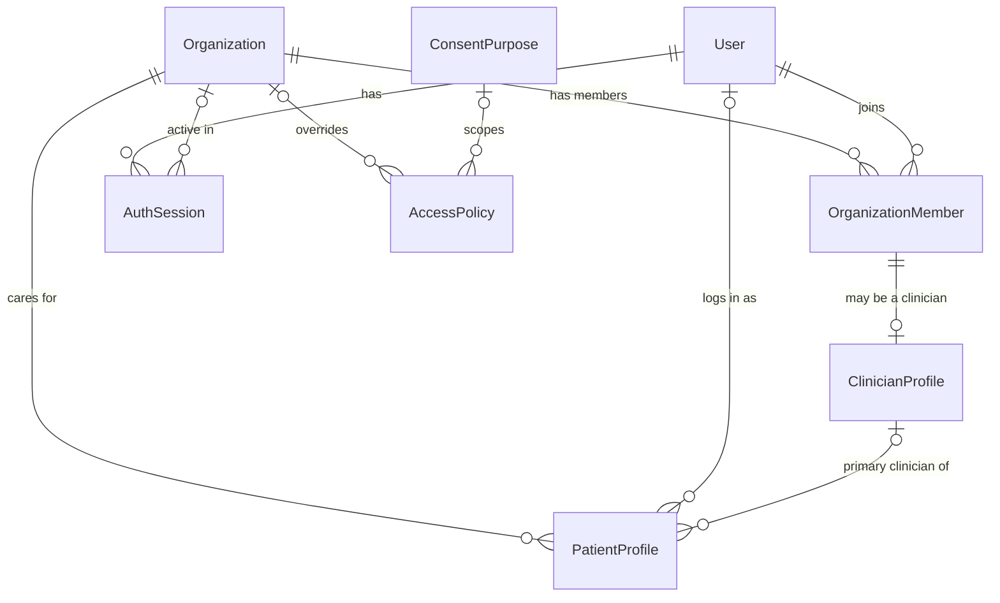
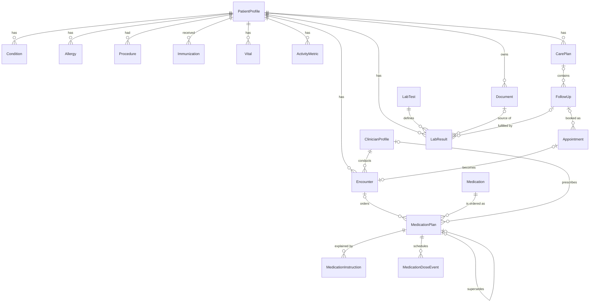
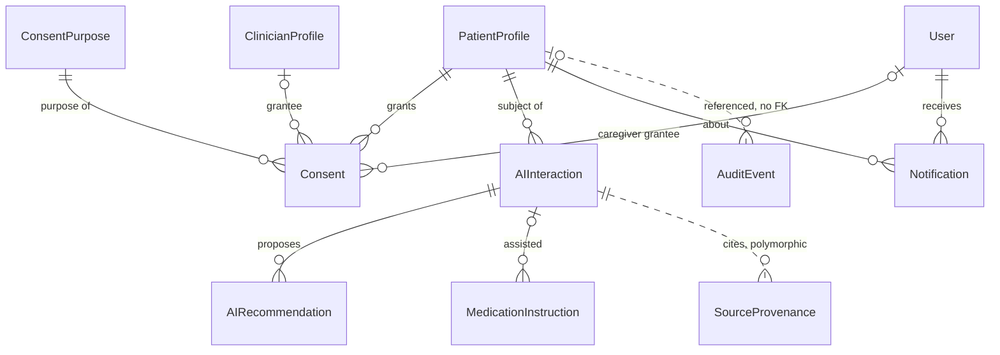

# HealthGuard — Data Model

> **Status:** technical design (Step 2). No application code yet.
> **Scope:** Phase 1 (investor/partner demo), with Phase 2+ hooks marked.
> **Data:** synthetic only. This design is integration-ready, not production-compliant or ABDM-certified.
>
> Related: [PRD](PRD.md) · [Architecture](ARCHITECTURE.md) · [Security](SECURITY.md) · [AI agents](AI_AGENT_SPEC.md) · [FHIR mapping](FHIR_MAPPING.md) · [ABDM integration](ABDM_INTEGRATION.md) · [Roadmap](ROADMAP.md)

## 1. Design rules

1. **PostgreSQL 17 with Prisma ORM 7.10.x.** Pin Prisma 7: npm's `latest` tag for the `prisma` CLI currently points at an 8.0 release candidate. Prisma 7 uses the `prisma-client` generator with an explicit `output`, needs the `@prisma/adapter-pg` driver adapter, and reads the connection URL from the Prisma config file instead of `schema.prisma`.
2. **UUIDv7 primary keys** (`@default(uuid(7)) @db.Uuid`) on every table. They are safe to expose in URLs and time-ordered, so index inserts stay local.
3. **The tenant is the Organization.** Every tenant-scoped row carries `organizationId`. Patient-scoped rows point at the patient through the composite key `(organizationId, patientProfileId)`, and references between clinical rows use `(organizationId, <id>)` as well. The database itself therefore rejects a row in one clinic that points at another clinic's patient, encounter, plan or document.
4. **Clinical facts are never edited away.** A correction sets `recordStatus = ENTERED_IN_ERROR` on the old row and adds a successor that names it in `supersedesId`. A signed medication plan is immutable; a change is a new version.
5. **Every clinical row says where it came from:** `recordSource`, `sourceSystem`, `sourceRef`, `verification` and `recordedByUserId`. Derived items (AI claims, extracted values, rendered instructions) link to their sources through `SourceProvenance`.
6. **Four kinds of content are kept apart** (section 7): recorded facts, deterministic calculations, AI summaries and AI recommendations.
7. **Time:** every instant is `timestamptz(3)` in UTC; clinical calendar dates use `date`. Each patient has a time zone and a daily routine (meal and sleep times) from which dose times are computed.
8. **Languages are data, not schema.** Locales are BCP 47 strings (`en-IN`, `hi-IN`, `te-IN`), so adding a language needs no migration.
9. **Reference data is global.** `Medication`, `LabTest` and `ConsentPurpose` have no `organizationId`. `AccessPolicy` rows are either platform defaults (`organizationId` null) or one organization's overrides.

The full schema (32 models, 66 enums) is in [Appendix A](#appendix-a--full-prisma-schema). It passes `prisma validate` with Prisma CLI 7.10.0. In Step 3 it becomes `apps/api/prisma/schema.prisma`.

## 2. Entities at a glance

| Entity | Module | Scope | What it holds |
|---|---|---|---|
| `User` | auth | Global | Login identity for staff, patients and (Phase 2) caregivers |
| `AuthSession` | auth | Global | Refresh-token session and the active organization |
| `Organization` | organizations | Tenant root | A clinic or hospital |
| `OrganizationMember` | organizations | Tenant | A user's roles and status in one organization |
| `ClinicianProfile` | clinicians | Tenant | Professional details of a doctor or nurse member |
| `PatientProfile` | patients | Tenant | A patient within one organization's care context |
| `Medication` | medications | Global reference | Drug catalogue entry: generic name, strength, form |
| `LabTest` | labs | Global reference | Test definition with LOINC code, unit and reference range |
| `ConsentPurpose` | consent | Global reference | Why data may be used: consultation, AI assistance and so on |
| `Encounter` | encounters | Patient | A consultation or visit |
| `Condition` | records | Patient | Diagnosis or problem-list entry |
| `Allergy` | records | Patient | Allergy or intolerance |
| `Procedure` | records | Patient | Surgery or procedure |
| `Immunization` | records | Patient | Vaccination |
| `MedicationPlan` | medications | Patient | Doctor-authored medication order, or a medicine the patient reports |
| `MedicationInstruction` | medications | Patient | Patient-facing instruction for one plan in one language |
| `MedicationDoseEvent` | adherence | Patient | One scheduled dose and the patient's response |
| `LabResult` | labs | Patient | One lab value with its reference range and interpretation |
| `Vital` | activity | Patient | Blood pressure, weight, heart rate, glucose and similar |
| `ActivityMetric` | activity | Patient | Daily steps, sleep and active minutes |
| `Document` | files | Patient | Metadata of an uploaded report; the bytes live in object storage |
| `CarePlan` | follow-ups | Patient | Clinician-authored plan and goals |
| `FollowUp` | follow-ups | Patient | A repeat test, visit, call-back or review that is due |
| `Appointment` | appointments | Patient | Proposed, patient-approved and confirmed slots |
| `Consent` | consent | Patient | The patient's purpose-bound grant of access |
| `AccessPolicy` | consent | Global or tenant | Which role may do what to which data category, for which purpose |
| `AuditEvent` | audit | Tenant (nullable) | Append-only record of every access and change |
| `Notification` | notifications | Tenant | A message queued for or sent to a user |
| `AIInteraction` | ai | Patient | One model call or fallback, with inputs, output and check results |
| `AIRecommendation` | ai | Patient | A proposal for a clinician to accept or dismiss |
| `SourceProvenance` | ai | Tenant | Link from a derived item to the facts it rests on |
| `SystemSetting` | demo | Global | Key-value settings such as the demo clock |

Three entities go beyond the minimum list because the core journey needs them: `AuthSession` (OIDC-ready sessions), `MedicationInstruction` (versioned multilingual instructions) and `SystemSetting` (the demo clock).

## 3. Relationships

### 3.1 Identity and tenancy



A person treated at two clinics has two `PatientProfile` rows, one per organization, both linked to the same `User` when the patient logs in. Staff never see across organizations; the patient sees all of their own profiles.

### 3.2 Clinical record and medication



### 3.3 Consent, audit and AI



Dotted lines are logical links without a foreign key: `SourceProvenance` points at many entity types, and `AuditEvent` must outlive whatever it describes.

## 4. Entities by domain

Fields listed are the ones that matter for behaviour; the appendix has every column.

### 4.1 Identity and tenancy

**User** — global login identity.
- Fields: `email`, `phone` (E.164), `displayName`, `preferredLocale`, `status`, `platformRole`, `passwordHash` (local demo auth only, argon2id), `oidcIssuer` + `oidcSubject` (SSO from Phase 2), `mfaEnabled`.
- Constraints: unique `email`, unique `phone`, unique `(oidcIssuer, oidcSubject)`.
- Lifecycle: `INVITED → ACTIVE → DISABLED`; soft delete through `deletedAt`, because audit events reference users.
- A user holds no clinical data. Roles live on `OrganizationMember`; a patient record lives on `PatientProfile`.

**AuthSession** — one refresh-token session.
- Fields: `refreshTokenHash` (unique; the raw token is never stored), `expiresAt`, `revokedAt`, `activeOrganizationId`, hashed user agent and IP.
- Rotated on every refresh; reuse of a rotated token revokes the whole session. Hard-deleted 30 days after expiry.

**Organization** — the tenant.
- Fields: `slug` (unique), `type` (`CLINIC`, `HOSPITAL`), `status`, `isDemo`, `timezone`, `settings` (enabled locales, reminder grace minutes, escalation rules, AI budget), `hfrId` (ABDM Health Facility Registry ID, Phase 3).
- Soft delete; a suspended organization's members cannot sign in to it.

**OrganizationMember** — a user's place in one organization.
- Fields: `roles` (`ORG_ADMIN`, `DOCTOR`, `NURSE`, `CARE_COORDINATOR`, `FRONT_DESK`, `AUDITOR`; a member may hold several), `status` (`INVITED → ACTIVE ⇄ SUSPENDED → REMOVED`), `joinedAt`.
- Constraints: unique `(organizationId, userId)`; unique `(organizationId, id)` so tenant-scoped rows can reference a member by composite key.
- Never hard-deleted; removal is a status.

**ClinicianProfile** — professional details for a doctor or nurse member.
- Fields: `displayName`, `specialty`, `registrationNumber`, `registrationCouncil`, `hprId` (ABDM Healthcare Professionals Registry, Phase 3), `isPrescriber`.
- One per member: unique `(organizationId, memberId)`. Only members with `isPrescriber = true` and the `DOCTOR` role can sign a medication plan.

**PatientProfile** — a patient inside one organization's care context.
- Fields: `mrn`, `givenName`, `familyName`, `dateOfBirth`, `sex`, `phone`, `preferredLocale`, `timezone`, `dailyRoutine` (JSON such as `{"wake":"06:30","breakfast":"08:00","lunch":"13:30","dinner":"20:30","sleep":"22:30"}`), `primaryClinicianId`, `abhaNumber` / `abhaAddress` / `abhaVerifiedAt` (written only by a verification through ABDM: sandbox test identities in the separate Phase 2 sandbox environment, real identities from Phase 3; always empty in the demo), `status`, `isSynthetic`.
- Constraints: unique `(organizationId, mrn)`, unique `(organizationId, abhaAddress)`, unique `(organizationId, id)`.
- Identifiers (name, date of birth, phone, ABHA) are confidential: they are never sent to a model, and in production they are field-encrypted.
- Soft delete. `isSynthetic = true` on every demo patient; a demo organization rejects patients without it.

### 4.2 Reference data

**Medication** — global drug catalogue.
- Fields: `genericName`, `strengthValue` + `strengthUnit`, `form`, `defaultRoute`, `brandNames[]`, `allergenClasses[]` (for example `PENICILLIN`, used by the deterministic allergy cross-check), `snomedCode`, `atcCode`.
- Constraint: unique `(genericName, strengthValue, strengthUnit, form)`. Retired entries set `isActive = false`.

**LabTest** — global test definitions.
- Fields: `code` (unique, e.g. `HBA1C`), `loincCode` (unique, e.g. `4548-4`), `name`, `unit` (UCUM), `referenceLow`, `referenceHigh`, `referenceText`, `category`.

**ConsentPurpose** — the purposes a patient can consent to.
- Fields: `code` (unique), `defaultCategories[]`, `defaultDurationDays`, `abdmPurposeCode`, `requiresPatientAction`.

| Code | Default categories | Default duration | ABDM purpose |
|---|---|---|---|
| `CONSULTATION` | all clinical categories | 365 days | `CAREMGT` |
| `MEDICATION_MANAGEMENT` | medications, adherence, allergies, conditions, history | 365 days | `CAREMGT` |
| `LAB_REVIEW` | labs, documents | 365 days | `CAREMGT` |
| `AI_ASSISTANCE` | none (a processing purpose, not a data category) | 365 days | none |
| `CAREGIVING` (Phase 2) | medications, adherence, appointments | 180 days | none |
| `EMERGENCY_ACCESS` | all clinical categories | 60 minutes (organization setting) | `BTG` |

Data categories (`DataCategory`), used by consents and access policies: `DEMOGRAPHICS`, `ENCOUNTERS`, `CONDITIONS`, `ALLERGIES`, `HISTORY` (procedures and immunizations), `MEDICATIONS`, `ADHERENCE`, `LABS`, `VITALS`, `ACTIVITY`, `DOCUMENTS`, `CARE_PLAN`, `APPOINTMENTS`. "All clinical categories" means every category except `DEMOGRAPHICS`, which the patient's organization processes for registration, identification and scheduling without a separate consent; role checks and audit still apply ([Security §4.2](SECURITY.md#42-default-access-policy)). The mapping to ABDM health-information types is in [ABDM integration §4](ABDM_INTEGRATION.md#4-consent-boundary). Phase 3 adds reference purposes for ABDM purpose codes that have no internal equivalent, such as `PATRQT`.

### 4.3 Clinical record

All entities in this section carry the provenance columns from section 6.5 and are corrected, never deleted.

**Encounter** — a consultation or visit.
- Fields: `type` (`OUTPATIENT`, `TELECONSULT`, `FOLLOW_UP`, `INPATIENT`), `status` (`PLANNED → IN_PROGRESS → COMPLETED`, or `CANCELLED`), `reasonForVisit`, `clinicalNotes` (restricted; sent to a model only when a task needs it), `startedAt`, `endedAt`, `appointmentId`.
- Constraints: unique `(organizationId, appointmentId)` (one encounter per appointment). Index `(organizationId, patientProfileId, startedAt desc)` finds the previous visit for "What changed since last visit?".

**Condition** — `display`, `codeSystem` + `code` (ICD-10 or SNOMED CT), `clinicalStatus` (`ACTIVE`, `INACTIVE`, `RESOLVED`), `clinicalVerification` (`UNCONFIRMED`, `PROVISIONAL`, `CONFIRMED`, `REFUTED`), `onsetDate`, `abatementDate`. Index `(organizationId, patientProfileId, clinicalStatus)`.

**Allergy** — `substance`, `allergenClass`, `type` (`ALLERGY` or `INTOLERANCE`), `category`, `criticality`, `reaction`, `severity`, `clinicalStatus`, `clinicalVerification`. The allergy cross-check compares a plan's `Medication.allergenClasses` with the patient's active allergies; it warns the prescriber and never blocks or changes the order by itself.

**Procedure** — `display`, `code`, `status` (`COMPLETED`, `NOT_DONE`), `performedOn`, `performerText`, `facilityText`, `outcome`.

**Immunization** — `vaccineName`, `vaccineCode`, `status`, `occurredOn`, `doseNumber`, `lotNumber`.

### 4.4 Medications and adherence

**MedicationPlan** — the doctor-authored order, and the single source of truth for every dose time and every patient instruction.
- Dose fields: `medicationId`, `doseQuantity`, `doseUnit`, `route`.
- Timing fields mirror FHIR `Timing.repeat`: `frequency`, `period`, `periodUnit`, `timingEvents[]` (EventTiming codes such as `PCM`, after breakfast), `timingOffsetMinutes`, `timesOfDay[]` for exact clock times, `asNeeded`.
- Course fields: `durationDays`, `startDate`, `endDate`, `indication`, `specialInstructions` (the doctor's free text and the only input the AI may rephrase).
- Lifecycle: `DRAFT → ACTIVE` when signed (`signedAt`, `prescriberId`), then `COMPLETED`, `STOPPED` (clinician only, with `stopReason`), `ON_HOLD` or `SUPERSEDED`. A dose or timing change creates a new row with `version + 1` and `supersedesId`; the old row becomes `SUPERSEDED` and its future dose events are cancelled.
- A medicine the patient reports taking from elsewhere is a plan with `recordSource = PATIENT_REPORTED` and no prescriber; it maps to FHIR `MedicationStatement`.
- Constraints: unique `(organizationId, id)` and `(organizationId, patientProfileId, id)`; the second lets dose events prove they belong to the same patient as their plan. A database trigger rejects changes to the clinical fields of any non-draft plan (section 6.8).

Example, Ananya's new plan: Metformin 500 mg, `doseQuantity = 1`, `doseUnit = TABLET`, `route = ORAL`, `frequency = 1`, `period = 1`, `periodUnit = DAY`, `timingEvents = [PCM]`, `timingOffsetMinutes = 15`, `durationDays = 90`.

**MedicationInstruction** — what the patient reads and hears for one plan in one language.
- Fields: `locale`, `revision`, `doseText` (rendered from a reviewed per-language template), `notesText` (plain-language version of `specialInstructions`), `method` (`TEMPLATE_ONLY`, `TEMPLATE_PLUS_AI`, `HUMAN_TRANSLATED`), `templateKey` (e.g. `oral-solid.after-meal@2`), `aiInteractionId`, `validationStatus`, `validationReport`, `status` (`DRAFT → APPROVED`, or `REJECTED`; later `SUPERSEDED`), `approvedByUserId`, `audioObjectKey`.
- Constraints: unique `(medicationPlanId, locale, revision)`; a partial unique index allows only one `APPROVED` instruction per plan and locale.
- Release rule: a `TEMPLATE_ONLY` instruction that passes validation is approved automatically; one with AI-assisted notes also needs the prescriber's one-tap approval.

**MedicationDoseEvent** — one scheduled dose and what happened to it.
- Fields: `scheduledAt` (UTC), `localDate`, `slotLabel` (e.g. `PCM+15`), `status`, `remindAt` (moves forward on snooze), `reminderCount`, `respondedAt`, `responseChannel`, `respondedByUserId`, `skipReason`, `missedInferred` (true when the grace window passed with no answer), `idempotencyKey`.
- Lifecycle: `SCHEDULED → REMINDED → (SNOOZED → REMINDED)* → TAKEN | SKIPPED | MISSED`; future doses become `CANCELLED` when the plan stops or is superseded. The full workflow is drawn in [Architecture section 8](ARCHITECTURE.md#8-async-and-job-architecture).
- Constraints: unique `(medicationPlanId, scheduledAt)` makes schedule generation idempotent; unique `idempotencyKey` makes a double tap harmless; index `(status, remindAt)` serves the reminder dispatcher. The plan foreign key is `(organizationId, patientProfileId, medicationPlanId)`, so a dose can never be attached to another patient's plan.
- "Need help" is not a dose status: it creates a `FollowUp` of type `CALLBACK` for the clinic.

### 4.5 Labs, vitals, activity and documents

**LabResult** — `valueNumeric` or `valueText`, `unit`, `referenceLow` / `referenceHigh` (copied from the lab report at filing time), `interpretation` (computed deterministically: `LOW`, `NORMAL`, `HIGH`, `CRITICAL_LOW`, `CRITICAL_HIGH`), `effectiveAt` (sample time), `issuedAt`, `status` (`PRELIMINARY`, `FINAL`, `AMENDED`), `performingLab`, `extractionConfidence` (only for values read from a document), links to `labTest`, `encounter`, `document` and the `followUp` it fulfils.
- Index `(organizationId, patientProfileId, labTestId, effectiveAt desc)` serves before/after comparison.
- A value read from a document by the Record Ingestion Agent is only a draft inside `AIInteraction.output`. It becomes a `LabResult` when the patient or a clinician confirms it, with `recordSource = DOCUMENT_EXTRACTION`, `verification = PATIENT_CONFIRMED` or `CLINICIAN_VERIFIED`, `extractionConfidence` set, and a `SourceProvenance` row pointing at the document page. The AI never writes the row itself.

**Vital** — `type` (`BLOOD_PRESSURE`, `HEART_RATE`, `BODY_WEIGHT`, `BODY_HEIGHT`, `BLOOD_GLUCOSE`, `OXYGEN_SATURATION`, `BODY_TEMPERATURE`), `value` (systolic for blood pressure), `value2` (diastolic), `unit` (UCUM), `measuredAt`, `context` (e.g. fasting). Index `(organizationId, patientProfileId, type, measuredAt desc)`.

**ActivityMetric** — one daily aggregate: `type` (`STEPS`, `SLEEP_DURATION`, `ACTIVE_MINUTES`, `RESTING_HEART_RATE`, `WORKOUT_MINUTES`), `date` (patient-local day), `value`, `unit`, `sourceSystem` (e.g. `synthetic-generator`, later `apple-health`, `health-connect`). Unique `(patientProfileId, type, date, sourceSystem)` makes device imports idempotent.

**Document** — metadata only: `type`, `title`, `documentDate`, `objectKey` (unique; never a public URL), `mimeType`, `sizeBytes`, `sha256`, `status` (`UPLOADED → SCANNING → CLEAN | QUARANTINED → EXTRACTING → EXTRACTED → VERIFIED`, or `FAILED`), `scanResult`, `isSyntheticSample`. Soft delete; the object is removed by the retention job.

### 4.6 Care plans, follow-ups and appointments

**CarePlan** — clinician-authored: `authorId`, `title`, `goals` (JSON list written by the clinician), `status` (`DRAFT`, `ACTIVE`, `COMPLETED`, `REVOKED`), `startDate`, `endDate`.

**FollowUp** — something that falls due.
- Fields: `type` (`VISIT`, `REPEAT_TEST`, `CALLBACK`, `REVIEW`), `origin` (`CLINICIAN`, `RULE`, `PATIENT_REQUEST`), `reason`, `dueDate`, `windowStart`, `windowEnd`, `labTestId` (for repeat tests), `assignedMemberId` (for call-backs), `status` (`PLANNED → DUE → PROPOSED → SCHEDULED → COMPLETED`, or `CANCELLED` / `OVERDUE`).
- There is no `AI` origin: the AI can only propose a follow-up discussion as an `AIRecommendation`; a clinician or a clinician-configured rule creates the follow-up.

**Appointment**
- Fields: `clinicianId`, `followUpId`, `mode`, `status`, `startAt`, `endAt`, `proposedAt`, `patientApprovedAt`, `patientApprovedByUserId`, `confirmedAt`, `confirmedByUserId`, `cancelledAt`, `cancellationReason`.
- Lifecycle: `PROPOSED → PATIENT_APPROVED → CONFIRMED → COMPLETED`, or `CANCELLED` / `NO_SHOW`. A check constraint makes `CONFIRMED` and `COMPLETED` impossible without `patientApprovedAt`, so no code path, AI or otherwise, can book without the patient's approval.

### 4.7 Consent, access policy and audit

**Consent** — the patient's purpose-bound grant.
- Fields: `purposeId`, `granteeType` (`ORGANIZATION`, `CLINICIAN`, `USER` for a caregiver), `granteeClinicianId`, `granteeUserId`, `categories[]`, `dataFrom` / `dataTo` (which records are covered), `validFrom` / `validUntil` (when access is allowed), `status`, `method` (`IN_APP`, `CLINIC_ASSISTED`, `PAPER`, `DEMO_SEED`, `ABDM`, `BREAK_GLASS`), `requestedByUserId`, `decidedAt`, `revokedAt`, `revokedReason`, `justificationCode` (break-glass only), `noticeVersion` and `noticeLocale` (the exact notice the patient saw), `externalRef` (ABDM consent artefact ID, Phase 3).
- Lifecycle: `REQUESTED → GRANTED | DENIED`; `GRANTED → REVOKED | EXPIRED`. Rows are never deleted. Revocation takes effect on the next request.
- A `BREAK_GLASS` row is created by the system, not the patient: it lasts 60 minutes, notifies the patient and is always reviewed (Phase 2).
- Index `(organizationId, patientProfileId, status, validUntil)` serves the access decision.

**AccessPolicy** — role-based rules the access decision combines with consent.
- Fields: `organizationId` (null for a platform default), `role`, `category`, `actions[]` (`READ`, `CREATE`, `UPDATE`, `SIGN`, `EXPORT`), `purposeId` (null means any consented purpose), `requiresCareRelationship`, `effect` (`ALLOW`, `DENY`), `priority`.
- Organization rules override platform defaults, and `DENY` wins over `ALLOW`. The default matrix is in [Security section 4](SECURITY.md#4-authorization-rbac-and-consent-aware-access).

**AuditEvent** — append-only and deliberately without foreign keys.
- Fields: `occurredAt`, `actorType` (`USER`, `SERVICE`, `AI_AGENT`, `SYSTEM`), `actorUserId`, `actorRoles[]`, `onBehalfOfUserId` (the human an AI agent acted for), `aiAgent`, `patientProfileId`, `action`, `resourceType`, `resourceId`, `purposeCode`, `consentId`, `decision` (`ALLOW`, `DENY`, `NOT_APPLICABLE`), `decisionReason` (a code such as `NO_ACTIVE_CONSENT`), `outcome`, `requestId`, `ipHash`, `userAgentHash`, `metadata` (never clinical values or identifiers), `contentHash`.
- Indexes on `(organizationId, occurredAt desc)`, `(patientProfileId, occurredAt desc)` and `(actorUserId, occurredAt desc)`. The second one powers the patient's "who saw my data" screen.

### 4.8 Notifications, AI and system

**Notification** — `recipientUserId`, `patientProfileId`, `channel` (`IN_APP` and `SIMULATED_PHONE` in the demo; `SMS`, `WHATSAPP`, `PUSH`, `VOICE`, `EMAIL` later), `templateKey`, `locale`, `params` (IDs only; external channels never carry clinical values), `status` (`QUEUED → SENT → DELIVERED → READ`, or `FAILED` / `CANCELLED`), `dedupeKey` (unique, so a reminder is sent at most once), `scheduledFor`.

**AIInteraction** — one model call or deterministic fallback.
- Who and why: `actorUserId` (the human the agent acted for), `agent`, `task`, `purposeCode`, `consentIds[]`.
- What ran: `provider` (`ANTHROPIC`, `DEMO`), `model`, `promptKey`, `promptVersion`, `promptHash`.
- What went in and out: `inputFactIds[]`, `inputHash`, `output` (the validated JSON), `validation` (each check's result), `status`, `fallbackReason`.
- Cost and speed: `latencyMs`, `inputTokens`, `outputTokens`, `costMicroUsd`, `cached`.
- Immutable once completed. `output` is restricted health data: it is shown only through the same access rules as the facts it summarises, and never written to logs.

**AIRecommendation** — `type` (`DISCUSSION_POINT`, `QUESTION_FOR_CLINICIAN`, `FOLLOW_UP_DISCUSSION`, `DATA_QUALITY_FLAG`), `audience`, `text`, `rationale`, `confidence` (`LOW`, `MEDIUM`, `HIGH`), `status` (`PROPOSED → ACCEPTED | DISMISSED | EXPIRED`), `reviewedByUserId`, `reviewedAt`, `reviewNote`, `expiresAt`. Accepting a recommendation records the clinician's decision; it never creates an order, a follow-up or a booking by itself.

**SourceProvenance** — `subjectType` (`AI_CLAIM`, `AI_RECOMMENDATION`, `EXTRACTED_VALUE`, `MEDICATION_INSTRUCTION`), `subjectId`, `claimKey` (e.g. `summary[2]`), `relationType` (`SUPPORTED_BY`, `EXTRACTED_FROM`, `DERIVED_FROM`), `sourceType`, `sourceId`, `sourceLocator` (a page and field for documents, or the inputs of a calculation). Indexed both ways so the UI can answer "where did this come from?" and "what was derived from this fact?".

**SystemSetting** — key-value JSON, e.g. `demo.clock` = `{"anchorDay0": "2026-07-08", "offsetDays": 92}`. Never holds patient data.

## 5. Status fields and who may change them

| Entity | Field | Values | Changed by |
|---|---|---|---|
| `MedicationPlan` | `status` | DRAFT, ACTIVE, ON_HOLD, COMPLETED, STOPPED, SUPERSEDED, ENTERED_IN_ERROR | Prescribing clinician; `COMPLETED` by the end-date job |
| `MedicationInstruction` | `status`, `validationStatus` | DRAFT, APPROVED, REJECTED, SUPERSEDED · PENDING, PASSED, FAILED | Validators; prescriber approval for AI-assisted notes |
| `MedicationDoseEvent` | `status` | SCHEDULED, REMINDED, SNOOZED, TAKEN, SKIPPED, MISSED, CANCELLED | Patient (or clinic on the patient's behalf); reminder and grace-window jobs |
| `Encounter` | `status` | PLANNED, IN_PROGRESS, COMPLETED, CANCELLED | Clinician, front desk |
| `LabResult` | `status`, `verification` | PRELIMINARY, FINAL, AMENDED · UNVERIFIED, PATIENT_CONFIRMED, CLINICIAN_VERIFIED | Lab feed or clinician; patient confirms extracted values |
| `Document` | `status` | UPLOADED … VERIFIED, QUARANTINED, FAILED | Scan and extraction jobs; confirming user |
| `FollowUp` | `status` | PLANNED, DUE, PROPOSED, SCHEDULED, COMPLETED, CANCELLED, OVERDUE | Clinician; due-date job; booking flow |
| `Appointment` | `status` | PROPOSED, PATIENT_APPROVED, CONFIRMED, CANCELLED, COMPLETED, NO_SHOW | System proposes; patient approves; clinic confirms |
| `Consent` | `status` | REQUESTED, GRANTED, DENIED, REVOKED, EXPIRED | Patient; expiry job; system for break-glass |
| `AIInteraction` | `status` | PENDING, SUCCEEDED, FALLBACK_USED, VALIDATION_FAILED, BLOCKED_BY_CONSENT, BLOCKED_BY_SAFETY, PROVIDER_ERROR | AI orchestrator only |
| `AIRecommendation` | `status` | PROPOSED, ACCEPTED, DISMISSED, EXPIRED | Clinician; expiry job |
| `Notification` | `status` | QUEUED, SENT, DELIVERED, READ, FAILED, CANCELLED | Notification worker; recipient |
| `OrganizationMember` | `status` | INVITED, ACTIVE, SUSPENDED, REMOVED | Organization admin |

Every status change writes an `AuditEvent` with action `STATUS_CHANGE` (or a more specific action such as `SIGN` or `CONSENT_REVOKE`).

## 6. Conventions

### 6.1 Keys and identifiers
- Primary keys: UUIDv7, generated by Prisma. External identifiers (MRN, ABHA, lab accession numbers) are ordinary columns, never primary keys.
- API responses use the UUIDs; MRNs are shown only to staff.

### 6.2 Tenant scoping

Every staff request runs with an active organization. A Prisma client extension adds `organizationId` to every query on a tenant-scoped model and fails closed when it is missing ([Architecture section 6](ARCHITECTURE.md#6-multi-tenant-architecture)). The composite foreign keys add a second guarantee in the database:

```prisma
model LabResult {
  organizationId   String @db.Uuid
  patientProfileId String @db.Uuid
  encounterId      String? @db.Uuid
  patient   PatientProfile @relation(fields: [organizationId, patientProfileId], references: [organizationId, id])
  encounter Encounter?     @relation(fields: [organizationId, encounterId], references: [organizationId, id])
}
```

A lab result can only point at a patient and an encounter in its own organization. PostgreSQL row-level security is the third layer, added in Phase 2 ([Security section 3](SECURITY.md#3-multi-tenancy-and-organization-isolation)).

### 6.3 Timestamps and time zones
- `createdAt` and `updatedAt` on every mutable table; domain timestamps (`effectiveAt`, `measuredAt`, `scheduledAt`, `signedAt`, `decidedAt`) say when the thing happened, not when it was stored.
- Instants are `timestamptz(3)`; calendar facts (onset, date of birth, follow-up due date, activity day) are `date`.
- Dose times are computed in the patient's `timezone` from `dailyRoutine`: after-breakfast with a 15-minute offset is 08:15 for a patient who eats at 08:00.
- All reads of "now" go through the Clock service, so the demo clock can move without touching the data.

### 6.4 Deletion strategy

| Strategy | Entities | Why |
|---|---|---|
| Soft delete (`deletedAt`) | `User`, `Organization`, `OrganizationMember`, `ClinicianProfile`, `PatientProfile`, `Document` | Audit events and clinical rows keep referring to them |
| Correct, never delete (`recordStatus`, `supersedesId`) | `Encounter`, `Condition`, `Allergy`, `Procedure`, `Immunization`, `LabResult`, `Vital`, `ActivityMetric` | The record must show what was believed and when |
| New version per change | `MedicationPlan` (`version`, `supersedesId`), `MedicationInstruction` (`revision`) | Dose history must be reconstructable |
| Status only, never deleted | `Consent`, `Appointment`, `FollowUp`, `CarePlan`, `MedicationDoseEvent`, `AIRecommendation` | Their history is evidence |
| Append-only | `AuditEvent`, `SourceProvenance`, `AIInteraction` (after completion) | Tamper evidence and explainability |
| Hard delete by housekeeping job | `AuthSession` (30 days after expiry), `Notification` (after 180 days) | No lasting value |
| Deactivate (`isActive`) | `Medication`, `LabTest`, `ConsentPurpose`, `AccessPolicy` | Old rows still explain old records |

A patient's erasure request in production becomes a soft delete plus a scheduled purge wherever no legal retention duty applies; the exact rules for clinical records need legal review before Phase 2.

### 6.5 Provenance

Inline columns on every clinical row:

| Column | Meaning | Example |
|---|---|---|
| `recordSource` | How the fact entered HealthGuard | `CLINICIAN_ENTERED`, `PATIENT_REPORTED`, `DEVICE`, `LAB_FEED`, `DOCUMENT_EXTRACTION`, `INTEROP_IMPORT`, `SYNTHETIC_SEED` |
| `sourceSystem` | Which system or device | `demo-seed`, `synthetic-generator`, `health-connect` |
| `sourceRef` | Identifier in that system | a lab accession number |
| `verification` | Who has confirmed it | `UNVERIFIED`, `PATIENT_CONFIRMED`, `CLINICIAN_VERIFIED` |
| `recordedByUserId` | Who entered or confirmed it | a user ID (no foreign key; the audit event is authoritative) |

`SourceProvenance` links derived items to facts. For each AI claim, the orchestrator writes one row per cited fact; for an extracted lab value, one row pointing at the document page; for a calculated value shown in a brief, one row of type `CALCULATION` whose locator records the inputs (metric, window start, window end).

### 6.6 Audit requirements

| Event | Action | Written by |
|---|---|---|
| Any read of patient data by staff, a caregiver or an AI agent | `READ` (one per request, with resource type and patient) | Audit interceptor |
| A denied read or write | `ACCESS_DENIED` with `decisionReason` | Access service |
| Create, update or status change of a clinical row | `CREATE`, `UPDATE`, `STATUS_CHANGE` | Module services |
| Signing a medication plan | `SIGN` | Medications module |
| Consent requested, granted, denied, revoked | `CONSENT_REQUEST`, `CONSENT_GRANT`, `CONSENT_DENY`, `CONSENT_REVOKE` | Consent module |
| Break-glass access | `BREAK_GLASS` | Consent module |
| A model call or fallback | `AI_INVOKE` (`actorType = AI_AGENT`, `onBehalfOfUserId` set) | AI orchestrator |
| AI output shown to a person | `AI_OUTPUT_RELEASED` | AI module |
| A clinician accepting or dismissing a recommendation | `AI_RECOMMENDATION_REVIEWED` | AI module |
| A FHIR export | `EXPORT` | Interoperability module |
| Sign-in, sign-out, failed sign-in, organization switch | `LOGIN`, `LOGOUT`, `LOGIN_FAILED`, `ORG_SWITCH` | Auth module |
| Demo persona switch, clock change, reset | `DEMO_PERSONA_SWITCH`, `DEMO_CLOCK_CHANGE`, `DEMO_RESET` | Demo module |

The audit row is written in the same transaction as the change it describes. For reads, it is written before the response is sent; if it cannot be written, the request fails.

### 6.7 Indexes and uniqueness

| Table | Index or constraint | Serves |
|---|---|---|
| `PatientProfile` | unique `(organizationId, mrn)` | MRN lookup inside a clinic |
| `OrganizationMember` | unique `(organizationId, userId)` | One membership per user per organization |
| `Encounter` | `(organizationId, patientProfileId, startedAt desc)` | Previous visit for "What changed?" |
| `LabResult` | `(organizationId, patientProfileId, labTestId, effectiveAt desc)` | Before/after per test |
| `Vital` | `(organizationId, patientProfileId, type, measuredAt desc)` | Latest weight, blood-pressure series |
| `ActivityMetric` | unique `(patientProfileId, type, date, sourceSystem)` | Idempotent imports |
| `MedicationDoseEvent` | unique `(medicationPlanId, scheduledAt)` | Idempotent schedule generation |
| `MedicationDoseEvent` | `(status, remindAt)` | Reminder dispatcher scan |
| `MedicationInstruction` | partial unique `(medicationPlanId, locale)` where `status = 'APPROVED'` | One live instruction per language |
| `Consent` | `(organizationId, patientProfileId, status, validUntil)` | Access decision |
| `AuditEvent` | `(patientProfileId, occurredAt desc)` | Patient's access log |
| `Notification` | unique `dedupeKey` | At-most-once reminders |
| `AIInteraction` | `(organizationId, patientProfileId, createdAt desc)` | AI transparency panel |
| `FollowUp` | `(organizationId, status, dueDate)` | Daily due-date evaluation |

The partial index uses Prisma's `partialIndexes` preview feature. If that preview is removed, the same index moves to a hand-written SQL migration.

### 6.8 Rules enforced in SQL migrations

Prisma does not model triggers or check constraints; these live in SQL migrations created with `prisma migrate dev --create-only`.

Audit events are append-only. The application's database role also gets only `SELECT, INSERT` on this table.

```sql
CREATE FUNCTION forbid_audit_mutation() RETURNS trigger LANGUAGE plpgsql AS $$
BEGIN
  RAISE EXCEPTION 'AuditEvent is append-only';
END $$;

CREATE TRIGGER audit_event_append_only
  BEFORE UPDATE OR DELETE ON "AuditEvent"
  FOR EACH ROW EXECUTE FUNCTION forbid_audit_mutation();
```

Signed medication plans are immutable:

```sql
CREATE FUNCTION protect_signed_plan() RETURNS trigger LANGUAGE plpgsql AS $$
BEGIN
  IF OLD.status <> 'DRAFT' AND (
       NEW."medicationId", NEW."doseQuantity", NEW."doseUnit", NEW.route,
       NEW.frequency, NEW.period, NEW."periodUnit", NEW."timingEvents",
       NEW."timingOffsetMinutes", NEW."timesOfDay", NEW."durationDays",
       NEW."startDate", NEW."specialInstructions"
     ) IS DISTINCT FROM (
       OLD."medicationId", OLD."doseQuantity", OLD."doseUnit", OLD.route,
       OLD.frequency, OLD.period, OLD."periodUnit", OLD."timingEvents",
       OLD."timingOffsetMinutes", OLD."timesOfDay", OLD."durationDays",
       OLD."startDate", OLD."specialInstructions"
     ) THEN
    RAISE EXCEPTION 'Signed medication plans are immutable; create a new version';
  END IF;
  RETURN NEW;
END $$;

CREATE TRIGGER medication_plan_immutable
  BEFORE UPDATE ON "MedicationPlan"
  FOR EACH ROW EXECUTE FUNCTION protect_signed_plan();
```

Check constraints:

```sql
-- No booking without the patient's approval
ALTER TABLE "Appointment" ADD CONSTRAINT appointment_requires_patient_approval
  CHECK (status NOT IN ('CONFIRMED', 'COMPLETED') OR "patientApprovedAt" IS NOT NULL);

-- A signed clinician order always names its prescriber
ALTER TABLE "MedicationPlan" ADD CONSTRAINT signed_order_has_prescriber
  CHECK (status = 'DRAFT' OR "recordSource" <> 'CLINICIAN_ENTERED'
         OR ("prescriberId" IS NOT NULL AND "signedAt" IS NOT NULL));

-- A grantee column matches the grantee type
ALTER TABLE "Consent" ADD CONSTRAINT consent_grantee_matches_type CHECK (
  ("granteeType" = 'ORGANIZATION' AND "granteeClinicianId" IS NULL AND "granteeUserId" IS NULL) OR
  ("granteeType" = 'CLINICIAN' AND "granteeClinicianId" IS NOT NULL AND "granteeUserId" IS NULL) OR
  ("granteeType" = 'USER' AND "granteeUserId" IS NOT NULL AND "granteeClinicianId" IS NULL));

-- A dose answered by the patient has an answer time
ALTER TABLE "MedicationDoseEvent" ADD CONSTRAINT dose_answer_has_time
  CHECK (status NOT IN ('TAKEN', 'SKIPPED') OR "respondedAt" IS NOT NULL);

-- A lab result has a value
ALTER TABLE "LabResult" ADD CONSTRAINT lab_result_has_value
  CHECK ("valueNumeric" IS NOT NULL OR "valueText" IS NOT NULL);
```

Phase 2 additions: an exclusion constraint against double-booking a clinician (`btree_gist`, `tstzrange("startAt", "endAt")` for approved and confirmed appointments) and row-level security policies on every tenant table.

### 6.9 Data classification

| Class | Examples | Handling |
|---|---|---|
| Restricted: health data | Clinical tables, documents, AI inputs and outputs, clinical notes | Consent-gated reads, every read audited, never logged, encrypted at rest |
| Confidential: identifiers | Names, date of birth, phone, email, ABHA number and address | Minimum necessary, masked in lists, never in prompts, field-encrypted in production |
| Internal | Organization settings, access policies, catalogues | Role-gated |

### 6.10 Retention

| Data | Demo | Pilot and production (proposed, needs legal review) |
|---|---|---|
| Clinical records and documents | Until the demo is reset | The hospital's record-retention rules; HealthGuard processes on its behalf |
| `AuditEvent` | Until reset | At least one year online (the DPDP Rules' minimum for logs), then archived per contract |
| `AIInteraction` | Until reset | One year online, then archived or purged per contract |
| `Notification` | 180 days | 180 days |
| `AuthSession` | 30 days after expiry | 30 days after expiry |

## 7. Four kinds of content

The hero screen mixes all four; the API labels each item with a `kind`, and the UI shows a matching badge.

| Kind | Where it lives | Example from the hero demo | Badge |
|---|---|---|---|
| `FACT` | Clinical tables | HbA1c 6.8% on day 85 (`LabResult`) | Recorded |
| `CALCULATED` | Computed on read by `packages/clinical`; never stored as truth | Average daily steps 5,200 → 7,100; adherence 92% | Calculated |
| `AI_SUMMARY` | `AIInteraction.output`, claims with source IDs | "HbA1c fell from 7.4% to 6.8% over the period in which Metformin was started." | AI summary · check sources |
| `AI_RECOMMENDATION` | `AIRecommendation` | "Two consecutive doses were missed around day 41; you may want to ask what happened." | AI suggestion · for clinician review |

## 8. Synthetic hero dataset

Day 0 is the previous visit; the demo's "today" is day 92. Every seeded timestamp is stored relative to an anchor date, so the scenario never looks stale. All people and values are fictional.

The seed restores two checkpoints: day 0 (history up to the consultation) and day 92 (every row below). The demo module's scenario engine produces the days in between by replaying a deterministic script, so jumping to day 6, 42, 85 or 88 always yields the same data.

| Data | Rows | Values |
|---|---|---|
| Organizations | 2 | HealthGuard Demo Clinic (clinic, Hyderabad); Lakeview Demo Hospital (exists only to prove tenant isolation) |
| Staff | 5 | Dr. Meera Sharma (doctor, prescriber, Ananya's primary clinician); Dr. Arjun Menon (doctor, not in Ananya's care); Ravi Kumar (care coordinator); a clinic admin; one Lakeview Demo Hospital doctor, used only for the tenant-isolation proof |
| Patients | 3 | Ananya Rao, 58, prefers Telugu, breakfast at 08:00; two patients with shorter histories |
| Conditions | 2 | Type 2 diabetes mellitus (ICD-10 E11, since 2021); essential hypertension (I10, since 2022) |
| Allergy | 1 | Penicillin, hives, confirmed |
| History | 3 | Laparoscopic cholecystectomy (2016); influenza vaccine (2025); COVID-19 vaccine (2021) |
| Medication plans | 2 | Telmisartan 40 mg, once daily in the morning, since 2022; Metformin 500 mg, 1 tablet once daily 15 minutes after breakfast, 90 days from day 0 |
| Instructions | 3 | Metformin in English, Hindi and Telugu, approved on day 0 |
| Dose events | 180 | 90 per plan for days 1–90: 83 taken, 5 missed (2 of them on days 41–42), 2 skipped, each, so 166 of 180 = 92% |
| Lab results | 2 | HbA1c 7.4% (day −2) and 6.8% (day 85) |
| Vitals | weekly | Weight 74.2 kg (day 0) and 72.9 kg (day 90); weekly home blood pressure |
| Activity | 182 days | Daily steps; 30-day average 5,200 before day 0 and 7,100 over days 62–91 |
| Encounters | 4 | 2021 diagnosis, 2022 review, day 0 consultation, day 92 visit |
| Follow-ups | 3 | Repeat HbA1c due day 85 (completed); visit due around day 90 (booked for day 92); call-back on day 6 (completed) |
| Appointment | 1 | Day 92, 10:30, with Dr. Meera; approved by Ananya on day 88; confirmed |
| Consents | 4 | `CONSULTATION`, `MEDICATION_MANAGEMENT`, `LAB_REVIEW` and `AI_ASSISTANCE`, granted to the clinic on day 0 for 365 days |
| Documents | 1 | Synthetic lab-report PDF for the day-85 HbA1c |

These rows produce the hero panel exactly: HbA1c 7.4 → 6.8 %, weight 74.2 → 72.9 kg, average daily steps 5,200 → 7,100, adherence 92%. The calculation rules are in [Architecture section 12](ARCHITECTURE.md#12-hero-demo-what-changed-since-last-visit).

## Appendix A — Full Prisma schema

<details>
<summary>schema.prisma — 32 models, 66 enums; validated with Prisma CLI 7.10.0</summary>

```prisma
// HealthGuard domain model: design reference for Phase 1
// Prisma ORM 7.10.x, PostgreSQL 17, UUIDv7 keys, timestamptz everywhere

generator client {
  provider        = "prisma-client"
  output          = "../src/generated/prisma"
  moduleFormat    = "esm"
  previewFeatures = ["partialIndexes"]
}

datasource db {
  provider = "postgresql"
  // Prisma 7: the connection URL lives in the Prisma config file, not here.
}

// ===================================================================
// Enums
// ===================================================================

enum UserStatus {
  INVITED
  ACTIVE
  DISABLED
}

enum PlatformRole {
  NONE
  PLATFORM_ADMIN
}

enum OrganizationType {
  CLINIC
  HOSPITAL
}

enum OrganizationStatus {
  ACTIVE
  SUSPENDED
}

enum MemberRole {
  ORG_ADMIN
  DOCTOR
  NURSE
  CARE_COORDINATOR
  FRONT_DESK
  AUDITOR
}

enum MemberStatus {
  INVITED
  ACTIVE
  SUSPENDED
  REMOVED
}

enum PatientStatus {
  ACTIVE
  INACTIVE
  DECEASED
}

enum Sex {
  FEMALE
  MALE
  OTHER
  UNKNOWN
}

enum RecordSource {
  CLINICIAN_ENTERED
  PATIENT_REPORTED
  DEVICE
  LAB_FEED
  DOCUMENT_EXTRACTION
  INTEROP_IMPORT
  SYNTHETIC_SEED
}

enum ProvenanceVerification {
  UNVERIFIED
  PATIENT_CONFIRMED
  CLINICIAN_VERIFIED
}

enum RecordStatus {
  ACTIVE
  ENTERED_IN_ERROR
}

enum EncounterType {
  OUTPATIENT
  TELECONSULT
  FOLLOW_UP
  INPATIENT
}

enum EncounterStatus {
  PLANNED
  IN_PROGRESS
  COMPLETED
  CANCELLED
}

enum ClinicalStatus {
  ACTIVE
  INACTIVE
  RESOLVED
}

enum ClinicalVerification {
  UNCONFIRMED
  PROVISIONAL
  CONFIRMED
  REFUTED
}

enum AllergyType {
  ALLERGY
  INTOLERANCE
}

enum AllergyCategory {
  MEDICATION
  FOOD
  ENVIRONMENT
  BIOLOGIC
}

enum AllergyCriticality {
  LOW
  HIGH
  UNABLE_TO_ASSESS
}

enum ReactionSeverity {
  MILD
  MODERATE
  SEVERE
}

enum ProcedureStatus {
  COMPLETED
  NOT_DONE
}

enum ImmunizationStatus {
  COMPLETED
  NOT_DONE
}

enum DoseForm {
  TABLET
  CAPSULE
  SYRUP
  SUSPENSION
  INJECTION
  INHALER
  DROPS
  CREAM
  PATCH
  OTHER
}

enum DoseUnit {
  TABLET
  CAPSULE
  ML
  MG
  IU
  PUFF
  DROP
  APPLICATION
  PATCH
}

enum Route {
  ORAL
  SUBLINGUAL
  INHALATION
  SUBCUTANEOUS
  INTRAMUSCULAR
  INTRAVENOUS
  TOPICAL
  OPHTHALMIC
  OTIC
  NASAL
  TRANSDERMAL
  RECTAL
}

enum PeriodUnit {
  DAY
  WEEK
  MONTH
}

// FHIR R4 EventTiming codes (Timing.repeat.when)
enum EventTiming {
  MORN
  AFT
  EVE
  NIGHT
  HS
  WAKE
  C
  CM
  CD
  CV
  AC
  ACM
  ACD
  ACV
  PC
  PCM
  PCD
  PCV
}

enum MedicationPlanStatus {
  DRAFT
  ACTIVE
  ON_HOLD
  COMPLETED
  STOPPED
  SUPERSEDED
  ENTERED_IN_ERROR
}

enum InstructionMethod {
  TEMPLATE_ONLY
  TEMPLATE_PLUS_AI
  HUMAN_TRANSLATED
}

enum InstructionStatus {
  DRAFT
  APPROVED
  REJECTED
  SUPERSEDED
}

enum ValidationStatus {
  PENDING
  PASSED
  FAILED
}

enum DoseStatus {
  SCHEDULED
  REMINDED
  SNOOZED
  TAKEN
  SKIPPED
  MISSED
  CANCELLED
}

enum ResponseChannel {
  APP
  WHATSAPP
  SMS
  IVR
  CLINIC
  SYSTEM
}

enum LabResultStatus {
  PRELIMINARY
  FINAL
  AMENDED
}

enum ResultInterpretation {
  LOW
  NORMAL
  HIGH
  CRITICAL_LOW
  CRITICAL_HIGH
}

enum VitalType {
  BLOOD_PRESSURE
  HEART_RATE
  BODY_WEIGHT
  BODY_HEIGHT
  BLOOD_GLUCOSE
  OXYGEN_SATURATION
  BODY_TEMPERATURE
}

enum ActivityMetricType {
  STEPS
  SLEEP_DURATION
  ACTIVE_MINUTES
  RESTING_HEART_RATE
  WORKOUT_MINUTES
}

enum DocumentType {
  LAB_REPORT
  IMAGING_REPORT
  PRESCRIPTION
  DISCHARGE_SUMMARY
  CONSULTATION_NOTE
  VACCINATION_RECORD
  OTHER
}

enum DocumentStatus {
  UPLOADED
  SCANNING
  CLEAN
  QUARANTINED
  EXTRACTING
  EXTRACTED
  VERIFIED
  FAILED
}

enum CarePlanStatus {
  DRAFT
  ACTIVE
  COMPLETED
  REVOKED
}

enum FollowUpType {
  VISIT
  REPEAT_TEST
  CALLBACK
  REVIEW
}

enum FollowUpOrigin {
  CLINICIAN
  RULE
  PATIENT_REQUEST
}

enum FollowUpStatus {
  PLANNED
  DUE
  PROPOSED
  SCHEDULED
  COMPLETED
  CANCELLED
  OVERDUE
}

enum AppointmentMode {
  IN_PERSON
  VIDEO
  PHONE
}

enum AppointmentStatus {
  PROPOSED
  PATIENT_APPROVED
  CONFIRMED
  CANCELLED
  COMPLETED
  NO_SHOW
}

enum ConsentStatus {
  REQUESTED
  GRANTED
  DENIED
  REVOKED
  EXPIRED
}

enum GranteeType {
  ORGANIZATION
  CLINICIAN
  USER
}

enum DataCategory {
  DEMOGRAPHICS
  ENCOUNTERS
  CONDITIONS
  ALLERGIES
  HISTORY
  MEDICATIONS
  ADHERENCE
  LABS
  VITALS
  ACTIVITY
  DOCUMENTS
  CARE_PLAN
  APPOINTMENTS
}

enum ConsentMethod {
  IN_APP
  CLINIC_ASSISTED
  PAPER
  DEMO_SEED
  ABDM
  BREAK_GLASS
}

enum AccessAction {
  READ
  CREATE
  UPDATE
  SIGN
  EXPORT
}

enum PolicyEffect {
  ALLOW
  DENY
}

enum ActorType {
  USER
  SERVICE
  AI_AGENT
  SYSTEM
}

enum AuditAction {
  READ
  CREATE
  UPDATE
  STATUS_CHANGE
  SIGN
  EXPORT
  LOGIN
  LOGOUT
  LOGIN_FAILED
  ORG_SWITCH
  CONSENT_REQUEST
  CONSENT_GRANT
  CONSENT_DENY
  CONSENT_REVOKE
  BREAK_GLASS
  ACCESS_DENIED
  AI_INVOKE
  AI_OUTPUT_RELEASED
  AI_RECOMMENDATION_REVIEWED
  DEMO_PERSONA_SWITCH
  DEMO_CLOCK_CHANGE
  DEMO_RESET
}

enum AccessDecision {
  ALLOW
  DENY
  NOT_APPLICABLE
}

enum AuditOutcome {
  SUCCESS
  FAILURE
}

enum NotificationChannel {
  IN_APP
  SIMULATED_PHONE
  EMAIL
  SMS
  WHATSAPP
  PUSH
  VOICE
}

enum NotificationStatus {
  QUEUED
  SENT
  DELIVERED
  READ
  FAILED
  CANCELLED
}

enum AIAgent {
  ORCHESTRATOR
  RECORD_INGESTION
  CLINICAL_TIMELINE
  MEDICATION_INSTRUCTION
  MEDICATION_ADHERENCE
  DOCTOR_BRIEF
  TREND_ANALYSIS
  FOLLOW_UP
  SAFETY
  CONSENT
}

enum AIProviderName {
  ANTHROPIC
  DEMO
}

enum AIInteractionStatus {
  PENDING
  SUCCEEDED
  FALLBACK_USED
  VALIDATION_FAILED
  BLOCKED_BY_CONSENT
  BLOCKED_BY_SAFETY
  PROVIDER_ERROR
}

enum AIRecommendationType {
  DISCUSSION_POINT
  QUESTION_FOR_CLINICIAN
  FOLLOW_UP_DISCUSSION
  DATA_QUALITY_FLAG
}

enum RecommendationAudience {
  CLINICIAN
  PATIENT
}

enum AIRecommendationStatus {
  PROPOSED
  ACCEPTED
  DISMISSED
  EXPIRED
}

enum Confidence {
  LOW
  MEDIUM
  HIGH
}

enum ProvenanceSubject {
  AI_CLAIM
  AI_RECOMMENDATION
  EXTRACTED_VALUE
  MEDICATION_INSTRUCTION
}

enum ProvenanceRelation {
  SUPPORTED_BY
  EXTRACTED_FROM
  DERIVED_FROM
}

enum SourceEntity {
  ENCOUNTER
  CONDITION
  ALLERGY
  PROCEDURE
  IMMUNIZATION
  MEDICATION_PLAN
  DOSE_EVENT
  LAB_RESULT
  VITAL
  ACTIVITY_METRIC
  DOCUMENT
  CARE_PLAN
  FOLLOW_UP
  APPOINTMENT
  CALCULATION
}

// ===================================================================
// Platform and identity
// ===================================================================

model User {
  id              String       @id @default(uuid(7)) @db.Uuid
  email           String?      @unique
  phone           String?      @unique
  displayName     String
  preferredLocale String       @default("en-IN")
  status          UserStatus   @default(ACTIVE)
  platformRole    PlatformRole @default(NONE)
  passwordHash    String?
  oidcIssuer      String?
  oidcSubject     String?
  mfaEnabled      Boolean      @default(false)
  lastLoginAt     DateTime?    @db.Timestamptz(3)
  createdAt       DateTime     @default(now()) @db.Timestamptz(3)
  updatedAt       DateTime     @updatedAt @db.Timestamptz(3)
  deletedAt       DateTime?    @db.Timestamptz(3)

  memberships       OrganizationMember[]
  patientProfiles   PatientProfile[]
  sessions          AuthSession[]
  notifications     Notification[]
  caregiverConsents Consent[]

  @@unique([oidcIssuer, oidcSubject])
}

model AuthSession {
  id                   String    @id @default(uuid(7)) @db.Uuid
  userId               String    @db.Uuid
  activeOrganizationId String?   @db.Uuid
  refreshTokenHash     String    @unique
  expiresAt            DateTime  @db.Timestamptz(3)
  revokedAt            DateTime? @db.Timestamptz(3)
  lastUsedAt           DateTime  @default(now()) @db.Timestamptz(3)
  userAgentHash        String?
  ipHash               String?
  createdAt            DateTime  @default(now()) @db.Timestamptz(3)

  user               User          @relation(fields: [userId], references: [id], onDelete: Cascade)
  activeOrganization Organization? @relation(fields: [activeOrganizationId], references: [id], onDelete: SetNull)

  @@index([userId, revokedAt])
}

model Organization {
  id        String             @id @default(uuid(7)) @db.Uuid
  slug      String             @unique
  name      String
  type      OrganizationType
  status    OrganizationStatus @default(ACTIVE)
  isDemo    Boolean            @default(false)
  timezone  String             @default("Asia/Kolkata")
  settings  Json               @default("{}")
  hfrId     String?            @unique
  createdAt DateTime           @default(now()) @db.Timestamptz(3)
  updatedAt DateTime           @updatedAt @db.Timestamptz(3)
  deletedAt DateTime?          @db.Timestamptz(3)

  members        OrganizationMember[]
  patients       PatientProfile[]
  activeSessions AuthSession[]
  accessPolicies AccessPolicy[]
  notifications  Notification[]
  provenance     SourceProvenance[]
}

model OrganizationMember {
  id             String       @id @default(uuid(7)) @db.Uuid
  organizationId String       @db.Uuid
  userId         String       @db.Uuid
  roles          MemberRole[]
  status         MemberStatus @default(INVITED)
  invitedById    String?      @db.Uuid
  joinedAt       DateTime?    @db.Timestamptz(3)
  createdAt      DateTime     @default(now()) @db.Timestamptz(3)
  updatedAt      DateTime     @updatedAt @db.Timestamptz(3)
  deletedAt      DateTime?    @db.Timestamptz(3)

  organization      Organization      @relation(fields: [organizationId], references: [id], onDelete: Restrict)
  user              User              @relation(fields: [userId], references: [id], onDelete: Restrict)
  clinicianProfile  ClinicianProfile?
  assignedFollowUps FollowUp[]

  @@unique([organizationId, userId])
  @@unique([organizationId, id])
  @@index([userId])
}

model ClinicianProfile {
  id                  String    @id @default(uuid(7)) @db.Uuid
  organizationId      String    @db.Uuid
  memberId            String    @db.Uuid
  displayName         String
  specialty           String?
  qualifications      String?
  registrationNumber  String?
  registrationCouncil String?
  hprId               String?
  isPrescriber        Boolean   @default(false)
  createdAt           DateTime  @default(now()) @db.Timestamptz(3)
  updatedAt           DateTime  @updatedAt @db.Timestamptz(3)
  deletedAt           DateTime? @db.Timestamptz(3)

  member            OrganizationMember @relation(fields: [organizationId, memberId], references: [organizationId, id], onDelete: Restrict)
  primaryPatients   PatientProfile[]
  encounters        Encounter[]
  prescribedPlans   MedicationPlan[]
  authoredCarePlans CarePlan[]
  appointments      Appointment[]
  consentGrants     Consent[]

  @@unique([organizationId, memberId])
  @@unique([organizationId, id])
}

model PatientProfile {
  id                 String        @id @default(uuid(7)) @db.Uuid
  organizationId     String        @db.Uuid
  userId             String?       @db.Uuid
  mrn                String
  givenName          String
  familyName         String?
  dateOfBirth        DateTime      @db.Date
  sex                Sex
  phone              String?
  preferredLocale    String        @default("en-IN")
  timezone           String        @default("Asia/Kolkata")
  dailyRoutine       Json
  primaryClinicianId String?       @db.Uuid
  abhaNumber         String?
  abhaAddress        String?
  abhaVerifiedAt     DateTime?     @db.Timestamptz(3)
  status             PatientStatus @default(ACTIVE)
  isSynthetic        Boolean       @default(false)
  createdAt          DateTime      @default(now()) @db.Timestamptz(3)
  updatedAt          DateTime      @updatedAt @db.Timestamptz(3)
  deletedAt          DateTime?     @db.Timestamptz(3)

  organization      Organization          @relation(fields: [organizationId], references: [id], onDelete: Restrict)
  user              User?                 @relation(fields: [userId], references: [id], onDelete: SetNull)
  primaryClinician  ClinicianProfile?     @relation(fields: [organizationId, primaryClinicianId], references: [organizationId, id], onDelete: Restrict)
  encounters        Encounter[]
  conditions        Condition[]
  allergies         Allergy[]
  procedures        Procedure[]
  immunizations     Immunization[]
  medicationPlans   MedicationPlan[]
  doseEvents        MedicationDoseEvent[]
  labResults        LabResult[]
  vitals            Vital[]
  activityMetrics   ActivityMetric[]
  documents         Document[]
  carePlans         CarePlan[]
  followUps         FollowUp[]
  appointments      Appointment[]
  consents          Consent[]
  notifications     Notification[]
  aiInteractions    AIInteraction[]
  aiRecommendations AIRecommendation[]

  @@unique([organizationId, id])
  @@unique([organizationId, mrn])
  @@unique([organizationId, abhaAddress])
  @@index([userId])
}

// ===================================================================
// Global reference data (not tenant-scoped)
// ===================================================================

model Medication {
  id              String   @id @default(uuid(7)) @db.Uuid
  genericName     String
  strengthValue   Decimal  @db.Decimal(10, 3)
  strengthUnit    String
  form            DoseForm
  defaultRoute    Route
  brandNames      String[]
  allergenClasses String[]
  snomedCode      String?
  atcCode         String?
  isActive        Boolean  @default(true)
  createdAt       DateTime @default(now()) @db.Timestamptz(3)
  updatedAt       DateTime @updatedAt @db.Timestamptz(3)

  plans MedicationPlan[]

  @@unique([genericName, strengthValue, strengthUnit, form])
}

model LabTest {
  id            String   @id @default(uuid(7)) @db.Uuid
  code          String   @unique
  loincCode     String?  @unique
  name          String
  unit          String
  referenceLow  Decimal? @db.Decimal(14, 4)
  referenceHigh Decimal? @db.Decimal(14, 4)
  referenceText String?
  category      String
  isActive      Boolean  @default(true)
  createdAt     DateTime @default(now()) @db.Timestamptz(3)
  updatedAt     DateTime @updatedAt @db.Timestamptz(3)

  results   LabResult[]
  followUps FollowUp[]
}

model ConsentPurpose {
  id                    String         @id @default(uuid(7)) @db.Uuid
  code                  String         @unique
  name                  String
  description           String
  defaultCategories     DataCategory[]
  defaultDurationDays   Int
  abdmPurposeCode       String?
  requiresPatientAction Boolean        @default(true)
  isActive              Boolean        @default(true)
  createdAt             DateTime       @default(now()) @db.Timestamptz(3)
  updatedAt             DateTime       @updatedAt @db.Timestamptz(3)

  consents       Consent[]
  accessPolicies AccessPolicy[]
}

// ===================================================================
// Clinical record (tenant- and patient-scoped)
// ===================================================================

model Encounter {
  id               String          @id @default(uuid(7)) @db.Uuid
  organizationId   String          @db.Uuid
  patientProfileId String          @db.Uuid
  clinicianId      String          @db.Uuid
  appointmentId    String?         @db.Uuid
  type             EncounterType
  status           EncounterStatus @default(PLANNED)
  reasonForVisit   String?
  clinicalNotes    String?
  startedAt        DateTime?       @db.Timestamptz(3)
  endedAt          DateTime?       @db.Timestamptz(3)
  recordSource     RecordSource    @default(CLINICIAN_ENTERED)
  sourceSystem     String?
  sourceRef        String?
  recordedByUserId String?         @db.Uuid
  recordStatus     RecordStatus    @default(ACTIVE)
  createdAt        DateTime        @default(now()) @db.Timestamptz(3)
  updatedAt        DateTime        @updatedAt @db.Timestamptz(3)

  patient         PatientProfile   @relation(fields: [organizationId, patientProfileId], references: [organizationId, id], onDelete: Restrict)
  clinician       ClinicianProfile @relation(fields: [organizationId, clinicianId], references: [organizationId, id], onDelete: Restrict)
  appointment     Appointment?     @relation(fields: [organizationId, appointmentId], references: [organizationId, id], onDelete: Restrict)
  conditions      Condition[]
  allergies       Allergy[]
  procedures      Procedure[]
  immunizations   Immunization[]
  medicationPlans MedicationPlan[]
  labResults      LabResult[]
  vitals          Vital[]
  documents       Document[]
  carePlans       CarePlan[]

  @@unique([organizationId, id])
  @@unique([organizationId, appointmentId])
  @@index([organizationId, patientProfileId, startedAt(sort: Desc)])
}

model Condition {
  id                   String                 @id @default(uuid(7)) @db.Uuid
  organizationId       String                 @db.Uuid
  patientProfileId     String                 @db.Uuid
  encounterId          String?                @db.Uuid
  codeSystem           String?
  code                 String?
  display              String
  clinicalStatus       ClinicalStatus         @default(ACTIVE)
  clinicalVerification ClinicalVerification   @default(CONFIRMED)
  onsetDate            DateTime?              @db.Date
  abatementDate        DateTime?              @db.Date
  note                 String?
  recordSource         RecordSource
  sourceSystem         String?
  sourceRef            String?
  verification         ProvenanceVerification @default(UNVERIFIED)
  recordedByUserId     String?                @db.Uuid
  recordStatus         RecordStatus           @default(ACTIVE)
  supersedesId         String?                @unique @db.Uuid
  createdAt            DateTime               @default(now()) @db.Timestamptz(3)
  updatedAt            DateTime               @updatedAt @db.Timestamptz(3)

  patient   PatientProfile @relation(fields: [organizationId, patientProfileId], references: [organizationId, id], onDelete: Restrict)
  encounter Encounter?     @relation(fields: [organizationId, encounterId], references: [organizationId, id], onDelete: Restrict)

  @@index([organizationId, patientProfileId, clinicalStatus])
}

model Allergy {
  id                   String                 @id @default(uuid(7)) @db.Uuid
  organizationId       String                 @db.Uuid
  patientProfileId     String                 @db.Uuid
  encounterId          String?                @db.Uuid
  substance            String
  substanceCode        String?
  allergenClass        String?
  type                 AllergyType            @default(ALLERGY)
  category             AllergyCategory
  criticality          AllergyCriticality?
  clinicalStatus       ClinicalStatus         @default(ACTIVE)
  clinicalVerification ClinicalVerification   @default(CONFIRMED)
  reaction             String?
  severity             ReactionSeverity?
  onsetDate            DateTime?              @db.Date
  recordSource         RecordSource
  sourceSystem         String?
  sourceRef            String?
  verification         ProvenanceVerification @default(UNVERIFIED)
  recordedByUserId     String?                @db.Uuid
  recordStatus         RecordStatus           @default(ACTIVE)
  supersedesId         String?                @unique @db.Uuid
  createdAt            DateTime               @default(now()) @db.Timestamptz(3)
  updatedAt            DateTime               @updatedAt @db.Timestamptz(3)

  patient   PatientProfile @relation(fields: [organizationId, patientProfileId], references: [organizationId, id], onDelete: Restrict)
  encounter Encounter?     @relation(fields: [organizationId, encounterId], references: [organizationId, id], onDelete: Restrict)

  @@index([organizationId, patientProfileId, clinicalStatus])
}

model Procedure {
  id               String                 @id @default(uuid(7)) @db.Uuid
  organizationId   String                 @db.Uuid
  patientProfileId String                 @db.Uuid
  encounterId      String?                @db.Uuid
  codeSystem       String?
  code             String?
  display          String
  status           ProcedureStatus        @default(COMPLETED)
  performedOn      DateTime?              @db.Date
  performerText    String?
  facilityText     String?
  outcome          String?
  note             String?
  recordSource     RecordSource
  sourceSystem     String?
  sourceRef        String?
  verification     ProvenanceVerification @default(UNVERIFIED)
  recordedByUserId String?                @db.Uuid
  recordStatus     RecordStatus           @default(ACTIVE)
  supersedesId     String?                @unique @db.Uuid
  createdAt        DateTime               @default(now()) @db.Timestamptz(3)
  updatedAt        DateTime               @updatedAt @db.Timestamptz(3)

  patient   PatientProfile @relation(fields: [organizationId, patientProfileId], references: [organizationId, id], onDelete: Restrict)
  encounter Encounter?     @relation(fields: [organizationId, encounterId], references: [organizationId, id], onDelete: Restrict)

  @@index([organizationId, patientProfileId, performedOn(sort: Desc)])
}

model Immunization {
  id               String                 @id @default(uuid(7)) @db.Uuid
  organizationId   String                 @db.Uuid
  patientProfileId String                 @db.Uuid
  encounterId      String?                @db.Uuid
  vaccineCode      String?
  vaccineName      String
  status           ImmunizationStatus     @default(COMPLETED)
  occurredOn       DateTime               @db.Date
  doseNumber       Int?
  lotNumber        String?
  performerText    String?
  recordSource     RecordSource
  sourceSystem     String?
  sourceRef        String?
  verification     ProvenanceVerification @default(UNVERIFIED)
  recordedByUserId String?                @db.Uuid
  recordStatus     RecordStatus           @default(ACTIVE)
  supersedesId     String?                @unique @db.Uuid
  createdAt        DateTime               @default(now()) @db.Timestamptz(3)
  updatedAt        DateTime               @updatedAt @db.Timestamptz(3)

  patient   PatientProfile @relation(fields: [organizationId, patientProfileId], references: [organizationId, id], onDelete: Restrict)
  encounter Encounter?     @relation(fields: [organizationId, encounterId], references: [organizationId, id], onDelete: Restrict)

  @@index([organizationId, patientProfileId, occurredOn(sort: Desc)])
}

// ===================================================================
// Medications and adherence
// ===================================================================

model MedicationPlan {
  id                  String                 @id @default(uuid(7)) @db.Uuid
  organizationId      String                 @db.Uuid
  patientProfileId    String                 @db.Uuid
  encounterId         String?                @db.Uuid
  medicationId        String                 @db.Uuid
  prescriberId        String?                @db.Uuid
  doseQuantity        Decimal                @db.Decimal(10, 3)
  doseUnit            DoseUnit
  route               Route
  frequency           Int
  period              Int                    @default(1)
  periodUnit          PeriodUnit             @default(DAY)
  timingEvents        EventTiming[]
  timingOffsetMinutes Int?
  timesOfDay          String[]
  asNeeded            Boolean                @default(false)
  durationDays        Int?
  startDate           DateTime               @db.Date
  endDate             DateTime?              @db.Date
  indication          String?
  specialInstructions String?
  status              MedicationPlanStatus   @default(DRAFT)
  version             Int                    @default(1)
  supersedesId        String?                @unique @db.Uuid
  signedAt            DateTime?              @db.Timestamptz(3)
  stoppedAt           DateTime?              @db.Timestamptz(3)
  stopReason          String?
  recordSource        RecordSource           @default(CLINICIAN_ENTERED)
  sourceSystem        String?
  sourceRef           String?
  verification        ProvenanceVerification @default(CLINICIAN_VERIFIED)
  recordedByUserId    String?                @db.Uuid
  createdAt           DateTime               @default(now()) @db.Timestamptz(3)
  updatedAt           DateTime               @updatedAt @db.Timestamptz(3)

  patient      PatientProfile          @relation(fields: [organizationId, patientProfileId], references: [organizationId, id], onDelete: Restrict)
  encounter    Encounter?              @relation(fields: [organizationId, encounterId], references: [organizationId, id], onDelete: Restrict)
  medication   Medication              @relation(fields: [medicationId], references: [id], onDelete: Restrict)
  prescriber   ClinicianProfile?       @relation(fields: [organizationId, prescriberId], references: [organizationId, id], onDelete: Restrict)
  supersedes   MedicationPlan?         @relation("PlanSupersession", fields: [supersedesId], references: [id], onDelete: Restrict)
  supersededBy MedicationPlan?         @relation("PlanSupersession")
  instructions MedicationInstruction[]
  doseEvents   MedicationDoseEvent[]

  @@unique([organizationId, id])
  @@unique([organizationId, patientProfileId, id])
  @@index([organizationId, patientProfileId, status])
}

model MedicationInstruction {
  id               String            @id @default(uuid(7)) @db.Uuid
  organizationId   String            @db.Uuid
  medicationPlanId String            @db.Uuid
  locale           String
  revision         Int               @default(1)
  doseText         String
  notesText        String?
  method           InstructionMethod
  templateKey      String
  aiInteractionId  String?           @db.Uuid
  validationStatus ValidationStatus  @default(PENDING)
  validationReport Json?
  status           InstructionStatus @default(DRAFT)
  approvedByUserId String?           @db.Uuid
  approvedAt       DateTime?         @db.Timestamptz(3)
  audioObjectKey   String?
  createdAt        DateTime          @default(now()) @db.Timestamptz(3)
  updatedAt        DateTime          @updatedAt @db.Timestamptz(3)

  plan          MedicationPlan @relation(fields: [organizationId, medicationPlanId], references: [organizationId, id], onDelete: Restrict)
  aiInteraction AIInteraction? @relation(fields: [organizationId, aiInteractionId], references: [organizationId, id], onDelete: Restrict)

  @@unique([medicationPlanId, locale, revision])
  @@unique([medicationPlanId, locale], map: "one_approved_instruction_per_locale", where: raw("status = 'APPROVED'"))
  @@index([organizationId, status])
}

model MedicationDoseEvent {
  id                String           @id @default(uuid(7)) @db.Uuid
  organizationId    String           @db.Uuid
  patientProfileId  String           @db.Uuid
  medicationPlanId  String           @db.Uuid
  scheduledAt       DateTime         @db.Timestamptz(3)
  localDate         DateTime         @db.Date
  slotLabel         String
  status            DoseStatus       @default(SCHEDULED)
  remindAt          DateTime         @db.Timestamptz(3)
  reminderCount     Int              @default(0)
  lastRemindedAt    DateTime?        @db.Timestamptz(3)
  respondedAt       DateTime?        @db.Timestamptz(3)
  responseChannel   ResponseChannel?
  respondedByUserId String?          @db.Uuid
  skipReason        String?
  missedInferred    Boolean          @default(false)
  idempotencyKey    String?          @unique
  recordSource      RecordSource     @default(PATIENT_REPORTED)
  createdAt         DateTime         @default(now()) @db.Timestamptz(3)
  updatedAt         DateTime         @updatedAt @db.Timestamptz(3)

  patient PatientProfile @relation(fields: [organizationId, patientProfileId], references: [organizationId, id], onDelete: Restrict)
  plan    MedicationPlan @relation(fields: [organizationId, patientProfileId, medicationPlanId], references: [organizationId, patientProfileId, id], onDelete: Restrict)

  @@unique([medicationPlanId, scheduledAt])
  @@index([status, remindAt])
  @@index([organizationId, patientProfileId, scheduledAt])
}

// ===================================================================
// Labs, vitals, activity, documents
// ===================================================================

model LabResult {
  id                   String                 @id @default(uuid(7)) @db.Uuid
  organizationId       String                 @db.Uuid
  patientProfileId     String                 @db.Uuid
  labTestId            String                 @db.Uuid
  encounterId          String?                @db.Uuid
  documentId           String?                @db.Uuid
  followUpId           String?                @db.Uuid
  valueNumeric         Decimal?               @db.Decimal(14, 4)
  valueText            String?
  unit                 String
  referenceLow         Decimal?               @db.Decimal(14, 4)
  referenceHigh        Decimal?               @db.Decimal(14, 4)
  interpretation       ResultInterpretation?
  effectiveAt          DateTime               @db.Timestamptz(3)
  issuedAt             DateTime?              @db.Timestamptz(3)
  status               LabResultStatus        @default(FINAL)
  performingLab        String?
  extractionConfidence Decimal?               @db.Decimal(4, 3)
  recordSource         RecordSource
  sourceSystem         String?
  sourceRef            String?
  verification         ProvenanceVerification @default(UNVERIFIED)
  recordedByUserId     String?                @db.Uuid
  recordStatus         RecordStatus           @default(ACTIVE)
  supersedesId         String?                @unique @db.Uuid
  createdAt            DateTime               @default(now()) @db.Timestamptz(3)
  updatedAt            DateTime               @updatedAt @db.Timestamptz(3)

  patient   PatientProfile @relation(fields: [organizationId, patientProfileId], references: [organizationId, id], onDelete: Restrict)
  labTest   LabTest        @relation(fields: [labTestId], references: [id], onDelete: Restrict)
  encounter Encounter?     @relation(fields: [organizationId, encounterId], references: [organizationId, id], onDelete: Restrict)
  document  Document?      @relation(fields: [organizationId, documentId], references: [organizationId, id], onDelete: Restrict)
  followUp  FollowUp?      @relation(fields: [organizationId, followUpId], references: [organizationId, id], onDelete: Restrict)

  @@index([organizationId, patientProfileId, labTestId, effectiveAt(sort: Desc)])
}

model Vital {
  id               String                 @id @default(uuid(7)) @db.Uuid
  organizationId   String                 @db.Uuid
  patientProfileId String                 @db.Uuid
  encounterId      String?                @db.Uuid
  type             VitalType
  value            Decimal                @db.Decimal(10, 3)
  value2           Decimal?               @db.Decimal(10, 3)
  unit             String
  measuredAt       DateTime               @db.Timestamptz(3)
  context          String?
  recordSource     RecordSource
  sourceSystem     String?
  sourceRef        String?
  verification     ProvenanceVerification @default(UNVERIFIED)
  recordedByUserId String?                @db.Uuid
  recordStatus     RecordStatus           @default(ACTIVE)
  createdAt        DateTime               @default(now()) @db.Timestamptz(3)
  updatedAt        DateTime               @updatedAt @db.Timestamptz(3)

  patient   PatientProfile @relation(fields: [organizationId, patientProfileId], references: [organizationId, id], onDelete: Restrict)
  encounter Encounter?     @relation(fields: [organizationId, encounterId], references: [organizationId, id], onDelete: Restrict)

  @@index([organizationId, patientProfileId, type, measuredAt(sort: Desc)])
}

model ActivityMetric {
  id               String             @id @default(uuid(7)) @db.Uuid
  organizationId   String             @db.Uuid
  patientProfileId String             @db.Uuid
  type             ActivityMetricType
  date             DateTime           @db.Date
  value            Decimal            @db.Decimal(12, 2)
  unit             String
  recordSource     RecordSource
  sourceSystem     String
  sourceRef        String?
  recordStatus     RecordStatus       @default(ACTIVE)
  createdAt        DateTime           @default(now()) @db.Timestamptz(3)
  updatedAt        DateTime           @updatedAt @db.Timestamptz(3)

  patient PatientProfile @relation(fields: [organizationId, patientProfileId], references: [organizationId, id], onDelete: Restrict)

  @@unique([patientProfileId, type, date, sourceSystem])
  @@index([organizationId, patientProfileId, type, date])
}

model Document {
  id                String         @id @default(uuid(7)) @db.Uuid
  organizationId    String         @db.Uuid
  patientProfileId  String         @db.Uuid
  encounterId       String?        @db.Uuid
  type              DocumentType
  title             String
  documentDate      DateTime?      @db.Date
  objectKey         String         @unique
  mimeType          String
  sizeBytes         Int
  sha256            String
  status            DocumentStatus @default(UPLOADED)
  scanResult        String?
  isSyntheticSample Boolean        @default(false)
  uploadedByUserId  String?        @db.Uuid
  recordSource      RecordSource
  sourceSystem      String?
  sourceRef         String?
  recordStatus      RecordStatus   @default(ACTIVE)
  createdAt         DateTime       @default(now()) @db.Timestamptz(3)
  updatedAt         DateTime       @updatedAt @db.Timestamptz(3)
  deletedAt         DateTime?      @db.Timestamptz(3)

  patient    PatientProfile @relation(fields: [organizationId, patientProfileId], references: [organizationId, id], onDelete: Restrict)
  encounter  Encounter?     @relation(fields: [organizationId, encounterId], references: [organizationId, id], onDelete: Restrict)
  labResults LabResult[]

  @@unique([organizationId, id])
  @@index([organizationId, patientProfileId, createdAt(sort: Desc)])
  @@index([organizationId, sha256])
}

// ===================================================================
// Care plans, follow-ups, appointments
// ===================================================================

model CarePlan {
  id               String         @id @default(uuid(7)) @db.Uuid
  organizationId   String         @db.Uuid
  patientProfileId String         @db.Uuid
  encounterId      String?        @db.Uuid
  authorId         String         @db.Uuid
  title            String
  goals            Json           @default("[]")
  status           CarePlanStatus @default(ACTIVE)
  startDate        DateTime       @db.Date
  endDate          DateTime?      @db.Date
  createdAt        DateTime       @default(now()) @db.Timestamptz(3)
  updatedAt        DateTime       @updatedAt @db.Timestamptz(3)

  patient   PatientProfile   @relation(fields: [organizationId, patientProfileId], references: [organizationId, id], onDelete: Restrict)
  encounter Encounter?       @relation(fields: [organizationId, encounterId], references: [organizationId, id], onDelete: Restrict)
  author    ClinicianProfile @relation(fields: [organizationId, authorId], references: [organizationId, id], onDelete: Restrict)
  followUps FollowUp[]

  @@unique([organizationId, id])
  @@index([organizationId, patientProfileId, status])
}

model FollowUp {
  id               String         @id @default(uuid(7)) @db.Uuid
  organizationId   String         @db.Uuid
  patientProfileId String         @db.Uuid
  carePlanId       String?        @db.Uuid
  labTestId        String?        @db.Uuid
  assignedMemberId String?        @db.Uuid
  type             FollowUpType
  origin           FollowUpOrigin
  reason           String
  dueDate          DateTime       @db.Date
  windowStart      DateTime?      @db.Date
  windowEnd        DateTime?      @db.Date
  status           FollowUpStatus @default(PLANNED)
  createdByUserId  String?        @db.Uuid
  completedAt      DateTime?      @db.Timestamptz(3)
  createdAt        DateTime       @default(now()) @db.Timestamptz(3)
  updatedAt        DateTime       @updatedAt @db.Timestamptz(3)

  patient        PatientProfile      @relation(fields: [organizationId, patientProfileId], references: [organizationId, id], onDelete: Restrict)
  carePlan       CarePlan?           @relation(fields: [organizationId, carePlanId], references: [organizationId, id], onDelete: Restrict)
  labTest        LabTest?            @relation(fields: [labTestId], references: [id], onDelete: Restrict)
  assignedMember OrganizationMember? @relation(fields: [organizationId, assignedMemberId], references: [organizationId, id], onDelete: Restrict)
  appointments   Appointment[]
  labResults     LabResult[]

  @@unique([organizationId, id])
  @@index([organizationId, status, dueDate])
  @@index([organizationId, patientProfileId, dueDate])
}

model Appointment {
  id                      String            @id @default(uuid(7)) @db.Uuid
  organizationId          String            @db.Uuid
  patientProfileId        String            @db.Uuid
  clinicianId             String            @db.Uuid
  followUpId              String?           @db.Uuid
  mode                    AppointmentMode   @default(IN_PERSON)
  status                  AppointmentStatus @default(PROPOSED)
  startAt                 DateTime          @db.Timestamptz(3)
  endAt                   DateTime          @db.Timestamptz(3)
  reason                  String?
  proposedAt              DateTime          @default(now()) @db.Timestamptz(3)
  patientApprovedAt       DateTime?         @db.Timestamptz(3)
  patientApprovedByUserId String?           @db.Uuid
  confirmedAt             DateTime?         @db.Timestamptz(3)
  confirmedByUserId       String?           @db.Uuid
  cancelledAt             DateTime?         @db.Timestamptz(3)
  cancellationReason      String?
  createdAt               DateTime          @default(now()) @db.Timestamptz(3)
  updatedAt               DateTime          @updatedAt @db.Timestamptz(3)

  patient   PatientProfile   @relation(fields: [organizationId, patientProfileId], references: [organizationId, id], onDelete: Restrict)
  clinician ClinicianProfile @relation(fields: [organizationId, clinicianId], references: [organizationId, id], onDelete: Restrict)
  followUp  FollowUp?        @relation(fields: [organizationId, followUpId], references: [organizationId, id], onDelete: Restrict)
  encounter Encounter?

  @@unique([organizationId, id])
  @@index([organizationId, clinicianId, startAt])
  @@index([organizationId, patientProfileId, startAt])
}

// ===================================================================
// Consent, access policy, audit
// ===================================================================

model Consent {
  id                 String         @id @default(uuid(7)) @db.Uuid
  organizationId     String         @db.Uuid
  patientProfileId   String         @db.Uuid
  purposeId          String         @db.Uuid
  granteeType        GranteeType
  granteeClinicianId String?        @db.Uuid
  granteeUserId      String?        @db.Uuid
  categories         DataCategory[]
  dataFrom           DateTime?      @db.Date
  dataTo             DateTime?      @db.Date
  validFrom          DateTime       @db.Timestamptz(3)
  validUntil         DateTime       @db.Timestamptz(3)
  status             ConsentStatus  @default(REQUESTED)
  method             ConsentMethod
  requestedByUserId  String?        @db.Uuid
  requestedAt        DateTime       @default(now()) @db.Timestamptz(3)
  decidedAt          DateTime?      @db.Timestamptz(3)
  revokedAt          DateTime?      @db.Timestamptz(3)
  revokedReason      String?
  justificationCode  String?
  noticeVersion      String
  noticeLocale       String
  externalRef        String?
  createdAt          DateTime       @default(now()) @db.Timestamptz(3)
  updatedAt          DateTime       @updatedAt @db.Timestamptz(3)

  patient          PatientProfile    @relation(fields: [organizationId, patientProfileId], references: [organizationId, id], onDelete: Restrict)
  purpose          ConsentPurpose    @relation(fields: [purposeId], references: [id], onDelete: Restrict)
  granteeClinician ClinicianProfile? @relation(fields: [organizationId, granteeClinicianId], references: [organizationId, id], onDelete: Restrict)
  granteeUser      User?             @relation(fields: [granteeUserId], references: [id], onDelete: Restrict)

  @@index([organizationId, patientProfileId, status, validUntil])
  @@index([granteeClinicianId, status])
  @@index([granteeUserId, status])
}

model AccessPolicy {
  id                       String         @id @default(uuid(7)) @db.Uuid
  organizationId           String?        @db.Uuid
  role                     MemberRole
  category                 DataCategory
  actions                  AccessAction[]
  purposeId                String?        @db.Uuid
  requiresCareRelationship Boolean        @default(true)
  effect                   PolicyEffect   @default(ALLOW)
  priority                 Int            @default(100)
  isActive                 Boolean        @default(true)
  description              String?
  createdAt                DateTime       @default(now()) @db.Timestamptz(3)
  updatedAt                DateTime       @updatedAt @db.Timestamptz(3)

  organization Organization?   @relation(fields: [organizationId], references: [id], onDelete: Restrict)
  purpose      ConsentPurpose? @relation(fields: [purposeId], references: [id], onDelete: Restrict)

  @@index([organizationId, role, category])
}

// Append-only. Deliberately has no foreign keys: audit rows must outlive
// the rows they describe and must never block or cascade.
model AuditEvent {
  id               String         @id @default(uuid(7)) @db.Uuid
  organizationId   String?        @db.Uuid
  occurredAt       DateTime       @default(now()) @db.Timestamptz(3)
  actorType        ActorType
  actorUserId      String?        @db.Uuid
  actorRoles       String[]
  onBehalfOfUserId String?        @db.Uuid
  aiAgent          AIAgent?
  patientProfileId String?        @db.Uuid
  action           AuditAction
  resourceType     String
  resourceId       String?        @db.Uuid
  purposeCode      String?
  consentId        String?        @db.Uuid
  decision         AccessDecision
  decisionReason   String?
  outcome          AuditOutcome
  requestId        String?
  ipHash           String?
  userAgentHash    String?
  metadata         Json           @default("{}")
  contentHash      String

  @@index([organizationId, occurredAt(sort: Desc)])
  @@index([patientProfileId, occurredAt(sort: Desc)])
  @@index([actorUserId, occurredAt(sort: Desc)])
}

// ===================================================================
// Notifications
// ===================================================================

model Notification {
  id                String              @id @default(uuid(7)) @db.Uuid
  organizationId    String              @db.Uuid
  recipientUserId   String              @db.Uuid
  patientProfileId  String?             @db.Uuid
  channel           NotificationChannel
  templateKey       String
  locale            String
  params            Json                @default("{}")
  status            NotificationStatus  @default(QUEUED)
  dedupeKey         String              @unique
  scheduledFor      DateTime            @db.Timestamptz(3)
  sentAt            DateTime?           @db.Timestamptz(3)
  deliveredAt       DateTime?           @db.Timestamptz(3)
  readAt            DateTime?           @db.Timestamptz(3)
  failedAt          DateTime?           @db.Timestamptz(3)
  failureReason     String?
  relatedEntityType String?
  relatedEntityId   String?             @db.Uuid
  createdAt         DateTime            @default(now()) @db.Timestamptz(3)
  updatedAt         DateTime            @updatedAt @db.Timestamptz(3)

  organization Organization    @relation(fields: [organizationId], references: [id], onDelete: Restrict)
  recipient    User            @relation(fields: [recipientUserId], references: [id], onDelete: Restrict)
  patient      PatientProfile? @relation(fields: [organizationId, patientProfileId], references: [organizationId, id], onDelete: Restrict)

  @@index([recipientUserId, status, scheduledFor])
  @@index([organizationId, status, scheduledFor])
}

// ===================================================================
// AI interactions, recommendations, provenance
// ===================================================================

model AIInteraction {
  id               String              @id @default(uuid(7)) @db.Uuid
  organizationId   String              @db.Uuid
  patientProfileId String              @db.Uuid
  actorUserId      String              @db.Uuid
  agent            AIAgent
  task             String
  purposeCode      String
  consentIds       String[]            @db.Uuid
  provider         AIProviderName
  model            String
  promptKey        String
  promptVersion    String
  promptHash       String
  inputFactIds     String[]            @db.Uuid
  inputHash        String
  output           Json?
  status           AIInteractionStatus @default(PENDING)
  validation       Json?
  fallbackReason   String?
  latencyMs        Int?
  inputTokens      Int?
  outputTokens     Int?
  costMicroUsd     Int?
  cached           Boolean             @default(false)
  requestId        String?
  createdAt        DateTime            @default(now()) @db.Timestamptz(3)
  completedAt      DateTime?           @db.Timestamptz(3)

  patient         PatientProfile          @relation(fields: [organizationId, patientProfileId], references: [organizationId, id], onDelete: Restrict)
  recommendations AIRecommendation[]
  instructions    MedicationInstruction[]

  @@unique([organizationId, id])
  @@index([organizationId, patientProfileId, createdAt(sort: Desc)])
  @@index([organizationId, agent, status, createdAt(sort: Desc)])
}

model AIRecommendation {
  id               String                 @id @default(uuid(7)) @db.Uuid
  organizationId   String                 @db.Uuid
  patientProfileId String                 @db.Uuid
  aiInteractionId  String                 @db.Uuid
  type             AIRecommendationType
  audience         RecommendationAudience @default(CLINICIAN)
  text             String
  rationale        String?
  confidence       Confidence
  status           AIRecommendationStatus @default(PROPOSED)
  reviewedByUserId String?                @db.Uuid
  reviewedAt       DateTime?              @db.Timestamptz(3)
  reviewNote       String?
  expiresAt        DateTime?              @db.Timestamptz(3)
  createdAt        DateTime               @default(now()) @db.Timestamptz(3)
  updatedAt        DateTime               @updatedAt @db.Timestamptz(3)

  patient       PatientProfile @relation(fields: [organizationId, patientProfileId], references: [organizationId, id], onDelete: Restrict)
  aiInteraction AIInteraction  @relation(fields: [organizationId, aiInteractionId], references: [organizationId, id], onDelete: Restrict)

  @@index([organizationId, patientProfileId, status])
}

// Polymorphic link from a derived item (AI claim, AI recommendation,
// extracted value, rendered instruction) to the facts it rests on.
model SourceProvenance {
  id             String             @id @default(uuid(7)) @db.Uuid
  organizationId String             @db.Uuid
  subjectType    ProvenanceSubject
  subjectId      String             @db.Uuid
  claimKey       String?
  relationType   ProvenanceRelation
  sourceType     SourceEntity
  sourceId       String?            @db.Uuid
  sourceLocator  Json?
  createdAt      DateTime           @default(now()) @db.Timestamptz(3)

  organization Organization @relation(fields: [organizationId], references: [id], onDelete: Restrict)

  @@index([organizationId, subjectType, subjectId])
  @@index([organizationId, sourceType, sourceId])
}

// ===================================================================
// System
// ===================================================================

// Key-value settings, e.g. the demo clock offset. Never holds patient data.
model SystemSetting {
  key       String   @id
  value     Json
  updatedAt DateTime @updatedAt @db.Timestamptz(3)
}
```

</details>
