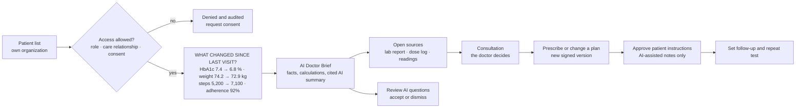

# HealthGuard — Product Requirements Document

> **Status:** technical design (Step 2). No application code yet.
> **Scope:** Phase 1 (investor/partner demo), with Phase 2 described.
> **Data:** synthetic only. Every screen shows "DEMO • SYNTHETIC HEALTH DATA • NOT FOR CLINICAL USE".
>
> Related: [Architecture](ARCHITECTURE.md) · [Data model](DATA_MODEL.md) · [Security](SECURITY.md) · [AI agents](AI_AGENT_SPEC.md) · [FHIR mapping](FHIR_MAPPING.md) · [ABDM integration](ABDM_INTEGRATION.md) · [Roadmap](ROADMAP.md)

## 1. Product vision

**HealthGuard turns fragmented patient data into one longitudinal health story, and turns prescriptions into instructions patients can actually follow.**

It is a longitudinal health intelligence and treatment-adherence platform: *Longitudinal Health Intelligence + Treatment Adherence + Consent Layer*. Patients get one record, instructions in their own language and reminders that fit their day. Doctors open a patient and see at once what changed since the last visit, with every number linked to its source.

What HealthGuard is not:
- not an AI doctor, and not a replacement for clinicians;
- not a replacement for ABDM, ABHA or DigiLocker; it connects to ABDM through an adapter, and patients keep the PHR app of their choice ([ABDM integration](ABDM_INTEGRATION.md));
- not an EMR or hospital information system;
- not a generic fitness app.

## 2. Problem

**Patients**
- forget medicines, and do not understand how or when to take them;
- lose reports, and do not remember past surgeries, vaccinations or conditions;
- have health data scattered across clinics, labs and phones;
- cannot see how their health has changed over time.

**Doctors**
- spend consultation time reconstructing history;
- often lack previous reports;
- need to know what changed since the last consultation;
- need medication, allergy, procedure and test context quickly.

**Clinics and hospitals**
- lose patients between visits: repeat tests and follow-ups slip;
- cannot see whether patients take what was prescribed;
- send reminders by hand, if at all.

## 3. Users

| User | Needs | Phase |
|---|---|---|
| Patient (for example Ananya, 58, prefers Telugu, two chronic conditions) | Instructions in their language, reminders, one record, control over who sees it | 1 |
| Doctor | A 30-second picture of what changed; structured prescribing; patient instructions without extra work | 1 |
| Care coordinator | Call-backs, follow-ups, appointments | 1 (call-back), 2 |
| Nurse | Medicines, allergies, vitals for patients in their care | 2 |
| Front desk | Registration and appointments | 2 |
| Clinic admin | Members, roles, settings | 1 (minimal), 2 |
| Caregiver (family member) | Medicines and adherence of a parent, with the parent's consent | 2 |
| Privacy lead or auditor | Access reports, break-glass reviews | 2 |

## 4. Buyer and business model

- **Buyer:** clinics and hospitals. HealthGuard is B2B2C: the organization buys it; its patients use it at no charge.
- **Economic buyer:** the clinic owner or the hospital's medical director or operations head. **Champions:** doctors who run chronic-care clinics.
- **Value to the buyer:** more completed follow-ups and repeat tests, better recorded adherence, less history-taking time per visit, patients who stay with the clinic, and structured longitudinal data with an ABDM-ready architecture.
- **Pricing hypothesis, to test in the pilot:** a monthly subscription per clinic, scaled by active patients.
- **Not buyers in Phases 1–2:** patients paying directly, insurers, pharmaceutical companies.

## 5. Product principles

- HealthGuard is NOT an AI doctor.
- HealthGuard is NOT a replacement for clinicians.
- HealthGuard does NOT replace ABDM.
- HealthGuard is a longitudinal health intelligence and treatment-adherence platform.
- Clinical decisions remain with clinicians.
- Patient actions requiring consequential decisions require explicit patient approval.
- Sensitive access must be authorized and audited.
- Demo data must always be synthetic.

Two design rules follow from these: the doctor's structured prescription is the single source of truth for every dose time and instruction, and AI explains and summarizes but never decides ([AI agents §1](AI_AGENT_SPEC.md#1-rules)).

## 6. Journeys

The primary journey:

**Patient → Health Records → Doctor Consultation → Doctor-authored Prescription → AI Explanation → Multilingual Instructions → Medication Schedule → Reminder → Patient Taken/Missed → Adherence Calculation → Repeat Test → Before/After Comparison → Activity/Wearable Data → Doctor AI Brief → Follow-up Recommendation → Patient Approval → Appointment → Consent → Audit Trail**

### 6.1 Patient journey

```mermaid
flowchart LR
  JOIN["Joins through the clinic<br/>language · daily routine"] --> REC["Health record<br/>history · allergies · documents"]
  REC --> CONS["Consultation<br/>consent shown and granted"]
  CONS --> RX["Doctor-authored prescription"]
  RX --> EXPL["AI explanation<br/>of the approved plan"]
  EXPL --> LANG["Instructions in Telugu,<br/>Hindi or English, with audio"]
  LANG --> SCHED["Medication schedule<br/>from the routine: 08:15"]
  SCHED --> REMIND["Reminder"]
  REMIND --> ANSWER{"Taken · Snooze ·<br/>Skip · Missed"}
  ANSWER --> ADH["Adherence calculated<br/>92%"]
  REMIND -- "Need help" --> CALL["Clinic call-back"]
  ADH --> TEST["Repeat test<br/>HbA1c"]
  TEST --> CMP["Before and after<br/>7.4 → 6.8 %"]
  CMP --> ACT["Activity data<br/>5,200 → 7,100 steps a day"]
  ACT --> PROP["Follow-up proposed"]
  PROP --> APPROVE{"Patient approves<br/>a slot?"}
  APPROVE -- yes --> APPT["Appointment confirmed"]
  APPROVE -- no --> LATER["Another slot or later"]
  APPT --> LOG["Access log<br/>who saw what, when, why"]
```

### 6.2 Doctor journey

### 6.3 Hero demo: what the doctor sees

Dr. Meera opens Ananya's record and immediately sees:

> **WHAT CHANGED SINCE LAST VISIT?**
> HbA1c: 7.4 → 6.8
> Weight: 74.2 → 72.9 kg
> Average daily steps: 5,200 → 7,100
> Medication adherence: 92%

Then the **AI DOCTOR BRIEF**, with these sections: reason for visit · active conditions · allergies · current medications · recent medication changes · recent lab results · trends · activity · adherence · important history · pending follow-ups · AI observations and questions · source references.

Requirements:
- The "what changed" panel is calculated without any model call and appears within one second ([Architecture §12](ARCHITECTURE.md#12-hero-demo-what-changed-since-last-visit)).
- Every item shows which of four kinds it is, with a badge: **recorded fact**, **calculation**, **AI summary** or **AI suggestion**.
- Every AI-generated sentence links to the facts it rests on; the doctor can open each source.
- AI observations are questions or discussion points for the doctor to accept or dismiss, never orders.
- If the model is unavailable, the brief still shows every factual section.

## 7. Core features

| Area | Feature | Phase 1 demo | Phase 2 pilot |
|---|---|---|---|
| Medication | Structured prescribing: medicine, dose, unit, route, frequency, timing event and offset, duration, notes, indication, follow-up date, repeat test | Yes | Yes |
| Medication | Allergy cross-check warning before signing | Yes | Yes |
| Medication | Patient instructions in English, Hindi and Telugu from reviewed templates; AI-rephrased doctor's notes after prescriber approval | Yes | Yes |
| Medication | Read-aloud audio | Pre-recorded demo lines | Indic text-to-speech |
| Medication | Dose schedule from the patient's daily routine | Yes | Yes |
| Medication | Reminders | In-app and simulated phone | WhatsApp, SMS fallback, push |
| Medication | Taken, Snooze, Skip, Missed, Need help | Yes | Yes |
| Medication | Recorded adherence and missed-dose flags to the clinician | Yes | Yes, plus caregiver alerts with consent |
| Record | Conditions, allergies and intolerances, procedures, hospitalizations, immunizations, prescriptions, lab and imaging reports, consultations | Yes | Yes, plus family history |
| Record | Chronological timeline | Yes | Yes |
| Record | Documents with AI extraction confirmed by a person | Synthetic sample library | Real uploads with scanning |
| Consent | Grant, revoke, purposes including AI assistance | Yes | Yes |
| Consent | "Who saw my data" access log | Yes | Yes |
| Interoperability | FHIR R4 export of a patient | Yes, tagged synthetic | Validated against profiles |
| Interoperability | ABDM and ABHA | Simulated, clearly labelled | Sandbox prototype |
| Intelligence | Activity and vitals | Synthetic generator | Apple Health and Health Connect through a native companion app; manual entry |
| Intelligence | Before/after lab comparison and trends with association-only wording | Yes | Yes |
| Clinician | "What changed since last visit?" | Yes | Yes |
| Clinician | AI Doctor Brief with sources, AI suggestions to accept or dismiss, AI details drawer | Yes | Yes |
| Follow-up | Repeat tests and visits that fall due | Yes | Yes |
| Follow-up | Slot proposal, patient approval, clinic confirmation | Mock booking | Clinic calendar or coordinator confirmation |
| Follow-up | Need help call-back queue | Yes | Yes, during clinic hours |
| Platform | Organizations (multi-tenant), roles, audit | Yes | Yes, plus row-level security |
| Platform | Demo console: personas, scenario clock, reset, AI provider switch | Yes | Removed |

## 8. MVP and demo scope (Phase 1)

Phase 1 is an investor and partner demo that runs on a laptop, entirely on synthetic data, and works offline.

### 8.1 Demo script (about 12 minutes)

The demo opens on the destination, rewinds to show the journey, and returns.

1. **Day 92.** Dr. Meera opens Ananya: "What changed since last visit?" shows HbA1c 7.4 → 6.8 %, weight 74.2 → 72.9 kg, average daily steps 5,200 → 7,100, adherence 92%, each with a "Calculated" badge. (1.5 min)
2. The AI Doctor Brief fills in: factual sections, a cited summary, two questions for the doctor. She opens a source and the AI details drawer, then accepts one question. (2 min)
3. Access: Dr. Arjun, in the same clinic but not in Ananya's care, is denied; a Lakeview Demo Hospital user gets "not found". Ananya's access log shows both attempts. (1 min)
4. The demo console rewinds to **day 0**: Ananya's record and her consent at the consultation. (1 min)
5. Dr. Meera prescribes Metformin 500 mg, 1 tablet once daily, 15 minutes after breakfast, for 90 days. The allergy check passes; she signs. (1.5 min)
6. Instructions appear in English, Hindi and Telugu with the validator's checklist; she approves the AI-assisted note; Ananya hears the Telugu audio; her reminder is set for 08:15. (1.5 min)
7. Day 1: reminder, Taken. Day 6: Need help, call-back queued. Day 42: two misses raise a flag for the doctor. Adherence updates as the clock moves. (1.5 min)
8. **Day 85:** the HbA1c report arrives; Ananya confirms the extracted value; before/after card and a one-sentence trend in association wording. (1 min)
9. **Day 88:** follow-up proposed; Ananya approves a slot; the clinic confirms (mock booking). (0.5 min)
10. Back to **day 92**: the hero panel again, now with the story behind it; a FHIR export tagged synthetic and, if time allows, the ABDM panel, labelled as a simulation ([ABDM integration §7](ABDM_INTEGRATION.md#7-simulated-in-the-demo-versus-real-later)). (0.5 min)

### 8.2 Phase 1 acceptance criteria
- The hero panel shows exactly the four values above, each linked to its sources.
- Every AI output is labelled by kind and cited; all safety eval suites pass at 100%.
- The full script runs with the network disconnected (`DemoAIProvider`) and with the live Anthropic API.
- Dr. Arjun is denied and the Lakeview user gets "not found"; both appear in the access log.
- English, Hindi and Telugu render correctly on Android Chrome and iOS Safari, including fonts.
- Reset and checkpoint jumps (days 0, 6, 42, 85, 88, 92) complete in under 60 seconds.
- The banner is visible on every screen and in every export.
- No code path can confirm an appointment without the patient's approval (service tests and the database check).

## 9. Phase 2: clinic pilot (summary)

One clinic, 100–500 consenting patients, about three months (long enough for one repeat HbA1c):
- real sign-in (phone OTP for patients; single sign-on with MFA for staff);
- consent notices in three languages, revocation, data-principal requests;
- WhatsApp reminders with SMS fallback; Need help routed to the clinic in clinic hours;
- real document uploads with scanning and confirmed extraction;
- caregiver access with the patient's consent; break-glass with review;
- a native companion app for Apple Health and Health Connect; manual home readings;
- row-level security, field-level encryption, VAPT, a data-protection impact assessment;
- hosting in an AWS India region.

Details and success criteria: [Roadmap](ROADMAP.md#phase-2--clinic-pilot).

## 10. Explicitly out of scope

**Never, in any phase**
- Diagnosing, prescribing, changing doses, frequencies or routes, or stopping medicines by AI.
- Booking appointments or approving treatment without the responsible person's explicit action.
- Acting as an emergency or triage service. Need help shows emergency numbers (112, and 108 for an ambulance) first.
- Replacing ABDM, ABHA, DigiLocker, an EMR or a hospital information system.
- Open-ended medical chat for patients.

**Not in Phase 1**
- Real patient data or production hosting.
- Real ABDM connectivity or certification claims.
- Native mobile apps and live wearable sync.
- WhatsApp, SMS, voice and push channels.
- Real clinic calendars, EMR, laboratory or pharmacy integrations.
- Caregiver accounts and break-glass access.
- Teleconsultation, payments, insurance.
- Population analytics or research use of data.
- Kubernetes or multi-region infrastructure.

## 11. Success metrics

| Phase | Metric | Target |
|---|---|---|
| 1 | Script completed end to end without manual fixes | 3 consecutive runs |
| 1 | Safety eval suites | 100% pass |
| 1 | Partner and investor demos with structured feedback | At least 3 |
| 1 | Clinics agreeing to discuss a pilot | At least 1 |
| 2 | Patients answering reminders weekly at day 60 | At least 70% of enrolled |
| 2 | Follow-up and repeat-test completion | At least 15 points above the clinic's baseline |
| 2 | Median time for a doctor to review the brief | Under 60 seconds |
| 2 | Released instructions failing a preservation check | Zero |

All targets are proposals to agree with the pilot clinic. The full set is in the [Roadmap](ROADMAP.md).

## 12. Glossary

| Term | Meaning |
|---|---|
| ABDM | Ayushman Bharat Digital Mission, India's national digital health infrastructure |
| ABHA | Ayushman Bharat Health Account: a person's health ID number and address |
| HIP / HIU | Health Information Provider / User: an ABDM role that shares or requests records |
| HIE-CM | ABDM's health information exchange consent manager |
| FHIR R4 | HL7's interoperability standard, release 4 |
| LOINC | Codes for lab tests and measurements, e.g. 4548-4 for HbA1c |
| EventTiming | FHIR codes for timing relative to daily events, e.g. `PCM`: after breakfast |
| Recorded adherence | Doses the patient confirmed as taken ÷ doses due |
| Care relationship | A clinician's documented involvement in a patient's care, required for clinical access |
| Break-glass | Emergency access without consent, time-limited and always reviewed |
